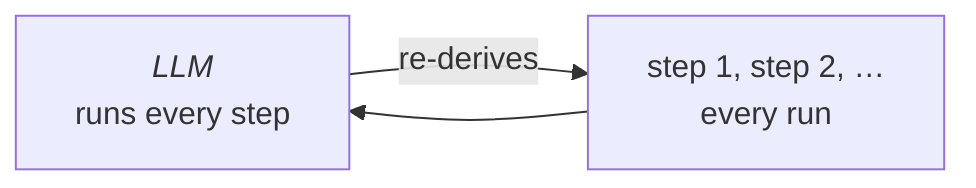
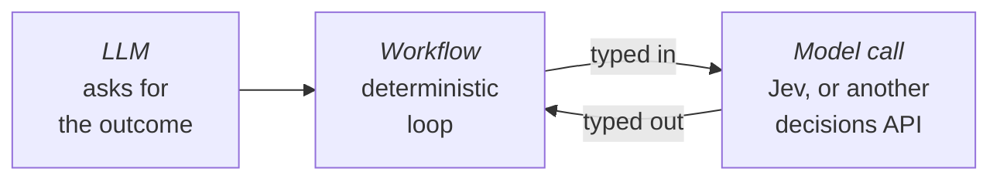
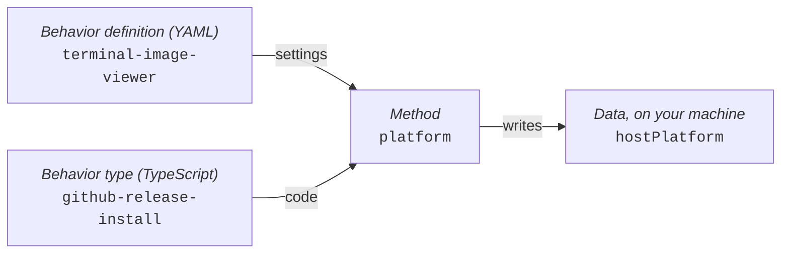
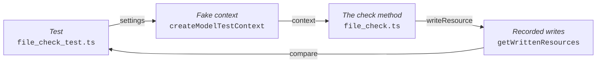
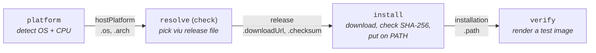
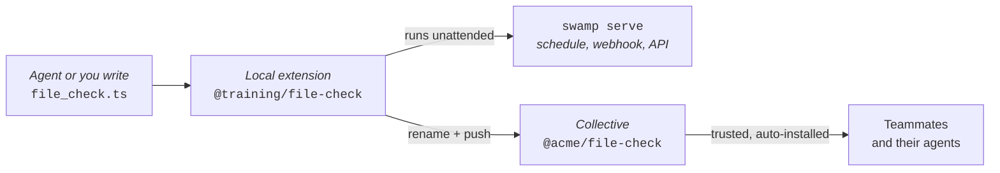
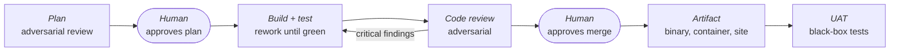
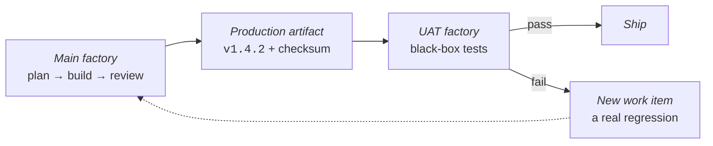
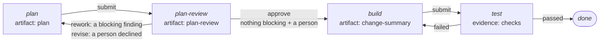

---
# You can also start simply with 'default'
theme: seriph
# random image from a curated Unsplash collection by Anthony
# like them? see https://unsplash.com/collections/94734566/slidev
background: https://cover.sli.dev
# some information about your slides (markdown enabled)
hideInToc: true
title: Swamp Training
author: Mischa Taylor
info: |
  ## Slidev Starter Template
  Presentation slides for developers.
# apply unocss classes to the current slide
class: text-center
# https://sli.dev/features/drawing
drawings:
  persist: false
# enable MDC Syntax: https://sli.dev/features/mdc
mdc: true
# open graph
# seoMeta:
#  ogImage: https://cover.sli.dev
themeConfig:
  paginationX: r
  paginationY: t
  paginationPagesDisabled: [1]
---

# Swamp Training

##### Mischa Taylor | 📧 <taylor@linux.com>

<div @click="$slidev.nav.next" class="mt-12 py-1" hover:bg="white op-10">
  Press Space for next page <carbon-arrow-right />
</div>

<div class="abs-br m-6 text-xl">
  <button @click="$slidev.nav.openInEditor()" title="Open in Editor" class="slidev-icon-btn">
    <carbon-edit />
  </button>
  <a href="https://github.com/slidevjs/slidev" target="_blank" class="slidev-icon-btn">
    <carbon-logo-github />
  </a>
</div>

<!--
The last comment block of each slide will be treated as slide notes. It will be visible and editable in Presenter Mode along with the slide. [Read more in the docs](https://sli.dev/guide/syntax.html#notes)
-->

---
hideInToc: true
routeAlias: toc
---

# Table of Contents

<Toc columns="2"/>

---
hideInToc: true
routeAlias: quick-check
class: compact-table
---

# Quick check: true or false?

Before anything about swamp, three statements about the AI agent you already use (Claude, ChatGPT, etc.)

| | Statement | True or false? |
| --- | --- | --- |
| **1** | My agent got a task right last week, so the same request gets the same result this week | ? |
| **2** | A well-written instructions file (`AGENTS.md`, `CLAUDE.md`) or skill makes my agent follow my process | ? |
| **3** | When my agent says “done, I restarted the device,” the device restarted | ? |

Hold on to your answers. We'll come back to all three before the end of phase 1.

<!--
Show of hands for each statement. Don't give the answers yet.

This is a pre-test on purpose. If you explain swamp clearly to people who think they already
understand their agent, they nod along and learn nothing. If they first commit to an answer that
turns out to be wrong, they want to hear why. Most rooms say "true" to at least one.
-->

---
layout: section
routeAlias: journey
---

# The Swamp Journey

<!--
The framework for adopting swamp comes from keeb (Nick Stinemates) on the swamp Discord.
-->

---
hideInToc: true
---

# If your agent can already do the task, why add swamp?

- **Swamp is an automation framework built for AI agents:** your agent writes the automation,
  and swamp runs it, remembers what happened, and checks the agent's work.

<div class="text-sm opacity-70 mt-4">

Swamp will make your agent use better, more reliable and more cost effective.

</div>

---
hideInToc: true
routeAlias: skill-for-loop
---

# Why not just write a skill for it?

Scott Tolinski's sites folder keeps filling up with stray projects. He asks Claude to tidy it up.
It mostly works, so he writes a skill: *“here's how to always clean up my sites folder.”*

<v-click>

Every run, a frontier model reads the skill and reinvents the same for loop from scratch:

| | A skill | The same prompt, *with swamp* |
| --- | --- | --- |
| Each run | Frontier tokens, re-deriving the steps | A behavior: typed inputs (the folder, a list of criteria), code, stored results |
| Getting it right more often | Pay for a newer model: “80% of the time to 90%” | It runs the same way every time |
| When it grows | Another paragraph in the skill | Refactor one behavior, wire in the next (deploy the folder when it changes) |

> You're going to take that thing and you're going to tack the words *with swamp* on the end of it.

</v-click>

<div class="text-sm opacity-70 mt-4">

Source: Adam Jacob on Syntax, [WTF is a Software Factory?](https://www.youtube.com/watch?v=aYz9G3__Z4g&t=238s) (3:58)

</div>

<!--
Adam's framing of the opening question for people who already use Claude Code or Codex. The
classification step uses Jev (TypeSafe's model, the same one in John Watson's alert triage);
swamp stores each classification result so later workflow steps can query it.
-->

---
hideInToc: true
class: compact-table
---

# Three phases of adopting swamp

| Phase | What you do | What you get |
| --- | --- | --- |
| **1. Install swamp** | Install swamp. Ask your agent for the same things, and add **“with swamp”** | Each request builds automation you can repeat |
| **2. Connect your systems** | Tell your agent to build a swamp **extension** for each system you use | Commands your agent can run on those systems, with every result recorded |
| **3. Automate what you repeat** | Tell your agent to make a swamp **workflow** for each task you repeat | One command, or a schedule, that runs the task the same way every time |

Expect to spend a while in each phase before moving on. Each builds on the one before, and
many people stay in phase 1 or 2 for a long time.

<div class="text-sm opacity-70 mt-4">

The journey comes from keeb (Nick Stinemates), on the swamp Discord.

</div>

---
layout: section
---

# One Thing, End to End

<!--
Set the contract for the whole session: one task, carried all the way through.
-->

---
hideInToc: true
---

# You're going to automate one thing

- You're going to take one task all the way from “I want this” to a working automation.
- Then you're going to break the automation.
- Then you're going to see why the automation survives the kinds of things that happen in real systems.
- By the end, you'll have learned most of the important parts of Swamp along the way.

---
hideInToc: true
class: requirement-slide
---

# Make Swamp Do Something

Here's the requirement:

> **Make this terminal display a picture.**

That's all you're going to give Swamp to start with.

Just the outcome.

---
hideInToc: true
---

# What Does Success Look Like?

You'll want to start with an ordinary image:

```text
swamp.png
```

And eventually be able to type **one command** against that file and see the image inside the
terminal, on Ubuntu, macOS and Windows.

Which command? You don't know yet, and that's the point:

- You're not going to figure out how to do that.

- You're going to ask Swamp to figure out how to automate it.

---
hideInToc: true
---

# What you need

Two tools: Swamp and an AI agent that can run commands on your machine.

| | What it is | Why you need it |
| --- | --- | --- |
| **Swamp** | The thing that runs, remembers and verifies the automation | It is the subject of the training |
| **An AI agent** | Claude Code, Codex, Gemini CLI, Copilot CLI, Cursor, … | You ask in plain words; it builds and runs the automation |

**Any of those agents will do.** I'll use Claude Code for the worked example, and I'll call out
the few places where the agent you picked changes what you type.

---
layout: section
---

<div class="phase-badge">Phase 1 · Install swamp</div>

# Setting Up

<!--
Installation. Keep this brisk; the interesting part is after the repo exists.
-->

---
hideInToc: true
---

# Phase 1: what changes when you add “with swamp”?

You probably already ask an agent to do things: restart a VM or container, answer a question
about your Home Assistant setup, tidy up a git branch. **Keep asking, and add two words:**

```text
Restart the stuck nginx container on web-1 with swamp.
```

<v-click>

| | Your usual prompt | The same prompt **with swamp** |
| --- | --- | --- |
| **The first time** | The agent runs one-off commands | The agent searches for an existing extension, then builds a method |
| **What's kept** | A chat transcript of what the agent says it did | Each result, saved as versioned data in `.swamp/` |
| **The next time** | The agent works the task out again, maybe differently | One command runs the same steps, with no agent needed |
| **Checking the work** | You take the agent's word | `swamp audit` shows commands the agent ran around swamp |

No swamp vocabulary needed yet. Swamp's instructions steer the agent; the rest of the course
shows how.

</v-click>

<!--
Misconception: "I have to learn swamp before swamp helps me." Phase 1 asks for nothing but the
usual prompt plus "with swamp", run inside a swamp repo. Ask the room to guess what changes
before the reveal. Each row pays off later: search-first on "Choose your own adventure"
(CLAUDE.md rule 1), versioned data on "Run a method, get data", one command on "The payoff",
and audit on "Check what the agent ran with swamp audit".
-->

---
hideInToc: true
routeAlias: vocabulary
class: compact-table
---

# Swamp vocabulary at a glance

You'll see these words before the course explains them. Each links to its full explanation.

| Word | Meaning | More |
| --- | --- | --- |
| **Behavior** | Swamp's unit of work: a behavior type plus a behavior definition | <Link to="swamp-lingo" title="Swamp lingo"/> |
| **Behavior type** | TypeScript code: the methods and the settings they need | <Link to="swamp-lingo" title="Swamp lingo"/> |
| **Behavior definition** | YAML settings for one use of a behavior type | <Link to="swamp-lingo" title="Swamp lingo"/> |
| **Method** | One action a behavior type can run | <Link to="swamp-lingo" title="Swamp lingo"/> |
| **Extension** | A shareable package of behavior types, workflows and more | <Link to="extensions" title="Extensions"/> |
| **Data** | What a method saves: versioned, kept in `.swamp/` | <Link to="data" title="Data"/> |
| **Workflow** | A YAML file that runs methods as steps, in order | <Link to="workflows" title="Workflows"/> |
| **Vault** | Where swamp reads secrets from when a step runs | <Link to="keeping-secrets" title="Secrets"/> |
| **Collective** | A person's or team's account for publishing extensions | <Link to="collectives" title="Collectives"/> |

---
hideInToc: true
---

# Installing Swamp

| Use | Cost |
| --- | --- |
| Personal | Free |
| Work | 30-day free trial, then a paid plan ([pricing](https://swamp-club.com/pricing)) |

The `swamp` CLI is the same on every plan. A paid plan adds private <Link to="extensions" title="extensions"/> (shareable packages of behaviors, workflows and more) and a <Link to="collectives" title="collective"/> (a shared account for publishing them to your organization).

Installing asks you to create a swamp-club.com account ([license](https://swamp-club.com/software-license-agreement), [registry terms](https://swamp-club.com/extension-registry-terms)).

The install script:
- Downloads the latest release from [GitHub](https://github.com/swamp-club/swamp/releases)
- Installs the binary to `~/.swamp/bin/swamp`
- Links `/usr/local/bin/swamp` to that binary, if you have permission

---
hideInToc: true
---

# Installing Swamp - Linux/macOS

```bash
# Install Swamp
curl -fsSL https://swamp-club.com/install.sh | sh

# Verify the Installation
swamp version
```

---
hideInToc: true
---

# Installing Swamp - Windows Powershell

Hit `Windows+R` and run `wt`. You should see a Windows Terminal command line prompt.

```powershell
# Install Swamp
irm https://swamp-club.com/install.ps1 | iex
```

```powershell
# Verify the installation (in a new shell)
swamp version
```

No admin rights needed. Where the script puts `swamp.exe` depends on the prompt you run it from:

| Prompt | Installs to | Adds the folder to |
| --- | --- | --- |
| Normal | `%LOCALAPPDATA%\swamp` | Your user PATH |
| Run as administrator | `C:\Program Files\swamp` | The machine PATH, for every user |

Use a normal prompt unless every account on the machine needs swamp.

<!--
The script checks the download's SHA-256 twice: against the artifact's checksum file and against
the GitHub release's checksums.txt. Only x86_64 is supported; Windows on ARM fails.
-->

---
hideInToc: true
---

# Installing Swamp - Misc

You can also find the latest release instructions on https://github.com/swamp-club/swamp/releases

---
hideInToc: true
---

# Install an AI agent - Linux/macOS

Pick one. The rest of the deck works the same whichever you choose.

```bash
curl -fsSL https://claude.ai/install.sh | bash          # Claude Code
curl -fsSL https://chatgpt.com/codex/install.sh | sh    # Codex CLI
npm install -g @google/gemini-cli                       # Gemini CLI
curl -fsSL https://gh.io/copilot-install | bash         # Copilot CLI
curl https://cursor.com/install -fsS | bash             # Cursor CLI
```

Verify, using the name of the agent you installed:

```bash
claude --version        # or: codex, gemini, copilot, cursor-agent
```

If that command isn't found, add its directory to PATH and try again:

```bash
echo 'export PATH="$HOME/.local/bin:$PATH"' >> ~/.bashrc && source ~/.bashrc
```

<!--
Install commands drift. Point people at the vendor's install page if one fails.
Everything after these two slides is agent-neutral except the slash-command syntax.
-->

---
hideInToc: true
---

# Install an AI agent - Windows

Same five agents, from an ordinary PowerShell prompt:

```powershell
irm https://claude.ai/install.ps1 | iex                 # Claude Code
npm install -g @openai/codex                            # Codex CLI
npm install -g @google/gemini-cli                       # Gemini CLI
npm install -g @github/copilot                          # Copilot CLI
irm 'https://cursor.com/install?win32=true' | iex       # Cursor CLI
```

The `npm` installs need Node.js 22 or later.

Verify, using the name of the agent you installed:

```powershell
claude --version        # or: codex, gemini, copilot, cursor-agent
```

Whichever platform you're on, each agent prompts you to sign in the first time you run it.

---
hideInToc: true
---

# Create a swamp repo, or use the one you have

Use the directory where you already work with your agent. It doesn't need to be a git repo, and
it doesn't need to contain code. Create a new one only if you don't have one:

```bash
mkdir swamp-thing && cd swamp-thing   # only if you don't have a directory yet

swamp auth login    # once per machine: sign in with your swamp-club account
swamp repo init     # adds swamp's files next to yours
```

`repo init` adds `.swamp.yaml`, folders such as `models/` and `workflows/`, and swamp's own
sections in `CLAUDE.md` and `.gitignore`. Your files, and your own `CLAUDE.md` notes, stay as
they are.

The automation you build lives in those files, so consider keeping the directory in git: that's
how you share it and roll it back. <Link to="what-to-commit" title="What to commit, what to ignore"/>

---
hideInToc: true
routeAlias: swamp-start
class: compact-table
---

# Do you need the `repo init` steps at all?

No. One command does the steps from the last slide, plus the first prompt:

| By hand | With `swamp start` |
| --- | --- |
| `mkdir` and `cd` into a directory | Pick or create a **workspace** on a local page |
| `swamp auth login`, `swamp repo init --tool <agent>` | Sign in if needed; swamp sets up the workspace for the agent you pick |
| Start the agent (`claude`, `codex`, ...) **inside** the repo | Swamp opens the agent in a new terminal, in the right folder |
| Type your first prompt | Describe the task on the page |

```bash
swamp start                        # opens the page in your browser
swamp start --workspace home-lab   # skips the picker; --path <dir> picks where a new one goes
```

You don't need to know where the folders are. This course uses the by-hand steps so you can see
each one.

<!--
New in swamp 20261013.025835. `swamp start --json` lists workspaces and the agents on the PATH
(Claude Code, Codex, Cursor, OpenCode, Copilot, Kiro, Pi, Amp, Antigravity) and changes nothing.
--no-browser prints the page address instead. A new workspace goes in --path, else the folder
set with `swamp config set workspaces.dir`, else swamp's data directory.
-->

---
hideInToc: true
---

# Can this terminal show `swamp.png` yet?

Put `swamp.png` in the repo and try:

```bash
cat swamp.png
```

<v-click>

No. A terminal shows text, so `cat` prints binary noise. Nothing about the terminal has changed
yet: `repo init` only taught your agent about swamp.

Next, look at what swamp told your agent. Then, in <Link to="ask-for-the-outcome" title="Ask for the outcome"/>,
hand the agent the requirement.

</v-click>

<!--
A-plot check-in during setup, so the room remembers what all this installing is for.
-->

---
hideInToc: true
class: compact-table
---

# How does your agent know swamp before your first prompt?

`swamp repo init` doesn't just make directories. Swamp also writes files that steer your agent:

| File | What the file does |
| --- | --- |
| `CLAUDE.md` | Eleven rules for working in a swamp repo, plus a list of skills to load |
| `~/.claude/skills/swamp*` | Two skills, `swamp` and `swamp-getting-started`, that the agent loads on demand |
| `.claude/settings.local.json` | Commands the agent may run without asking, plus an audit hook |

Other agents get the same rules with `swamp repo init --tool <name>`: `AGENTS.md` for Codex,
Copilot, Amp and OpenCode; `.cursor/rules/` for Cursor; `.kiro/steering/` for Kiro. Gemini CLI
isn't built in: define it with `swamp agent setup`.

Wrong agent? `swamp repo upgrade --tool codex` swaps the files; repeat `--tool` for more than one.

Whichever agent you use, **your agent already knows what swamp is** before giving a single prompt.

<!--
Tip from Dieter_be on the swamp Discord: "I have many times accidentally init'd my repos for
claude, even though I use codex, but then I just have swamp repo upgrade --tool codex in my
shell history where I need it." --tool replaces the enrolled list; plain `repo upgrade` keeps it.
-->

---
hideInToc: true
class: compact-table
---

# The rules swamp gives your agent

Swamp manages one section of `CLAUDE.md` and rewrites that section on `repo init`.

| Rule in `CLAUDE.md` | Where the rule shows up |
| --- | --- |
| 1. Search before you build | The agent reuses a community extension |
| 2. Extend, don't be clever | The agent adds methods, not a shell script |
| 3–4. Use the data model, with CEL | Steps read `data.latest(...)` |
| 7. Pin npm versions | Every `import` names a version |
| 10. Use swamp, don't bypass it | `swamp audit` flags commands run around swamp |
| Always load swamp skills | Tests, publishing, schedules |

On later slides, callouts like this one mark where swamp's instructions steered the agent:

>  **Swamp told the agent, via `CLAUDE.md` rule 1, "Search before you build":** search the registry before writing new code.

---
hideInToc: true
routeAlias: allowlist
---

# Can the agent run a workflow without asking you?

`.claude/settings.local.json` lists the swamp commands Claude Code may run without asking you.
Is `swamp workflow run` on the list?

<v-click>

| Allowed without asking | Not on the list, so Claude Code asks first |
| --- | --- |
| `swamp behavior get`, `create`, `edit`, `validate` | `swamp behavior run` (or the legacy `swamp model method run`) |
| `swamp workflow get`, `create`, `edit`, `validate` | `swamp workflow run` |
| `swamp data ...`, `swamp repo ...`, most `swamp vault ...` | `swamp extension pull`, `push`, `swamp vault read-secret` |

The agent can read and write automation freely. **Running automation still needs your OK.**

</v-click>

<!--
Rooms split both ways: some expect the agent to run anything, others expect a prompt for every
command. The answer is in between: writing automation is free, running automation asks.
As of swamp 20261014.204224, the allowlist names each subcommand three ways: `swamp behavior get`,
`swamp behaviour get` and the legacy `swamp model get`. A repo initialized on an older swamp lists
only the `model` spelling; `swamp repo upgrade` refreshes the settings file.
-->

---
hideInToc: true
---

# Check what the agent ran with `swamp audit`

The same settings file adds a hook that logs every shell command Claude Code runs.
Read the log with:

```bash
swamp audit
```

```text
Audit timeline (last 24h): 2 swamp, 1 direct
Time         Source   Summary
19:28:29     swamp    swamp behavior type search github
19:28:30     direct   curl -sL https://github.com/atanunq/viu/releases/latest
19:28:30     swamp    swamp workflow run terminal-image-setup
```

`direct` lines show the agent working **around** swamp. Rule 10, “use swamp, don't bypass it,” says it shouldn't.

---
hideInToc: true
class: compact-table
---

# How the audit hook works

The audit hook is a plain Claude Code hook in `.claude/settings.local.json`:

```json
"PostToolUse": [{ "matcher": "Bash",
  "hooks": [{ "type": "command", "command": "swamp audit record --from-hook" }] }]
```

| Step | What happens |
| --- | --- |
| Trigger | After every `Bash` tool call, successful (`PostToolUse`) or failed (`PostToolUseFailure`) |
| Record | Claude Code pipes the hook's JSON to `swamp audit record`, which appends one line to `.swamp/audit/commands-<date>.jsonl` |
| Read | `swamp audit` labels each command `swamp` or `direct` and hides noise like `ls` (`--all` shows everything) |

---
hideInToc: true
routeAlias: audit-limits
class: compact-table
---

# Is `swamp audit` a security control?

`swamp audit` logs every shell command the agent runs. Could an agent hide what it did?

<v-click>

| Limit | Why the limit matters |
| --- | --- |
| Only the `Bash` tool | File edits, MCP calls and commands inside scripts or workflows aren't logged |
| No output or exit code | Each line holds only the time, command, directory and session ID |
| Not tamper-proof | The hook and the log are local files the agent could edit: a visibility tool, not a security control |
| Not every agent | Cursor, Copilot, Kiro and OpenCode get their own audit hook; Codex and Amp get none |

`swamp audit` is a **visibility** tool. Use the allowlist and a deny list to *stop* commands.

</v-click>

<!--
Misconception: "it logs everything, so it's a security control". The hook only sees Bash, and
the log is a local file the agent could edit.
-->

---
hideInToc: true
routeAlias: what-to-commit
---

# What to commit, what to ignore

`swamp repo init` already adds the right-hand column to `.gitignore`, in a section marked
`swamp managed section - DO NOT EDIT`.

| Commit: the automation | Ignore: specific to one machine |
| --- | --- |
| `models/`, `workflows/`, `extensions/`, `vaults/`, `grants/` | `.swamp/`: data, run history, secrets **and their key** |
| `.swamp.yaml`: repo settings | `.swamp-sources.yaml`: paths on your own disk |
| `CLAUDE.md` or `AGENTS.md`: the agent's rules | `.claude/settings.local.json`: each person's agent settings |

After cloning, run `swamp repo upgrade` to set up your own agent settings. Add your own lines **outside** the
managed section, such as `.env` if you keep tokens like `WEBHOOK_SECRET` in a file.

---
layout: section
---

<div class="phase-badge">Phase 1 · Install swamp</div>

# Who Does What

<!--
Before building, settle the division of labor. This is the slide people remember.
-->

---
hideInToc: true
---

# Swamp Runs the Automation

At its simplest, **Swamp runs automation code that you create.**

You can build that automation yourself...

...or delegate much of the work to your favorite AI agent, with your usual prompt plus
“with swamp”:

```text
Build me ... with swamp.
```

---
hideInToc: true
routeAlias: getting-started
---

# Not sure what to build yet?

Your request doesn't need to be precise. Try something vague:

```text
Build me something with swamp that keeps an eye on my servers.
```

In a repo with no behaviors yet, the agent starts the `swamp-getting-started` walkthrough
instead of guessing. The walkthrough asks **what you want to automate, in your own words**, then
moves through five steps: **Goals → Create → Run → Inspect → Graduate**. Still unsure? The
walkthrough starts with a simple shell command behavior, so you see the whole loop before you commit
to anything.

**Describe the problem, not the swamp parts.** If your request uses swamp terms like
"create a behavior" or "set up a workflow", the agent assumes you already know swamp, skips the
questions and starts building. Plain words get you the guided version.

>  **Swamp told the agent, via the `swamp-getting-started` skill:** ask for the goal in the user's words, not by implementation type, and jump straight to the `swamp` skill only when the user already speaks swamp.

---
hideInToc: true
---

<div class="h-full flex flex-col items-center justify-center text-center gap-12">

<div class="text-4xl">
An agent is one way to build with Swamp.
</div>

<div class="text-6xl font-bold">
It isn't what makes Swamp, Swamp.
</div>

</div>

<!--
Swap "Claude" for whichever agent the room is using. The point survives the swap. That is the point.
-->

---
hideInToc: true
routeAlias: agent-fit
---

# So Where Does the Agent Fit?

| **Agent / Human** | **Swamp** |
| --- | --- |
| Reasons, investigates, creates | Executes and remembers |
| Makes judgments | Enforces gates |
| Proposes what to do | Verifies what happened |
| Tells you what it did | Measures what actually ran |

**The agent provides intelligence. Swamp provides structure around it.**
Swap the agent out and the right column doesn't change.

---
hideInToc: true
---

# Intelligence, Kept Honest

<div class="grid grid-cols-2 gap-20 mt-12">

<div>

<div class="flex items-center gap-5 mb-6">
  <ph-robot-duotone class="text-6xl" />
  <div class="text-3xl font-bold border-b-4 border-current pb-2">
    Agent / Human
  </div>
</div>

<div class="text-2xl leading-12 pl-2">

**Think** about the problem  
**Investigate** what is happening  
**Create** a solution  
**Decide** what should happen  
**Propose** actions

</div>

</div>

<div>

<div class="flex items-center gap-5 mb-6">
  
  <div class="text-3xl font-bold border-b-4 border-current pb-2">
    Swamp
  </div>
</div>

<div class="text-2xl leading-12 pl-2">

**Check** every claim against the machine  
**Refuse** the next step when one fails  
**Repeat** the run exactly, every time  
**Record** what happened, not what was claimed  
**Measure** every run, on every machine

</div>

</div>

</div>

<div class="text-center text-2xl mt-12 opacity-80">

**The agent makes things up. Swamp is the part that doesn't take its word.**

</div>

---
hideInToc: true
routeAlias: reverse-the-loop
---

# Who runs the outer loop?

<div class="grid grid-cols-2 gap-8">
<div>

**Without swamp:** the LLM is the loop



</div>
<div>

**With swamp:** the loop calls the LLM



</div>
</div>

Adam calls it **reversing the loop**: the loop calls out to intelligence only where it needs
judgment. The decision's inputs and outputs are typed, so the model behind it is swappable: to try
OpenAI's or Cloudflare's decisions API instead of Jev, make the provider an input of that one behavior.

<div class="text-sm opacity-70 mt-4">

Source: Adam Jacob on Syntax, [WTF is a Software Factory?](https://www.youtube.com/watch?v=aYz9G3__Z4g&t=531s) (8:51)

</div>

<!--
This is the same split as the two slides before it, drawn as control flow. It's also the shape of
John Watson's alert triage later in the course: a workflow that calls a cheap screen, then Claude
only when needed.
-->

---
hideInToc: true
routeAlias: switch-agents
---

# Can you switch agents halfway through?

On Rawkode Live, David Flanagan started in Codex. Codex's sandbox blocked the registry and an
installed MCP server kept getting in the way, so he quit and asked Claude Code instead:

> Use our PostHog swamp extension to find the most watched video in the last 72 hours.

<v-click>

It worked straight away. The extension, the behavior, the vault and the data live in the **repo**,
not in the agent's session.

- **Agent-agnostic:** people run swamp under Hermes and OpenClaw the same way. One viewer's Hermes
  is *only* allowed to use swamp: if something is missing, it gets built in swamp.
- **Pick the model per job:** Nick Stinemates builds with Opus and drives swamp with Haiku,
  *“a great router to the right behaviors.”*
- **If an agent's sandbox blocks swamp's network** (registry, `swamp extension pull`), allow it,
  or use another agent for that step.

</v-click>

<div class="text-sm opacity-70 mt-4">

Source: Nick Stinemates on Rawkode Live, [Hands-on Introduction to Swamp Club](https://rawkode.academy/watch/hands-on-introduction-to-swamp-club) (43:02–44:18)

</div>

<!--
The PostHog extension didn't exist in the registry; Codex built it earlier in the same stream.
Nick runs one agent per task: 90 to 120 iTerm2 windows by the end of the day, about 13,000
sessions in 30 days. He says the swamp team runs eight to ten agents each, all day.
-->

---
hideInToc: true
class: compact-table
---

# Back to the quick check: all three are false

| Statement | Why the statement is false | What swamp does instead |
| --- | --- | --- |
| **1.** Same request, same result | The agent's judgment varies from run to run | A method or workflow runs the same steps every time |
| **2.** A good skill makes the agent follow the process | A skill is context the model does its best to follow, and sometimes the model just doesn't | Swamp refuses the next step when a check fails |
| **3.** “Done” means the task got done | The agent reports what the agent believes happened | Swamp records what actually ran; `swamp audit` shows commands run around swamp |

Each answer is a row from the right-hand column on the last slide.
<Link to="quick-check" title="Back to the quick check"/>

<!--
Ask who changed their answer. The rest of the course is the right-hand column of this table,
built one piece at a time.
-->

---
hideInToc: true
---

# Where next: look for what you already repeat

Look back over what you've asked your agent (Claude or another one) in the last few weeks. Which
requests come up again and again?

For each repeated request, ask: **does the task need a creative decision every time?**

| Answer | What to ask for | How much AI each run uses |
| --- | --- | --- |
| **No**: the same steps every time | A swamp method or workflow you run with one command, or on a schedule | **None**: swamp runs the steps without the agent |
| **Partly**: fixed steps, then a judgment call | Swamp gathers and records the facts; the agent only makes the call | **Low**: the agent reads saved data instead of exploring |
| **Yes**: new thinking every time | Keep asking the agent, inside your swamp repo | **Full**, but the agent can call the methods you already built |

The agent's judgment is expensive and varies from run to run. Spend the agent's judgment on the
parts that need judgment, and let swamp repeat the rest the same way every time.

---
hideInToc: true
---

# Can the agent find what to automate for you?

You don't have to dig through weeks of requests yourself. In your swamp repo, ask the agent:

```text
Come up to speed with swamp, look back over my last 10 sessions, and identify
some things that would be good to automate with swamp.
```

This got maphew, new to swamp, past the blinking cursor.

<v-click>

Then make a habit of one question at the end of every session, from kneel:

```text
What ONE thing from our session should we manage with swamp?
```

**One** thing, not a list. kneel: “Agents get too excited. Start with one. Write them down. Run
agents on the backlog.” One thing gets built today, the same way this course builds one thing,
end to end; the rest go on the backlog.

</v-click>

<!--
Both prompts are from the swamp Discord (maphew, kneel). Stack72 (swamp team) went the other
way, and asked the agent for a whole automation backlog for an ops person: that works once the
backlog is written down and worked one item at a time. Ask the room before the reveal: what
would you ask at the end of a session? The first prompt needs an agent that can read its own
past sessions: Claude Code keeps transcripts under ~/.claude/projects/. With other agents,
paste or describe recent requests instead.
-->

---
hideInToc: true
routeAlias: two-statements
---

# What if you start from your own two statements?

Niel gave the swamp Discord two statements, and keeb replied: “I can lead you down a path from
your 2 statements to wanting to use swamp, or if you're using it, I can tell you how to maximize
it in that frame.” That path was <Link to="skill-file-gap" title="skill file or CLI"/>.

Write your own two statements:

1. **What I want to build:** “Our team's standards in a CLI that our developers share.”
2. **Why I'd build it that way:** “A CLI only loads into context when needed, and returns JSON.”

<v-click>

Then hand both sentences to your agent, in your swamp repo:

```text
Here's what I want to build: <statement 1>
Here's why I'd build it that way: <statement 2>
Come up to speed with swamp. If I'm new to swamp, show me where swamp fits.
If I already use swamp, tell me how to get more out of swamp for this.
```

The agent starts from your words, not from swamp's parts, the same way <Link to="getting-started" title="the getting-started walkthrough"/> asks for goals first.

</v-click>

<!--
Have everyone write their two statements before the reveal; the example pair is Niel's, from
the swamp Discord thread. The second statement matters most: the reasoning is where the agent
finds what swamp already does (Niel's "loads only when needed, returns JSON" is half of swamp's
case already). Pairs well with the previous slide's "What ONE thing" question: this slide finds
the first thing, that question finds the next one.
-->

---
hideInToc: true
class: compact-table
---

# Where next: ideas to try

Pick one request you made more than twice this month. Some starting points:

| You keep asking the agent to... | Ask for this instead |
| --- | --- |
| Check disk space or certificate expiry | A scheduled check that records each result |
| Restart a VM or a stuck service | A one-command method, no agent needed |
| List pull requests waiting on your review | A saved list the agent only has to summarize |
| Clean up merged git branches | A workflow that deletes them after you approve |
| Find Home Assistant devices with low batteries | A weekly report built from saved data |
| Confirm last night's backup ran | A check that fails loudly when the backup is missing |
| Find untagged or idle cloud resources | An inventory you can compare week to week |

Start with the request in plain words, the way you always ask for the task, and add “with
swamp”. Swamp's instructions steer the agent toward something repeatable.

---
hideInToc: true
routeAlias: smaller-software
class: compact-table
---

# What if software got smaller, not bigger?

| Who | Runs with swamp |
| --- | --- |
| Scott Tolinski | Keep Pi (his coding agent) updated · sort his sites folder with Jev · prune worktrees and Rust builds · Sentry bugs → issues → fixes → PRs |
| A Syntax host | Edit a podcast: tell the speakers apart by voice, transcribe |
| Adam Jacob | Read his email |
| Other users | Production infrastructure · wet-lab science, robot arms |
| Adam's partner | Revenue projections from NetSuite and the CRM, extended with Claude by a non-developer |

> I think that personalization layer is the sort of interesting newest frontier, where it's like,
> what if software got smaller, not bigger?

<div class="text-sm opacity-70 mt-4">

Source: Adam Jacob on Syntax, [WTF is a Software Factory?](https://www.youtube.com/watch?v=aYz9G3__Z4g&t=1824s) (30:24)

</div>

<!--
The partner's projections app started as a spreadsheet the two of them had carried around for a
decade. Adam's point: it's the best software his partner has ever used, and nobody else could use
it, because it's tied to their choices. Scott's examples start at 2:37 in the episode.
-->

---
hideInToc: true
routeAlias: first-hour
class: compact-table
---

# An hour with swamp, from scratch

David Flanagan (Rawkode) had never used swamp. Nick Stinemates helped live, with no canned demo:
*“pick a problem that matters to you and let's go solve that together.”*

| Asked for | What swamp did |
| --- | --- |
| “Triage open, neglected issues on the Rawkode Academy GitHub” | Searched the registry, pulled webframp's GitHub extension, created a behavior, stored 5 issues as data |
| “Run this at 4 a.m. every morning” | A workflow with a schedule trigger under `swamp serve` (a systemd timer works too) |
| “…as an HTML page in my downloads folder” | A report step on the same workflow |
| “A daily report on the videos people watch, from PostHog” | No extension existed, so the agent wrote one, with the API key in 1Password |
| “Always use the GraphQL API to resolve video titles” | Changed the behavior, not a prompt: every later run gets titles |

<div class="text-sm opacity-70 mt-4">

Source: David Flanagan and Nick Stinemates on Rawkode Live, [Hands-on Introduction to Swamp Club](https://rawkode.academy/watch/hands-on-introduction-to-swamp-club) (12:23–52:21)

</div>

<!--
Started with `swamp start` (see "Do you need the repo init steps at all?"): name a workspace,
describe the task, pick the agent, and swamp opens the agent in that folder. David's first
reaction: "all it did was write a markdown file and then run Codex." Nick: the agent is swamping
because it ran `swamp behavior type search github` first.
Next on David's list: a GitHub webhook on new issues (a signed route on swamp serve), and his
post-stream chore: download the stream from YouTube, make the thumbnail, re-encode, upload to
Cloudflare R2, add it to the website. "This is a collection of swamp behaviors and a workflow."
-->

---
layout: section
---

<div class="phase-badge">Phase 2 · Connect your systems</div>

# Create

<!--
Now hand the requirement to the agent and watch structure come out the other side.
-->

---
hideInToc: true
---

# Phase 2: connect your systems

Think about the systems you touch every week: GitHub, a cloud account, a database, an internal
API, a ticket tracker. For each one: what do you **read** from it, what do you **change** in it,
and what **credentials** does it need?

Then ask for the outcome:

```text
Build a swamp extension for our PagerDuty account that lists open
incidents and can acknowledge one.
```

Your agent searches the registry first, then reuses or extends a behavior type. Credentials go in a
**vault**, and a **collective** shares the extension with your team. You get methods you and your
agent can run, with every result saved as versioned data.

In this course, one prompt covers phases 2 and 3 together. The next sections take them apart.

---
hideInToc: true
routeAlias: ask-for-the-outcome
---

# Ask for the outcome, not the steps

Start your agent **inside the swamp repo**. Swamp's skills are installed for your user, but the
agent reads swamp's rules in `CLAUDE.md`, and Claude Code's allowlist, only from the directory
where the agent starts. Started anywhere else, the agent gets neither.

```bash
cd swamp-thing
claude          # or your agent's command: codex, gemini, ...
```

Then type this. Any agent works:

```
Build me an automation with swamp that makes this machine capable of
displaying an image directly in the terminal.
It needs to work on Ubuntu, macOS, and Windows.
```

Notice what isn't in there: no tool name, no package manager, no install path.
You stated the **outcome** and the **constraint**. The agent picks the rest.

>  **Swamp told the agent, via the Getting Started section of `CLAUDE.md`:** in a repo with no behaviors yet, the agent starts the `swamp-getting-started` tutorial first. This prompt already states a clear goal, so tell the agent to skip the tutorial.

---
hideInToc: true
---

# Choose your own adventure

What you get back from this prompt will vary.

I asked for automation to show images in the terminal.

My agent picked **viu**: a single-file image viewer with builds for Linux, macOS and Windows.
viu shows real images in terminals that support them and colored text blocks everywhere else.
**You might get `chafa`, `timg`, or something else.** That's fine: the shape of what gets built
is the same. From here on the slides say `viu`; substitute whatever your agent picked.

>  **Swamp told the agent, via `CLAUDE.md` rule 1, "Search before you build":** the agent runs `swamp behavior type search` and `swamp extension search` before writing any code, and pulls a **community extension** when one fits.


---
hideInToc: true
---

# We let the agent run ahead, on purpose

In this course the agent builds the whole automation from **one prompt**, and you look at
the result afterwards. That's a deliberate shortcut: it's the fastest way to get something
working and to meet swamp's pieces.

In real work, **when a human steps in** is one of the biggest choices you make. Let the agent
write too much before you weigh in, and you end up steering a finished implementation instead
of shaping it.

The course comes back to this in <Link to="human-steps-in" title="When should a human step in?"/>.

---
hideInToc: true
routeAlias: extensions
class: compact-table
---

# Can you download someone else's whole workflow?

Asked on the swamp Discord: “does swamp support sharing entire workflows, just download a generic
workflow and then tweak it? i see extensions and what not”

<v-click>

Yes. **Extension** is swamp's word for any package you share through the registry. An extension
isn't a kind of behavior; a behavior type is one of the things an extension carries:

| An extension can carry | For example |
| --- | --- |
| **Behavior types** | `@svendowideit/github-release-install`, the installer the agent reused |
| **Workflows** | A generic workflow you pull, then tweak for your systems |
| **Reports** | A repeatable analysis of behavior and workflow results |
| **Vaults** | A secret store swamp reads from, such as 1Password |
| **Datastores** | Somewhere other than `.swamp/` to keep data, such as a cloud bucket |

The extension's `manifest.yaml` lists what's inside. To find shared workflows:
`swamp extension search <words> --content-type workflows`.

</v-click>

<!--
Misconception: "an extension is a plugin behavior" or "extensions and behaviors are the same
thing". The deck's first example of an extension is a behavior type, so people merge the two.
From the swamp Discord, October 2026. Stack72: "extensions are a word that encompases sharing
behaviours, reports, workflows and vaults ... oh and datastores." And on the name: "it's an
extension of the system so we didn't spend much time on the naming."
Ask the room to guess before the reveal. The answer to coolbeans' question is yes: a manifest
can list workflows next to behaviors, and an extension can hold only workflows.
-->

---
hideInToc: true
---

# Extensions: where swamp code comes from

- **Extension:** a shareable package of swamp pieces: behavior types, workflows, reports, vaults or
  datastores. The installer the agent found is an extension holding one behavior type.

- **Extension registry:** the public catalog of shared extensions at swamp-club.com.
  Search the catalog with `swamp extension search <words>`.

- **Community extension:** an extension someone else published to the registry.
  `swamp extension pull <name>` downloads a copy into your repo.

- **Local extension:** an extension you (or your agent) write inside your own repo, in
  `extensions/behaviors/` (older repos: `extensions/models/`). A local extension can add methods to
  a community extension's behavior type.

- **`export const extension`:** despite the name, this line in a `.ts` file adds methods to an
  existing behavior type. The package and the export share a word, nothing more.

>  **Swamp told the agent, via `CLAUDE.md` rule 2, "Extend, don't be clever":** when a behavior type covers the job but lacks a method, the agent adds the method with `export const extension`, instead of a shell script, a CLI tool or a multi-step hack.

---
hideInToc: true
routeAlias: what-the-agent-built
---

# Did the agent write the installer from scratch?

The agent came back with a working viu installer for three operating systems. How much of the
code did the agent write?

<v-click>

The viu project publishes its binaries as GitHub releases. The agent found a **community extension**
built for exactly that: `@svendowideit/github-release-install`, in the **extension registry**.

The community extension's **behavior type** could already pick the right release file for this machine
and download the file with a checksum check. The behavior type could not install the file.

The agent wrote a **local extension** that gives the same behavior type three new **methods**:
- `platform`: detect the OS and CPU without `uname`, so the method works on native Windows
- `install`: put the viu binary in a bin directory and add that directory to PATH
- `verify`: run viu on a test image to prove the install worked

It then put the steps into a swamp **workflow**, `terminal-image-setup`: one command that runs
`platform`, `check`, `install` and `verify` in order, each step using the previous step's result.

</v-click>

<!--
Most people assume the agent wrote everything. It wrote three methods; the download and checksum
code came from the registry, because CLAUDE.md rule 1 says search before you build.
-->

---
hideInToc: true
class: compact-table
---

# The agent says “done.” Is the requirement met?

> Done. viu is installed, and `viu swamp.png` shows the picture.

You type `viu swamp.png`, and there's the picture, in this terminal.

<v-click>

Not yet. The requirement said Ubuntu, macOS **and** Windows. You've seen one machine, once,
on the agent's word:

| Still unproven | Where the course proves it |
| --- | --- |
| Another OS or CPU | <Link to="change-machine" title="Break the workflow: change the machine"/> |
| Next month, after someone deletes viu | <Link to="delete-binary" title="Break the workflow: delete the viu binary"/> |
| “Installed” means “works” | <Link to="broken-binary" title="A broken binary that installs fine"/> |

Statement 3 of the <Link to="quick-check" title="quick check"/>: “done” is a report. The rest of
the course turns the report into evidence.

</v-click>

<!--
A small payoff, early: the picture works here. Then the twist: one machine, once, as claimed.
The big payoff is "The payoff: run the whole thing", after the workflow is explained.
-->

---
hideInToc: true
routeAlias: behavior-rename
---

# Why “behavior” instead of “model”?

> As of a latest release of swamp, we now prefer the term behaviour over model as it aligns
> with how we talk about the product. — Paul, swamp team

<v-click>

- New users hear “model” and think of an LLM: “what do you mean by model? like opus?” — keeb
- A **behavior** “wraps up the definition, the methods, data, etc. nicely”, like an actor
  without the runtime baggage. — Adam Jacob

<div class="text-sm">

| | Behavior spelling, preferred | Model spelling, legacy but still works |
| --- | --- | --- |
| Words | behavior, behavior type, behavior definition | model, model type, model definition |
| Run a method | `swamp behavior run` (or `behaviour`) | `swamp model method run` |
| Everything else | `swamp behavior create`, `get`, `type describe`, ... | `swamp model create`, `get`, ... |
| Extension code | `export const behavior`, in `extensions/behaviors/` | `export const model`, in `extensions/models/` |

</div>

Stored names keep `model`: the `models/` folder, `modelName` in data, `model_method` in workflows.

</v-click>

<!--
From the swamp Discord, October 2026. Official as of swamp 20261014.204224: `swamp model --help`
says "legacy spelling of 'behavior'", and the swamp skills, CLAUDE.md and the allowlist all use
behavior. The legacy spelling is an exact synonym, not deprecated: same arguments, flags, JSON
output and exit codes. Older blog posts, docs and agent transcripts say model; same thing.
An extension written with the behavior spelling can't load on swamp clients older than this
release; `swamp extension push` warns with `behavior-spelling`.
Both spellings work: "we need to cater to you non spelling people."
-->

---
hideInToc: true
routeAlias: swamp-lingo
---

# Swamp lingo: behaviors, types and definitions

A **behavior** is swamp's unit of work. Every behavior has two halves, kept in separate places:

| Term | What it is | In my repo |
| --- | --- | --- |
| **Behavior type** | TypeScript code for one kind of task: its methods and the settings they need | `@svendowideit/github-release-install` |
| **Behavior definition** | A YAML file that fills in a type's settings for one particular use | `terminal-image-viewer`: the installer set up for viu |
| **Method** | One action a behavior type can run | `check`, `install`, `verify`, … |

A type is like a class; a definition is an object made from it. **Why keep them separate?**
One behavior type serves many definitions: the same installer code could install viu in one
definition and a different program in another. Only the settings change.

---
hideInToc: true
routeAlias: methods-are-tools
---

# When you ask swamp for something, is it just writing TypeScript?

David Flanagan's question on Rawkode Live, watching the agent pull a GitHub extension.

<v-click>

Yes, and that's the point. Nick Stinemates' answer, in object-oriented terms:

| Part | What it is | Example |
| --- | --- | --- |
| Zod schema | The object model | A GitHub repository |
| Methods | What you can do to the object | `fetch-issues` |
| To the agent | Each method is a tool call | Typed inputs, saved outputs |

The TypeScript is the **deterministic layer** that reaches into your systems. Nothing about it
needs AI to run: call the same method from a script, from CI or over the WebSocket API. A
workflow can add AI back only where it helps: *“just-in-time intelligence.”*

</v-click>

<div class="text-sm opacity-70 mt-4">

Source: Nick Stinemates on Rawkode Live, [Hands-on Introduction to Swamp Club](https://rawkode.academy/watch/hands-on-introduction-to-swamp-club) (18:50–21:33)

</div>

---
hideInToc: true
---

# Run a method, get data

The general shape of the command:

```text
swamp behavior run <definition name> <method name>
swamp behavior run <@behavior/type> <method name> <instance name>
```

The second shape names a behavior type instead of a definition. `swamp behaviour run` and the
legacy `swamp model method run` work too.

**For example**, from my repo:

```text
swamp behavior run  terminal-image-viewer  platform
                    └─ definition name ─┘  └method┘
```

- `terminal-image-viewer` is a **behavior definition** (<Link to="swamp-lingo" title="Swamp lingo"/>): viu's installer settings.
- `platform` detects the OS and CPU: one of the agent's three new **methods** (<Link to="what-the-agent-built" title="see"/>).

You won't usually type this command. Installing viu takes four methods in a row: `platform`,
`check`, `install`, `verify`. So the agent put all four into one **workflow**,
`terminal-image-setup`, and one command runs them in order.
Your agent may have picked different names.

<!--
Older blog posts, docs and agent transcripts may still show `swamp model method run`: same
command, legacy name. Every other `swamp model` subcommand still works too.
-->

---
hideInToc: true
routeAlias: data
---

# Where does `platform` save its answer?



`platform` writes the answer as data named `hostPlatform`. Does the answer go to a swamp server?

```json
{ "os": "darwin", "arch": "arm64", "binDir": "~/.local/bin" }
```

<v-click>

No. Swamp saves the data as a file **on your machine**, inside the repo. Nothing goes to the cloud:

```text
.swamp/data/@svendowideit/github-release-install/<behavior id>/hostPlatform/1/raw
```

`.swamp/` stays out of git (<Link to="shared-data" title="sharing it with a team"/>). Secrets belong in <Link to="keeping-secrets" title="vaults"/>, never in data.

</v-click>

---
hideInToc: true
---

# How does `check` know the OS without running `platform` again?

`check` needs the OS and CPU to pick a release file. `check` reads what `platform` wrote:

| Who's reading | How |
| --- | --- |
| At the terminal | `swamp data query 'modelName == "terminal-image-viewer" && name == "hostPlatform"'` |
| In a workflow | `data.latest("terminal-image-viewer", "hostPlatform")` |

```text
data.latest("terminal-image-viewer", "hostPlatform").attributes.os
            └── definition name ──┘  └ data name ─┘ └ one field ─┘
```

- `latest`: the highest-numbered version folder (`.../hostPlatform/1/`, `2/`, ...).
- `.attributes`: the JSON the method wrote. `.attributes.os` is `"darwin"`.

That line is a **CEL** expression. In phase 3 you'll see where it goes: inside a workflow step.

---
hideInToc: true
routeAlias: captured-not-managed
---

# Does swamp keep your GitHub issues in sync?

David's agent fetched five open issues, and `swamp data query` showed them. Close one on GitHub.
Does the data change?

<v-click>

No. Nick Stinemates: *“Managing state is the wrong frame. Capturing state is the right way to
think about it.”*

- Each run stores a **snapshot** of what the method saw, as a new version. Nothing syncs back.
- Over time the versions become history: *“How have my neglected issues changed over time?”* is a
  query over the data, not a new crawl of GitHub.
- The agent doesn't rediscover the repo, the filter or the issue shape each time. It runs the
  behavior, so it spends fewer tokens and a smaller model can do it.

Same idea as `check` reading the saved `platform` data, instead of running `platform` again.

</v-click>

<div class="text-sm opacity-70 mt-4">

Source: Nick Stinemates on Rawkode Live, [Hands-on Introduction to Swamp Club](https://rawkode.academy/watch/hands-on-introduction-to-swamp-club) (22:34–25:00)

</div>

---
layout: section
---

<div class="phase-badge">Phase 2 · Connect your systems</div>

# Writing a Behavior by Hand

<!--
So far the agent wrote every line of code. This section opens the hood: we write a small behavior
type ourselves, and learn just enough TypeScript and Zod to read what the agent writes.
-->

---
hideInToc: true
routeAlias: succeed-and-wrong
---

# Can a method succeed and still be wrong?

A behavior checks that a file is at least `minBytes` big. The settings say `minBytes: 5`, and the
file holds exactly 5 bytes.

```bash
swamp behavior run hello-file check
```

No error. No warning. Swamp saved the report:

```json
{ "path": "hello.txt", "exists": true, "sizeBytes": 5, "bigEnough": false }
```

**A 5-byte file isn't big enough for `minBytes: 5`?** The method ran, the data matches its schema,
and the answer is wrong.

By the end of this section you'll have written that method yourself, and the test that catches
this bug.

<!--
Ask the room where the bug is before moving on. Most people guess swamp, the schema or the
settings. The bug is one character in the method: `>` where `>=` belongs. The payoff is
"Break the behavior: a test catches the bug", near the end of the section.
-->

---
hideInToc: true
---

# Why write a behavior yourself?

Your agent will keep writing most of your swamp code. You still need to:

- **Read** the code the agent wrote, before you trust a workflow that runs the code
- **Fix** a small mistake without starting a whole new conversation with the agent
- **Judge** whether the agent's behavior type is any good

Every swamp behavior type is a single TypeScript file that uses a library called **Zod**.
This section teaches enough of both to write one small behavior type from scratch.

No prior TypeScript needed. If you've written YAML, bash or Python, you have enough to start.

>  **Swamp told the agent, via the `swamp` skill:** when you ask for a behavior type, the agent loads this skill. The skill dictates the file shape you're about to write by hand: a snake_case file name, `import { z } from "npm:zod@4"`, and `export const behavior` or `export const extension`.

---
hideInToc: true
routeAlias: wrap-a-cli
---

# Why wrap a CLI that already has a good `--help`?

Swamp's built-in `command/shell` behavior runs any command. Your agent reads `--help` and runs curl:

```bash
swamp behavior run fetch-status execute \
  --input run='curl -s https://swamp-club.com/does-not-exist -o /dev/null'
```

The server answers **404**. What does swamp save?

<v-click>

```json
{ "exitCode": 0, "durationMs": 368, "stdout": "", "stderr": "" }
```

The method **succeeded**, and the 404 is gone: curl only reports the status code when asked.
Next run, the agent may ask curl for the status code, or forget again.

</v-click>

<!--
From the swamp Discord. Question (maphew): with a CLI that has a decent --help, do you rely on
that or still build a swamp extension? keeb: "depends on what you want."

The 404 output is real (swamp 20261009.215038.0). Same shape as "Can a method succeed and still
be wrong?": a green run that lost the one fact you needed.
-->

---
hideInToc: true
class: compact-table
---

# What does a behavior type for the CLI add?

| | `command/shell` + `--help` | A behavior type for the CLI |
| --- | --- | --- |
| Inputs | Whatever string the agent writes | A Zod schema: valid, and called the same way, every time |
| Saved data | Exit code, output, duration | Every field you care about: status code, headers, timings |
| Learning the CLI | Every session reads `--help` again | Done once, in the behavior type |

> Later you can ask your agent: what was the response code of that curl that failed 7 minutes
> ago? — keeb, swamp team

A one-off command is fine in `command/shell`. Wrap the CLI once you run the command again, or
need to ask about a run later. The behavior type still runs the CLI underneath.

<!--
keeb's own curl model always saves headers, response code and timings as data: "the data is just
there. you don't have to go [mess] with your command/shell and try to make it happen again."
RavingSquirrels wrapped a CRUD CLI in a behavior type with a schema, so the CLI is always called
with valid data and in the same way: "it still ultimately runs the cli command but now it's
native swamp", and the "how do I use this" discovery is done once.
-->

---
hideInToc: true
---

# What we're building: `@training/file-check`

A tiny behavior type that answers one question about a file:

> **Does this file exist, and is the file at least `minBytes` big?**

Useful as the first step of `terminal-image-setup`: there's no point installing viu if `swamp.png`
is missing or empty.

| Part | For `@training/file-check` |
| --- | --- |
| Settings | `path` (required), `minBytes` (defaults to 1) |
| Method | `check` |
| Data saved | `report`: path, exists, size in bytes, big enough, when checked |

Create one file: `extensions/behaviors/file_check.ts`. Create the folder yourself: `repo init` doesn't.
Swamp loads every `.ts` file in `extensions/behaviors/` (and the older `extensions/models/`) automatically.

---
hideInToc: true
---

# TypeScript in one slide

**TypeScript** is JavaScript plus **types**: labels that say what kind of value a variable holds.
Swamp runs TypeScript with **Deno**, which is built into the swamp binary. Nothing to install.

```ts
const name = "viu";              // a string. const: the value never changes
let size = 0;                    // a number. let: the value can change later
size = 3207;

const ok: boolean = size > 0;    // ": boolean" is a type label. Optional when obvious

const tool = {                   // an object: keys and values, like a YAML mapping
  name: "viu",
  version: "1.6.1",
};
tool.name                        // "viu"
```

`//` starts a comment. Semicolons end statements. Curly braces `{ }` group things.


---
hideInToc: true
class: compact-table
---

# Why swamp runs on Deno

Deno is a runtime for TypeScript and JavaScript, like Node.js. What it gives swamp:

| Deno feature | What it means for you |
| --- | --- |
| **One self-contained binary** | Swamp installs as a single file: no Node.js, npm or `node_modules` |
| **TypeScript runs directly** | Extensions are plain `.ts` files; swamp bundles them itself, with no build step |
| **Dependencies are imports** | `import { z } from "npm:zod@4"` pins the version right in the code; nothing to install |
| **Tools built in** | `deno test`, `fmt` and `lint` come with swamp's own copy of Deno |
| **Permissions** | Code can't read files, use the network or run programs unless allowed, which matters when you run extensions other people wrote |

<div class="text-sm opacity-70 mt-4">

The swamp team hasn't published its reasons; this is our reading of what Deno gives swamp.

</div>

---
hideInToc: true
routeAlias: leaving-deno
class: compact-table
---

# Will swamp still run on Deno a year from now?

<v-click>

No. The swamp team announced a move off Deno on *Infrastructure Frontiers* 011 (12 October 2026).

<div class="text-sm">

| | What we know |
| --- | --- |
| **The acquisition** | Cloudflare acquired Deno. The team's **celld**, a Rust, self-hostable take on Cloudflare Workers, is merging into Cloudflare's `workerd` runtime |
| **Runtime sunset** | The Deno runtime gets monthly bug and security fixes until **October 2027**, then official development stops. The code stays open source; Deno Deploy shuts down around April 2027 |
| **Why move** | Swamp's business is built on Deno, and the team was already hitting edge cases, with Deno issues “just sitting there” |
| **Zig?** | Adam: “We'll just port the whole thing to Zig and move on”, half joking: agents make rewrites cheap. Paul: the real choice is the language, “I don't want to be going language to language to language forever.” Nothing is chosen yet |
| **Hard part** | The extension API uses Deno internals; a shim should mean “users don't see any difference” |
| **Why easy** | Swamp is “not millions of lines of code”, well architected, with tests covering the scenarios |

</div>

Everything in this course still runs on Deno today, including `Deno.stat` and `Deno.test` later on.

</v-click>

<!--
Ask the room to guess first: most will assume the runtime under a tool they install is permanent.
Source: Infrastructure Frontiers - AI News for Infrastructure Engineers, episode 011, about 19:14.
Acquisition details from Cloudflare's announcement: Ryan Dahl and Bert Belder lead merging celld into
workerd, so Workers and Durable Objects can run on private infrastructure. JSR keeps running (its
infrastructure moves to Cloudflare) and rusty_v8 support continues. Deno Deploy customers get help
moving to Cloudflare Workers.
Adam Jacob's Zig line is a reaction, not a plan: "my first instinct was... it's going to be so painful.
And then I was like, nah." Paul: "I'm not worried about moving off it. I'm disappointed that we
have to make that decision." Later in the episode the Deno story was picked as "noise": if you
can replace the runtime in a couple of days, it doesn't move the needle.
-->

---
hideInToc: true
---

# TypeScript: functions

```ts
// A function that takes a number and returns a boolean
function isBigEnough(size: number): boolean {
  return size >= 1;
}

// The same function, written as an "arrow function". Swamp code uses this style a lot
const isBigEnough = (size: number) => size >= 1;
```

`(size: number)` is the input and its type; `: boolean` is the type of the result. In the arrow
version TypeScript works out the result type itself.

---
hideInToc: true
---

# TypeScript: a reading guide

Five pieces of syntax show up in every swamp behavior type:

| You see | It means | Python equivalent |
| --- | --- | --- |
| `import { z } from "npm:zod@4"` | Load `z` from zod, version 4 | `from zod import z` |
| `export const behavior = {...}` | Make `behavior` visible to swamp | A module-level name |
| `const { path } = obj` | Copy a field out of an object | `path = obj["path"]` |
| `` `size is ${size}` `` | A string with a value inserted | `f"size is {size}"` |
| `try {...} catch {...}` | Run code; on an error, run the backup | `try` / `except` |

With the earlier TypeScript slides, this table covers almost every line of `@training/file-check`.
The one piece left, `async`, gets a slide when the `check` method needs `async`.

---
hideInToc: true
---

# If `minBytes` is typed as a number, how does `"abc"` get in?

TypeScript checks types **while you write code**. When the code runs, the type labels are gone.

That's a problem for swamp, because the most important values come from **outside** the code:

- settings you type on the command line: `--global-arg minBytes=abc`
- a behavior definition's YAML file, edited by hand
- one workflow step's output, read by the next step

TypeScript never sees any of those values. Nothing stops `"abc"` from arriving where a number
should be.

**Zod closes the gap.** A Zod **schema** describes what valid data looks like, and Zod checks real
data against the schema **while the code runs**.

---
hideInToc: true
---

# Zod in one slide

```ts
import { z } from "npm:zod@4";

const Settings = z.object({
  path: z.string(),                          // must be text
  minBytes: z.number().int().min(0),         // whole number, zero or more
  retries: z.number().default(3),            // if missing, use 3
  label: z.string().optional(),              // allowed to be missing
  mode: z.enum(["fast", "safe"]),            // only these two strings
  tags: z.array(z.string()),                 // a list of strings
});

Settings.parse({ path: "swamp.png", minBytes: -5, mode: "safe", tags: [] });
// throws: minBytes: Too small: expected number to be >=0
```

You read a schema top to bottom like a form: each line names a field and the rules for that field.
`.describe("...")` adds help text that swamp shows to people and agents.

---
hideInToc: true
---

# Part 1: the schemas

```ts {1|3-6|8-14|all}
import { z } from "npm:zod@4";

const GlobalArgsSchema = z.object({
  path: z.string().describe("File to check"),
  minBytes: z.number().int().min(0).default(1),
});

const ReportSchema = z.object({
  path: z.string(),
  exists: z.boolean(),
  sizeBytes: z.number(),
  bigEnough: z.boolean(),
  checkedAt: z.string(),
});
```

- `GlobalArgsSchema`: the settings every `file-check` behavior definition must provide
- `ReportSchema`: the shape of the data the `check` method saves

Neither schema does anything yet. Both are just descriptions, stored in constants for the next step.

---
hideInToc: true
---

# What a behavior type file declares

A behavior type file uses Zod schemas to describe three things to swamp:

| Part | Question it answers | Zod schema? |
| --- | --- | --- |
| `globalArguments` | What settings does each behavior definition need? | Yes |
| `resources` | What data do methods save? | Yes, one schema per resource |
| `methods` | What actions can the behavior type run? | Yes, for each method's arguments |

Plus two labels: `type` (the behavior type's name, `@collective/name`) and `version` (a date-based
version, `YYYY.MM.DD.N`).

Swamp reads these declarations **before running any code**. That's how
`swamp behavior type describe` can show a behavior type's settings without running anything.

---
hideInToc: true
---

# Part 2: describe the behavior type

```ts {1|2-3|4|5-12|13-15|all}
export const behavior = {
  type: "@training/file-check",
  version: "2026.10.04.1",
  globalArguments: GlobalArgsSchema,
  resources: {
    report: {
      description: "What we found out about the file",
      schema: ReportSchema,
      lifetime: "infinite",
      garbageCollection: 10,
    },
  },
  methods: {
    check: { /* coming up */ },
  },
};
```

- `export const behavior`: a **new** behavior type. The agent's viu code used `export const extension`
  instead, which adds methods to someone else's behavior type. Older code says `export const model`: same thing.
- `lifetime: "infinite"`: keep the data forever. `garbageCollection: 10`: keep the last 10 versions.

---
hideInToc: true
---

# Why does `check` start with `async`?

The `check` method asks the operating system about a file, and the answer takes time. So does
downloading or running a program. A function doing that kind of work is **`async`**: it hands back a **Promise** right away, an IOU for a result that isn't ready yet.
**`await`** waits until the IOU is paid:

```ts
const readSize = async (path: string) => {
  const info = await Deno.stat(path);   // wait for the operating system to answer
  return info.size;
};

const size = await readSize("swamp.png");   // 3207
const oops = readSize("swamp.png");         // Promise { <pending> }, not 3207
```

Forgetting `await` rarely crashes. The code keeps going with the IOU instead of the number:
`oops >= 1` is `false`, and `` `size is ${oops}` `` prints `size is [object Promise]`.
It's the most common beginner bug. In Python terms, it's calling an `async def` without `await`.

---
hideInToc: true
---

# Part 3: the `check` method

```ts {2|3|4|5|7-14|16-23|all}{maxHeight:'380px'}
check: {
  description: "Check that the file exists and is big enough",
  arguments: z.object({}),
  execute: async (args, context) => {
    const { path, minBytes } = context.globalArgs;

    let sizeBytes = 0;
    let exists = true;
    try {
      const info = await Deno.stat(path);
      sizeBytes = info.size;
    } catch {
      exists = false;
    }

    const handle = await context.writeResource("report", "report", {
      path,
      exists,
      sizeBytes,
      bigEnough: sizeBytes >= minBytes,
      checkedAt: new Date().toISOString(),
    });
    return { dataHandles: [handle] };
  },
},
```

---
hideInToc: true
---

# Part 3, line by line: reading the file

| Code | What the code does |
| --- | --- |
| `arguments: z.object({})` | `check` takes no extra arguments. An empty schema still has to be there |
| `execute: async (args, context) =>` | The function swamp calls when someone runs `check` |
| `context.globalArgs` | The behavior definition's settings, **already checked against `GlobalArgsSchema`** |
| `Deno.stat(path)` | Ask the operating system about the file. Throws an error if the file is missing |

---
hideInToc: true
---

# Part 3, line by line: saving the report

| Code | What the code does |
| --- | --- |
| `try { } catch { }` | A missing file is an answer, not a crash: record `exists = false` |
| `{ path, exists, ... }` | Shorthand for `{ path: path, exists: exists, ... }` |
| `context.writeResource("report", "report", {...})` | Save data. First `"report"` picks the schema; second `"report"` names the data |
| `return { dataHandles: [handle] }` | Tell swamp which data this run produced |

The second name is the one workflows use: `data.latest("swamp-image", "report")`.

---
hideInToc: true
---

# Did swamp load the behavior type?

```bash
swamp behavior type describe @training/file-check
```

```text
Type: @training/file-check
Version: 2026.10.04.1
Global Arguments:
  path (string) *required
  minBytes (integer)
Data Outputs:
  report [resource] - What we found out about the file (infinite)
Methods:
  check - Check that the file exists and is big enough
```

Swamp turned the Zod schema into documentation: `.int()` became `(integer)`, and `minBytes`
isn't required because it has a `.default(1)`. No code ran. Swamp only read the declarations.

If the behavior type is missing, swamp couldn't load the file: check for a typo with
`swamp behavior type search`.

---
hideInToc: true
---

# Create a behavior definition, run the method

A **behavior type** is code. A **behavior definition** is settings for that code. Create one:

```bash
swamp behavior create @training/file-check swamp-image --global-arg path=swamp.png
```

Swamp writes a YAML file under `models/@training/file-check/` (the folder keeps its old name):

```yaml
type: '@training/file-check'
typeVersion: 2026.10.04.1
name: swamp-image
globalArguments:
  path: swamp.png
  minBytes: 1          # filled in from .default(1)
```

Then run the method, and look at the data:

```bash
swamp behavior run swamp-image check
swamp data query 'modelName == "swamp-image" && name == "report"' --json
```

---
hideInToc: true
---

# The data the method saved

```json
{
  "name": "report",
  "version": 1,
  "isLatest": true,
  "modelName": "swamp-image",
  "modelType": "@training/file-check",
  "content": {
    "path": "swamp.png",
    "exists": true,
    "sizeBytes": 3207,
    "bigEnough": true,
    "checkedAt": "2026-10-04T22:54:27.801Z"
  }
}
```

This is the one entry in the query's `results` list, trimmed.
`content` has exactly the shape `ReportSchema` describes. The query shows only the newest
version: run `check` again and swamp saves `version: 2`. Version 1 stays, so you can compare runs.

---
hideInToc: true
routeAlias: bad-settings
---

# Break the behavior: bad settings

You wrote no error-handling code in `check`. What happens with a negative size, or no path?

```bash
swamp behavior create @training/file-check bad --global-arg path=swamp.png --global-arg minBytes=-5
```

<v-click>

```text
Invalid global arguments for type '@training/file-check':
  minBytes: Too small: expected number to be >=0
```

</v-click>

```bash
swamp behavior create @training/file-check bad --global-arg minBytes=3
```

<v-click>

```text
Invalid global arguments for type '@training/file-check':
  path: Invalid input: expected string, received undefined
```

**The schema is the error handling.**
`.min(0)` and the required `path` were enough to stop bad settings before the method ran.

</v-click>

<!--
Before each click, ask the room: does swamp create the behavior definition, or refuse?
-->


---
hideInToc: true
class: compact-table
---

# Break the behavior: bad output

Change one line in `check` so the size is saved as text instead of a number:

```ts
sizeBytes: String(sizeBytes),
```

The settings broke the rules last time, and swamp refused to run. This time the method's own
output breaks `ReportSchema`. Does swamp refuse again?

<v-click>

```text
Warning   Resource 'report' (instance 'report') data does not match schema:
          Invalid input: expected number, received string at "sizeBytes"
```

The method still finishes and the data is still saved. Swamp **warns** instead of failing.

| Where the data comes from | What swamp does with a schema mismatch |
| --- | --- |
| Settings and arguments going **into** a method | Refuses to run the method |
| Data a method writes **out** | Saves the data and logs a warning |

Read your warnings. A later workflow step reading `sizeBytes` will get `"3207"`, not `3207`.

</v-click>

<!--
Get a show of hands before the click. Most people expect a refusal, because the last slide
refused.
-->


---
hideInToc: true
---

# Where do the `_test.ts` files come from?

Ask your agent for a behavior type and you'll often get two files back:

```text
extensions/behaviors/file_check.ts          the behavior type
extensions/behaviors/file_check_test.ts     tests for the behavior type
```

Swamp doesn't have a test command, and swamp doesn't generate the tests itself.

>  **Swamp told the agent, via the `swamp` skill:** the skill tells the agent to review the code adversarially, smoke-test it, then write unit tests with `@swamp-club/swamp-testing`. `swamp extension push` asks for confirmation if the review is missing:

| Kind | What runs | What a failure catches |
| --- | --- | --- |
| **Unit test** | The method's code, with a fake swamp around it | Logic bugs: wrong comparison, wrong field |
| **Smoke test** | The real method, against the real system | Wrong URL, wrong permissions, an API that changed |

---
hideInToc: true
---

# A unit test calls `execute` directly

A unit test skips swamp entirely. No behavior definition YAML, no saved data, no workflow:



`createModelTestContext` comes from swamp's testing library, `@swamp-club/swamp-testing`.
The fake context behaves like the real `context`, but `writeResource` only **records** what the
method tried to save, so the test can check the data afterwards.

---
hideInToc: true
---

# A unit test for `check`

```ts {1-3|5-7|9-12|14-17|all}
import { assertEquals } from "jsr:@std/assert@1";
import { createModelTestContext } from "jsr:@swamp-club/swamp-testing";
import { behavior } from "./file_check.ts";

Deno.test("check reports a file that exists", async () => {
  const path = await Deno.makeTempFile();
  await Deno.writeTextFile(path, "hello");          // exactly 5 bytes

  const { context, getWrittenResources } = createModelTestContext({
    globalArgs: { path, minBytes: 5 },
  });
  await behavior.methods.check.execute({}, context);

  const report = getWrittenResources()[0].data;
  assertEquals(report.exists, true);
  assertEquals(report.sizeBytes, 5);
  assertEquals(report.bigEnough, true);
});
```

---
hideInToc: true
---

# Reading the test: setting up

| Code | What the code does |
| --- | --- |
| `Deno.test("...", async () => { })` | Declares one test. The text is the name printed in the results |
| `Deno.makeTempFile()` | Creates a throwaway file, so the test never depends on `swamp.png` |
| `createModelTestContext({ globalArgs })` | Builds the fake context, with the settings a behavior definition would have. The name still says Model |

---
hideInToc: true
---

# Reading the test: running and checking

| Code | What the code does |
| --- | --- |
| `behavior.methods.check.execute({}, context)` | Runs `check`, exactly as swamp would |
| `getWrittenResources()[0].data` | The data `check` tried to save |
| `assertEquals(actual, expected)` | Fails the test when the two values differ |

`minBytes: 5` with a 5-byte file is deliberate: the test sits exactly on the boundary,
where a `>=` versus `>` mistake would show up.

---
hideInToc: true
---

# Run the tests

Swamp keeps its own copy of **Deno** at `~/.swamp/deno/deno`. Use that copy, or install Deno.

```bash
~/.swamp/deno/deno test --allow-read --allow-write extensions/behaviors/
```

```text
running 1 test from ./extensions/behaviors/file_check_test.ts
check reports a file that exists ... ok (3ms)

ok | 1 passed | 0 failed (6ms)
```

- `deno test` finds every file ending in `_test.ts` and runs every `Deno.test` inside.
- `--allow-read --allow-write`: Deno blocks file access unless you allow file access.
  The test needs both to create the temporary file.
- Milliseconds, not minutes: no network, no real install, nothing to clean up.

---
hideInToc: true
---

# One setup file: `deno.json`

The first `deno test` run fails before any test starts:

```text
TS7006 [ERROR]: Parameter 'args' implicitly has an 'any' type.
      execute: async (args, context) => {
```

Swamp runs behavior code **without** checking types. `deno test` **does** check types, and objects
to `args` and `context` having no type labels. Add a `deno.json` at the repo root:

```json
{
  "compilerOptions": { "noImplicitAny": false }
}
```

`noImplicitAny: false` tells TypeScript that parameters without labels are fine.
The behavior file stays exactly as swamp expects, and swamp still loads the behavior type normally.

---
hideInToc: true
routeAlias: test-catches-bug
---

# Break the behavior: a test catches the bug

Back to the bug from <Link to="succeed-and-wrong" title="the start of this section"/>. Change one character in `check`:

```ts
bigEnough: sizeBytes > minBytes,      // was >=
```

<v-click>

```text
check reports a file that exists ... FAILED (4ms)

error: AssertionError: Values are not equal.
    [Diff] Actual / Expected
-   false
+   true
    at file:///.../file_check_test.ts:17:3

FAILED | 0 passed | 1 failed (7ms)
```

Line 17 is `assertEquals(report.bigEnough, true)`. A 5-byte file with `minBytes: 5` should be big
enough, and the changed code says the file isn't.

Without the test, `swamp behavior run` would succeed and save a wrong report. Nothing would
look broken.

</v-click>

---
hideInToc: true
---

# The unit tests pass. Why keep a `verify` step?

<v-click>

| Layer | When the layer runs | What the layer proves |
| --- | --- | --- |
| **Unit test** (`_test.ts`) | Before you commit, in milliseconds | The method's logic is right, for inputs you chose |
| **Smoke test** (`swamp behavior run`) | Before you publish, against the real system | The method works with real files, APIs and permissions |
| **`verify` step** (in the workflow) | On every run, on every machine | This run, on this machine, actually worked |

Each layer catches what the layer before cannot. Unit tests never touch the real system.
Smoke tests only run when someone remembers to run them. `verify` runs every time, but only
after the work is done.

When your agent hands you a behavior type, read the test names first. The names list what the
agent thought could go wrong.

</v-click>

<!--
Misconception: good unit tests make a runtime check redundant. Unit tests never touch the real
system; the broken-binary slide in phase 3 is the case only verify catches.
-->

---
hideInToc: true
---

# Your turn: extend `@training/file-check`

Extend `@training/file-check`. Write the code yourself first, add a `Deno.test` for each change,
then ask your agent to review both.

1. Add a `maxBytes` setting with `.optional()`, and report `tooBig` when the file exceeds it.
2. Add a method argument instead of a setting: `check` takes `{ path }`, so one behavior definition can
   check any file. (Hint: method arguments arrive in `args`, not `context.globalArgs`.)
3. Make `check` **fail** when the file is missing: `throw new Error(...)` **before** calling
   `writeResource`, so no misleading data gets saved.
4. After phase 3: add a `swamp-image` `check` step to `terminal-image-setup`, and make `platform`
   depend on the new step.

Before publishing your own behavior type with `swamp extension push`, replace `@training` with your
collective's name: `swamp auth whoami` lists them.

---
layout: section
routeAlias: keeping-secrets
---

<div class="phase-badge">Phase 2 · Connect your systems</div>

# Keeping Secrets

<!--
Tokens, passwords and API keys. Where swamp keeps them, how a workflow reads them without the
value landing in git, and how to point swamp at the password manager the team already uses.
-->


---
hideInToc: true
---

# Why does `terminal-image-setup` stop working after an hour of testing?

You re-run `terminal-image-setup` again and again while you test it. Then `check` fails with 403.
Ask the installer how it talks to GitHub:

```bash
swamp behavior run terminal-image-viewer authStatus --input checkRemaining=true
```

<v-click>

```text
GitHub authentication: none — requests are anonymous (60/hour)
Rate limit:           59/60 remaining (resets 2026-10-10T16:40:44.000Z)
```

Every run asks GitHub's releases API which file to download, and anonymous callers get 60
requests an hour. A GitHub token raises the limit, and the installer has a setting for one:
`githubToken`. So where does the token go?

</v-click>

<!--
The A plot needs a secret: the viu installer hits GitHub's anonymous rate limit. The authStatus
output is real (2026-10-10). On a rate-limited request the installer's error ends with "GitHub's
unauthenticated API limit is 60 requests/hour" plus how to authenticate.
-->

---
hideInToc: true
routeAlias: paste-token
---

# What happens if you paste the token into the setting?

```bash
swamp behavior create @svendowideit/github-release-install viu-installer \
  --global-arg repo=atanunq/viu --global-arg githubToken=ghp_abc123
```

<v-click>

```text
Error: Global argument 'githubToken' is marked sensitive and cannot be set to a literal value
… — it would be stored in cleartext in the definition YAML.
```

Swamp refuses, because the behavior type marks `githubToken` sensitive. A setting the behavior type
**doesn't** mark gets no such check: the token lands in the YAML, and in git history, forever.

</v-click>

<v-click>

A **vault** holds the secret; the YAML holds only a reference, read **when a step runs**:

| Vault type | Where the secrets live | How you get it |
| --- | --- | --- |
| `local_encryption` | Encrypted files in `.swamp/secrets/` | Built in |
| `@swamp/1password` | Your team's 1Password | Registry, installed automatically |
| AWS, Azure, others | Your cloud's secret manager | `swamp extension search vault` |

</v-click>

<!--
Ask the room what goes wrong before the first click. Most people say "nothing, the repo is
private". The real answer has two halves: swamp refuses a literal value for a setting marked
sensitive (tested 2026-10-10), and for an unmarked setting the YAML is committed, so the token
outlives every rotation.
-->

---
hideInToc: true
class: compact-table
routeAlias: vaults
---

# Vaults: a separate path for secrets

Tokens, passwords and API keys never travel with your other data. Swamp keeps them on a
**separate path**:

| A secret is… | So it never… |
| --- | --- |
| Referenced by name: `vault.get(dev-secrets, GITHUB_TOKEN)` | Appears in a behavior definition or a workflow file |
| Read from the vault only when a step runs | Gets frozen into configuration, so rotating it just works |
| Never written to `.swamp/data` or cached between runs | Lands in versioned data, run history or a shared datastore |

One gap remains. <Link to="following-the-secret" title="Following the secret"/> finds the gap.

> secrets are never frozen into YAML files, never written to .swamp data, and never cached
> between runs. — [the swamp manual](https://swamp-club.com/manual/explanation/how-swamp-works)

---
hideInToc: true
---

# Store a secret

```bash
swamp vault create local_encryption dev-secrets
op read "op://Private/GitHub/token" | swamp vault put dev-secrets GITHUB_TOKEN   # piped
swamp vault put dev-secrets GITHUB_TOKEN                                          # prompts, hidden
swamp vault list-keys dev-secrets                                                 # names only
```

Pipe the value or let swamp prompt for the value. `swamp vault put dev-secrets KEY=value` also
works, but leaves the secret in your shell history.

>  **Swamp told the agent, via the `swamp` skill:** the agent must never ask you to paste a secret into the chat. The agent tells you to run `swamp vault put` in your own terminal, so the value never enters the agent's context.

---
hideInToc: true
---

# Use a secret

The installer takes `githubToken: '${{ vault.get(dev-secrets, GITHUB_TOKEN) }}'`. To follow a
secret you can see, the next slides use `@training/file-check`. Reference the secret with a CEL
expression, in single quotes so your shell leaves the `$` alone:

```bash
swamp behavior create @training/file-check secret-image \
  --global-arg 'path=${{ vault.get(dev-secrets, IMAGE_PATH) }}'
```

The behavior definition's YAML file stores the expression, not the value:

```yaml
globalArguments:
  path: '${{ vault.get(dev-secrets, IMAGE_PATH) }}'
```

Swamp reads the vault fresh for **each step**, so a rotated secret takes effect on the next run
with no edits.

>  **Swamp told the agent, via the `swamp` skill:** never read a secret and paste the value into a setting. A copied value is frozen: rotation and refresh stop working.

---
hideInToc: true
routeAlias: following-the-secret
---

# Following the secret

After a run with `vault.get(dev-secrets, IMAGE_PATH)`, can the secret's value show up anywhere
outside the vault?

<v-click>

| Place | What's stored | Git? |
| --- | --- | --- |
| `models/.../secret-image.yaml` | The expression | Yes |
| `vaults/local_encryption/<id>.yaml` | The vault's settings, no secrets | Yes |
| The run's method summary report | Only the setting's name, `path` | No |
| `.swamp/secrets/.../dev-secrets/` | The encrypted value and its `.key` | No |
| Data the method saves | `***` if saved as-is; **the plain text** if the method changed it | No |

Swamp only recognizes the exact value: `path.toUpperCase()` saves `"SWAMP.PNG"`. That's the leak,
and the next slide shows how to close it.

</v-click>

<!--
Most people answer "no, swamp masks secrets". Swamp masks the exact value, so a method that
changes the value before saving it leaks the changed copy.
-->

---
hideInToc: true
---

# Sensitive output fields

Mark the field sensitive in the behavior type's Zod schema:

```ts
const ReportSchema = z.object({
  path: z.string().meta({ sensitive: true }),
  // ...
});
```

Run the method again. Swamp moves the value into the vault and saves a reference instead:

```json
{
  "path": "${{ vault.get('dev-secrets', 'training-file-check-ebd3ddec-...-check-report-report-path') }}",
  "exists": true,
  "sizeBytes": 3207
}
```

Mark a whole resource with `sensitiveOutput: true`, and pick the vault with `vaultName`.
Versions saved **before** the change still hold the plain value.

---
hideInToc: true
---

# Use 1Password

Set up once per machine:

1. Install the 1Password CLI, `op`.
2. Sign `op` in. On a laptop, turn on **CLI integration** in the 1Password app. For `swamp serve`
   or CI, set `OP_SERVICE_ACCOUNT_TOKEN` for a 1Password service account.

```bash
swamp vault create @swamp/1password team-1p --config '{"op_vault": "Private"}'
```

`@swamp` is a trusted collective, so swamp downloads `@swamp/1password` the first time a vault
uses the type. Every `vault.get(team-1p, ...)` expression now reads from 1Password's `Private` vault.

---
hideInToc: true
---

# Name 1Password items in expressions

| Key in `vault.get(team-1p, ...)` | Reads from 1Password |
| --- | --- |
| `github` | The `password` field of the item `github` |
| `github/token` | The `token` field of the item `github` |
| `op://Private/github/token` | That exact 1Password reference |

Already using `dev-secrets`? Move the secrets to 1Password and keep the vault's name:

```bash
swamp vault migrate dev-secrets --to-type @swamp/1password --config '{"op_vault": "Private"}' --dry-run
```

---
hideInToc: true
routeAlias: vault-copy
---

# Should the agent copy a 1Password secret into a local vault?

On Rawkode Live, David gave the agent a 1Password reference for the PostHog key. The agent's
script read the value **out of 1Password** and stored it in a local encrypted vault.

<v-click>

Stop it there. Use the `@swamp/1password` vault directly:

| Copy into a local vault | `@swamp/1password` |
| --- | --- |
| Two places to rotate the key | One |
| The value passes through the agent's script | Only a reference is stored; swamp reads the value when the method runs |

Nick Stinemates: the raw value never sits with the LLM or in the behavior's settings, and on a
team people can run a workflow that uses a key **without** access to its vault. Watch the
commands the agent runs, not just its summary: that's how David caught it.

</v-click>

<div class="text-sm opacity-70 mt-4">

Source: Nick Stinemates on Rawkode Live, [Hands-on Introduction to Swamp Club](https://rawkode.academy/watch/hands-on-introduction-to-swamp-club) (40:41–46:52)

</div>

---
hideInToc: true
---

# Can your agent read your secrets?

**Only if you say yes.** Swamp has one command that prints a secret:

| Command | Shows |
| --- | --- |
| `swamp vault list-keys dev-secrets` | Secret names only |
| `swamp vault read-secret dev-secrets GITHUB_TOKEN` | The value: after a confirmation prompt, or at once with `--json` or `--yes` |

Swamp's allowlist leaves out `read-secret`, so Claude Code asks you first. (Repos set up before
October 10, 2026: run `swamp repo upgrade`.) To block reads outright, add to `~/.claude/settings.json`:

```json
{ "permissions": { "deny": ["Bash(swamp vault read-secret:*)"] } }
```

Reads are logged only if the vault's file in `vaults/` sets `auditReads: true`; then
`swamp vault audit-trail` lists them. `local_encryption` keeps its `.key` next to the secrets,
so beyond a laptop experiment, use 1Password or a cloud secret manager.
---
layout: section
routeAlias: collectives
---

<div class="phase-badge">Phase 2 · Connect your systems</div>

# Sharing Through a Collective

<!--
A-plot: a teammate wants the same check before viu draws their logo. @training/file-check works
on one laptop. A collective is how a team shares the behavior type, proves who wrote it, and lets
swamp install it automatically.
-->

---
hideInToc: true
---

# The `@` in every behavior type name

Every extension name starts with a **collective**: the part between `@` and the first `/`.
A collective is a swamp-club.com account, and only the collective's members can publish
under that name.

| Name | Whose name |
| --- | --- |
| `@svendowideit/github-release-install` | The person who wrote the GitHub installer |
| `@swamp/...`, `@si/...` | Reserved for the swamp team |
| `@training/file-check` | Nobody: a placeholder, rejected on push |
| `@acme/file-check` | Your team, once your team publishes `file-check` |

>  **Swamp told the agent, via the `swamp` skill:** run `swamp auth whoami`, **ask you** which collective to use, and never use a placeholder like `@local/`.

---
hideInToc: true
---

# Why collectives matter

**Ownership.** `@acme/file-check` can only come from a member of `acme`. Nobody can publish a
look-alike under your name.

**Trust.** Swamp downloads extensions from trusted collectives automatically, the first time a
model or workflow uses one, at the version pinned in the repo's lockfile. Everything else needs a
deliberate `swamp extension pull`.

**Discovery.** `swamp extension search` finds published extensions. Your agent's
**search-before-build** rule (from `CLAUDE.md` / `AGENTS.md`) then finds your team's code before
writing new code.

Together: **the collective is where a team's automation lives**, the way a GitHub organization
is where a team's repositories live.

---
hideInToc: true
---

# Which collectives does swamp trust?

You're a member of `acme`. Will swamp install an `@acme/...` extension automatically?

<v-click>

```bash
swamp extension trust list
```

```text
Trusted Collectives

Explicit:
  swamp

Auto-trust membership collectives: disabled

Resolved (effective):
  swamp
```

- **Trusted by default:** only `swamp`
- **Membership:** collectives you belong to are **not** trusted until you add them, or turn on
  `swamp extension trust auto-trust on`
- **Added by hand:** `swamp extension trust add svendowideit`

</v-click>

<!--
Most people expect membership to mean trust. Membership is not trust: only `swamp` is trusted
until someone adds a collective.
-->

---
hideInToc: true
---

# Share trust settings through git

`swamp extension trust add` saves the trust list in the repo's `.swamp.yaml`.
Commit `.swamp.yaml`, and everyone who clones the repo trusts the same collectives:

```yaml
trustedCollectives:
  - swamp
  - svendowideit
```

`trustMemberCollectives` is `false` unless you set it. Set it to `true` to trust every
collective you belong to.

Pulled versions are pinned in `extensions/models/upstream_extensions.json`. Commit that file too:
a trusted collective can't slip a new version onto a teammate's machine.

---
hideInToc: true
---

# Join a collective

```bash
swamp auth login     # sign in to swamp-club.com
swamp auth whoami    # shows your username and the collectives you belong to
```

Organization collectives and their members are managed on swamp-club.com. After joining a new
collective, run `swamp auth whoami` again to refresh the membership list swamp keeps.

Then rename the behavior type to use the collective, in `extensions/behaviors/file_check.ts`:

```ts
export const behavior = {
  type: "@acme/file-check",       // was "@training/file-check"
  version: "2026.10.04.1",
  // ...
};
```

Renaming the type changes which code existing definitions point at: update `type:` in each definition's
YAML file under `models/` too.

---
hideInToc: true
---

# Publish `@acme/file-check`

A `manifest.yaml` at the repo root lists what to publish:

```yaml
manifestVersion: 1
name: "@acme/file-check"
version: "2026.10.04.1"
description: "Check that a file exists and is big enough"
behaviors:
  - file_check.ts              # relative to extensions/behaviors/
```

```bash
swamp extension version @acme/file-check     # what the next version should be
swamp extension fmt manifest.yaml            # format and lint the code
swamp extension push manifest.yaml --dry-run # check everything, upload nothing
swamp extension push manifest.yaml           # publish to the registry
```

>  **Swamp told the agent, via the `swamp` skill:** the agent works through eight gates in order (repo, login, manifest, collective, version, format, dry run, push), and the final push needs your explicit approval. `push` itself refuses a collective that isn't yours.

---
hideInToc: true
---

# What your teammates get

A teammate wants the same check before viu draws the team logo. On their machine, in their own
swamp repo:

```bash
swamp extension search file-check
swamp behavior create @acme/file-check team-logo --global-arg path=logo.png
swamp behavior run team-logo check
```

- If the repo trusts `acme` (`swamp extension trust add acme`, committed in `.swamp.yaml`), swamp
  downloads `@acme/file-check` on first use. Being a member of `acme` isn't enough on its own.
- Otherwise, the teammate runs `swamp extension pull @acme/file-check` first.
- The teammate's agent finds `@acme/file-check` when the agent searches before building.

Fix a bug, bump the version, push again: teammates move to the fix with `swamp extension update`.
Ship a workflow too, and teammates can skip `swamp behavior create`: see <Link to="virtual-models" title="Virtual behaviors"/>.

---
layout: section
routeAlias: one-repo-or-many
---

<div class="phase-badge">Phase 2 · Connect your systems</div>

# One Repo or Many?

<!--
Misconception: "one extension, one git repo", because the Publish slide put manifest.yaml at the
repo root. Real example: swampworks (github.com/taylorific/swampworks), a git monorepo built on
2026-10-11 through five pull requests. Each slide asks the question the PR had to answer.
-->

---
hideInToc: true
routeAlias: second-extension
---

# Second extension: new git repo, or the same one?

`@acme/file-check` is published. Where does the code for `@acme/viu-install` go?

<v-click>

| | **Monorepo**: one git repo | **Many repos**: one per extension |
| --- | --- | --- |
| CI and review rules | Written once, shared | Set up in every repo, or skipped |
| A PR's CI run | Works out which extensions changed | Checks the whole repo |
| Finding the extensions | Needs an index (a README table) | The GitHub org page |
| Access, licence, issues | Shared by every extension | Set per extension |
| Who publishes this way | @swamp, @webframp, @magistr, @lint | @dougschaefer (28 repos), @mgreten (120) |

Both are common in the registry's top 10, and @sntxrr sits between: one repo per product family.

</v-click>

<!--
Ask the room before the reveal. Most people pick "many repos" because of the Publish slide.
"Who publishes this way" is from a scan of the registry's top 10 collectives on 2026-10-11:
four monorepos, five many-repo publishers, and @hivemq, whose linked repo is no longer public.
-->

---
hideInToc: true
---

# A real monorepo: swampworks

[github.com/taylorific/swampworks](https://github.com/taylorific/swampworks) holds my swamp
extensions. The repo was built in one day, one pull request at a time:

| PR | What the PR added | The decision the PR made |
| --- | --- | --- |
| #1 | `@taylor/webshot` and CI | Monorepo; CI checks only what a PR touches |
| #2 | A generated extension table in the README | How people find extensions in a monorepo |
| #3 | Declared acceptances for two warnings | Record a waiver in code, not at publish time |
| #4 | `@taylor/roam-graph` | A second extension drops in with no CI changes |
| #5 | `@taylor/slidev` | Same again: the shape holds |

The rest of this section walks through the questions behind #1–#3.

---
hideInToc: true
routeAlias: swamp-repo-vs-git-repo
---

# Is a swamp repo the same thing as a git repo?

<div class="grid grid-cols-2 gap-6">
<div>

```text
swampworks/              ← one git repo
├── .github/workflows/   ci.yml, readme.yml
├── scripts/             README table generator
├── README.md
├── webshot/             ← a swamp repo
│   ├── .swamp.yaml
│   ├── CLAUDE.md
│   ├── manifest.yaml
│   └── extensions/models/
├── roam/                ← a swamp repo
└── slidev/              ← a swamp repo
```

</div>
<div>

<v-click>

No. Each extension directory got its own `swamp repo init`, so each extension has its own:

- `.swamp.yaml`: trust list, repo ID
- `CLAUDE.md` and skills
- data, vaults and lockfile: `roam/` pins `@keeb/anthropic`; `webshot/` doesn't

The git repo is shared. The swamp state isn't. An agent working in `roam/` never sees
`webshot/`'s data.

</v-click>

</div>
</div>

<!--
This is the part people miss: "monorepo" is about git. Swamp state stays per extension, so
running one extension's methods can't pollute another extension's data or secrets.
-->

---
hideInToc: true
routeAlias: monorepo-ci
---

# A PR changes `roam/`. Should CI test `webshot/` too?

<v-click>

Not every time. `webshot`'s smoke test runs real Chrome in Docker, about 3–4 minutes. PR #1's CI
finds every extension, then keeps only the ones the PR touched:

```bash
all=$(find . -mindepth 2 -maxdepth 2 -name manifest.yaml | sed 's|^\./||; s|/manifest\.yaml$||')
changed=$(git diff --name-only "${BASE_SHA}...${HEAD_SHA}")
for dir in $all; do
  grep -q "^${dir}/" <<< "$changed" && selected="${selected}${dir}"$'\n'
done
```

- A PR that changes `.github/` checks **every** extension: the rules themselves changed
- Pushes to `main` check every extension, so `main` always gets a full result
- PR #4 and #5 added `roam/` and `slidev/` **without touching `ci.yml`**

A many-repo layout gets this for free. In a monorepo, the selection step is the price.

</v-click>

---
hideInToc: true
---

# Where do a monorepo's CI rules come from?

Other people's swamp monorepos. Before writing a check, the agent read theirs:

| Check in `ci.yml` | Borrowed from | What the check catches |
| --- | --- | --- |
| Inline import specifiers only | webframp/swamp-extensions | `from "zod"` passes `deno check`, but the registry scores the extension UNSCORED |
| Behavior `version` equals manifest `version` | umag/swamp-workspace | A published package whose behavior type has a different version |
| README `--check` mode | evrardjp/swamp-extensions | A README that no longer matches the manifests |
| `deno` pinned to 2.9.7 | swamp itself | CI formatting differently from `swamp extension fmt` |

A check written once in a monorepo protects every extension added later.

---
hideInToc: true
routeAlias: who-runs-ci
---

# Many-repo publishers: how many of their repos run CI?

The registry's top 10 collectives include five that publish from many repos: @mgreten,
@sntxrr, @keeb, @dougschaefer and @shrug. Together, about 220 public repos. Guess first.

<v-click>

| | Many-repo publishers | Monorepo publishers |
| --- | --- | --- |
| Repos checked | 222 | 4 |
| Repos with `.github/workflows` | **0** | 2: webframp, umag |
| Repos with unit tests | 186 | 3 |

The tests exist, but nothing runs them on every change. Setting up CI 222 times is the hidden
cost of many repos. A monorepo writes CI once: swampworks borrowed its CI rules from the two
monorepos with workflows.

</v-click>

<!--
Scanned 2026-10-11: every GitHub repo linked from the five collectives' registry entries, default
branch only. Excludes meagerfindings/swamp, a fork of swamp itself that carries swamp's own
workflows. swamp-club/swamp-extensions and sock-lint/swamp-extensions show no workflows either.
Misconception: "many repos is simpler". Simpler to start, but the shared parts never get built.
-->

---
hideInToc: true
routeAlias: readme-table
---

# How does anyone find the extensions in a monorepo?

<v-click>

PR #2: a table in the root README, generated from every `*/manifest.yaml` plus the registry's public API.

| Decision | Why |
| --- | --- |
| Rebuild daily, not only on push | Publishing happens on the registry, outside git |
| Leave download counts out | Counts change constantly: a bot commit every day |
| Only rewrite between `EXTENSIONS_START` / `END` | The rest of the README stays hand-written |
| Deno may write only `README.md`, reach only `swamp-club.com` | The generator can't touch anything else |
| Commit with `GITHUB_TOKEN` | A `GITHUB_TOKEN` push doesn't trigger workflows, so the bot can't loop |
| Never update the table from a PR | PRs only get a dry run |

</v-click>

---
hideInToc: true
---

# Can PR #2 be tested before PR #1 merges?

PR #2 was based on `main` before webshot landed, so on PR #2's branch the table read
"No extensions yet". The commit-and-push step can only run on `main`.

<v-click>

PR #2's description said so, and named the step's first real test: the bot adding the
`@taylor/webshot` row on `main`. The git log shows that test, and the two after it:

```text
d910df9 github-actions[bot]  Update extension table in README   ← #2 merged: webshot row
bb5b44c github-actions[bot]  Update extension table in README   ← #4 merged: roam row
77dc29d github-actions[bot]  Update extension table in README   ← roam published: no git change
```

The last commit came from a manual run: publishing roam-graph changed the registry, not the repo,
so no push triggered an update. That's why the table also rebuilds daily.

</v-click>

---
hideInToc: true
routeAlias: pr-shape
---

# What should an agent's pull request say?

Every swampworks PR has the same parts. PR #1, abridged:

| Part | From PR #1 |
| --- | --- |
| **Summary** | webshot drives headless Chrome over DevTools, no npm dependencies |
| **Testing** | 35 unit tests; a mutation check confirmed they catch reversed tiles |
| **Not yet verified** | The smoke job on GitHub's Linux runners. "This PR's run is the first check." |
| **Not in this PR** | Publishing to the registry; an auto-publish workflow (needs secrets) |

"Not yet verified" is statement 3 of the <Link to="quick-check" title="quick check"/> in practice:
“done” is a report, so the report says which parts are still claims.

<!--
The reviewer reads "Not yet verified" first: that's where the PR's risk is. "Not in this PR"
keeps scope arguments out of review.
-->

---
hideInToc: true
routeAlias: accept-warnings
---

# Waive a publish warning, or record the reason?

webshot runs Docker and Chrome as subprocesses: webshot's whole job. The publish safety scan
flags both `Deno.Command` lines.

<v-click>

| | Waive at publish | Record in code (PR #3) |
| --- | --- | --- |
| How | `push --yes` | `// swamp-quality-ignore deno-command: <reason>` |
| The reason lives | Nowhere | In the code, `extension quality`, the registry |
| Line stops spawning | Nobody notices | Swamp reports a stale acceptance |
| Automated publish | `--yes` on every run | Nothing to answer |

The larger monorepos all waive with `--yes` (swamp-club/swamp-extensions has about 296 spawning
files). swampworks records the reason once, so a future publish workflow has no waivers to grant.

</v-click>

---
hideInToc: true
routeAlias: monorepo-or-many
---

# So which layout should your team pick?

| Pick a **monorepo** when | Pick **many repos** when |
| --- | --- |
| One person or team owns every extension | Different teams own different extensions |
| The extensions share CI, licence and review rules | Some extensions are private, some public |
| You want one place to add the next check | Each extension needs its own issues and releases |
| Extensions often change together | Access must differ per extension |

Either way, keep each extension a **separate swamp repo** (its own `swamp repo init`), so each
extension's data, vaults and trust list stay separate.

---
hideInToc: true
---

# Your turn: plan where `@acme/viu-install` lives

Ask your agent, in your swamp repo:

> We're publishing a second extension, `@acme/viu-install`. Compare a monorepo with one repo per
> extension for our team, then open a pull request with the layout you recommend, CI that checks
> only the extensions a PR touches, and a "Not yet verified" section.

Check the PR against swampworks: one `swamp repo init` per extension, a CI selection step,
and an honest list of what the PR's own CI run is the first test of.

---
layout: section
routeAlias: workflows-section
---

<div class="phase-badge">Phase 3 · Automate what you repeat</div>

# Workflows

<!--
The agent's one prompt in phase 2 also produced a workflow, terminal-image-setup. This section
shows how that part works.
-->

---
hideInToc: true
---

# Phase 3: automate what you repeat

Think about the tasks you do more than twice: checking certificates, rotating keys, setting up a
laptop, cutting a release.

Then ask for the outcome:

```text
Make a swamp workflow that checks every domain's TLS certificate each
morning and opens a ticket for any that expire within 30 days.
```

A **workflow** chains the methods from phase 2: each step reads the previous step's data,
`dependsOn` stops the run on a failure, and a `verify` step proves the result. Run it with
`swamp workflow run`, or unattended on a schedule or a webhook with `swamp serve`.

---
hideInToc: true
routeAlias: workflows
---

# Workflow: chaining methods into one job

- **Workflow:** a YAML file in `workflows/` that lists steps. Each step runs one method on a behavior.
- **Inputs:** options you pass when running it (`version`, `binDir`, `addToPath`, `force`).
- **dependsOn:** a step runs only after the step it depends on succeeds.
- **`data.latest(...)`:** a step reads the data the previous step just saved. Nothing is hard-coded.

`terminal-image-setup` runs four methods on the `terminal-image-viewer` behavior:

| Step | Method | Reads | Saves |
| --- | --- | --- | --- |
| `platform` | `platform` | (nothing) | `hostPlatform`: OS, CPU type, bin directory |
| `resolve` | `check` | `hostPlatform` | `release`: download URL and SHA-256 |
| `install` | `install` | `release` | `installation`: installed path |
| `verify` | `verify` | `installation` | `verification`: version and test-image render |

---
hideInToc: true
---

# How does `install` know which file to download?



Nobody told `install` the URL. `install` reads what `resolve` saved:

```yaml
downloadUrl: ${{ data.latest("terminal-image-viewer", "release").attributes.platform.downloadUrl }}
checksum:    ${{ data.latest("terminal-image-viewer", "release").attributes.checksum }}
```

No OS name, no URL, no version is written into the workflow. Every value is produced by a step.

---
hideInToc: true
---

# CEL: the expressions in workflow YAML

```yaml
checksum: ${{ data.latest("terminal-image-viewer", "release").attributes.checksum }}
```

Inside the double braces is a **CEL** expression (Common Expression Language), evaluated when the step runs.

| Piece of the expression | What the piece reads |
| --- | --- |
| `data.latest(…, "release")` | The newest saved `release` data |
| `.attributes.checksum` | One field inside that data |
| `inputs.version` | A workflow input: `--input version=1.6.1` |

CEL can compare and combine values, but can't run commands, read files or loop: no hidden scripts.

>  **Swamp told the agent, via `CLAUDE.md` rules 3 and 4:** wire steps together with CEL, reuse data instead of fetching it again, and prefer `data.latest(...)`.

---
hideInToc: true
routeAlias: virtual-models
---

# Does a workflow step need a behavior you created first?

`terminal-image-setup` names `terminal-image-viewer`, a behavior definition saved with `swamp behavior create`.
Could a step run `@training/file-check` without anyone running `swamp behavior create`?

<v-click>

Yes. Name the **behavior type** instead of a definition, and give the definition a name:

```yaml
task:
  type: model_method
  modelType: "@training/file-check"   # instead of modelIdOrName
  modelName: swamp-image-check        # swamp creates this definition
  methodName: check
  globalArgs:
    path: swamp.png
```

Swamp creates a **virtual behavior** at run time, in `.swamp/auto-definitions/`. Virtual behaviors stay
out of `swamp behavior list`, but `swamp behavior get swamp-image-check` shows them.

**Why use a virtual behavior:** an extension can ship a behavior type *and* a workflow that uses the behavior type. A
teammate pulls the extension and runs the workflow with no `swamp behavior create`.

</v-click>

<!--
Misconception: every behavior needs a definition you created and committed. The definition still
exists; swamp writes the definition for you.

`modelIdOrName` and `modelType` can't both appear in one step. Inside a `forEach`, a templated
`modelName` (`checker-${{ self.file }}`) gives one virtual behavior per item.
-->

---
hideInToc: true
routeAlias: stale-data
---

# Is every CEL expression evaluated when the step runs?

Step `src` checks a file and saves a report. Step `dst` runs next, as a **virtual behavior**:

```yaml
modelType: "@training/file-check"
modelName: dst-check
globalArgs:
  path: ${{ data.latest("src-check", "report").attributes.path }}
```

Last run, `src` saved `other.png`. This run, `src` saves `swamp.png`. Which file does `dst` check?

<v-click>

| `dst` is… | `dst` checks |
| --- | --- |
| A virtual behavior (`modelType`) | **`other.png`**: last run's value, and the run is green |
| A definition you created (`modelIdOrName`) | `swamp.png`: this run's value |

A virtual behavior's settings are resolved **once, when the workflow starts**. A `vault.get(...)`
setting is still read fresh at each run. **Rule:** to read an earlier step's data, create the behavior definition.

</v-click>

<!--
Most people say swamp.png, because the CEL slide said expressions are evaluated when the step
runs. That's true for definitions you created, and for vault refs everywhere. A data ref in a
virtual behavior's globalArgs is frozen at workflow start: the auto-definition YAML holds the
literal value. With no earlier data at all, the workflow fails before src runs
("No such key: attributes").

Tested with swamp 20261009.215038.0. Same failure shape as "Can a method succeed and still be
wrong?": a green run is not a correct run.
-->

---
hideInToc: true
---

# The payoff: run the whole thing

```bash
swamp workflow run terminal-image-setup
```

```text
✔ platform   darwin/arm64, binDir=~/.local/bin
✔ resolve    viu 1.6.1 → viu-aarch64-apple-darwin  (sha256 9f3c…a21e)
✔ install    ~/.local/bin/viu
✔ verify     viu 1.6.1, test image rendered
```

Then the thing you actually asked for, back at the start, with the tool the agent chose:

```bash
viu swamp.png
```

One requirement, *“make this terminal display a picture”*, is now **one command**, on three
operating systems, with a record of how it got there.

>  **Swamp told Claude Code, via `settings.local.json`:** `swamp workflow run` isn't on the allowlist, so Claude Code asks you before running the workflow. The agent writes automation freely; running automation needs your OK.

---
hideInToc: true
---

# Look at what happened

The run left evidence behind. Ask swamp about it:

```bash
swamp data list terminal-image-viewer             # what data got produced
swamp workflow get terminal-image-setup           # what the workflow does
swamp behavior get terminal-image-viewer --json   # what settings I saved
swamp behavior search --json                      # which behaviors exist
swamp audit                                       # every command the agent ran
```

Or read the code itself:

```text
extensions/models/github_release_binary_install.ts              yours
.swamp/pulled-extensions/@svendowideit/github-release-install/  community
workflows/workflow-terminal-image-setup.yaml                    workflow
```

**`terminal-image-setup` works. Now find out whether the workflow only works once.**

---
layout: section
---

<div class="phase-badge">Phase 3 · Automate what you repeat</div>

# Breaking the Workflow

<!--
This is the part that separates a demo from an automation. Do these live.

Every slide in this section asks a question before showing the result. Get a guess from the room
before each click: a wrong guess is what makes the answer stick.
-->

---
hideInToc: true
routeAlias: delete-binary
---

# Break the workflow: delete the viu binary

```bash
rm "$(command -v viu)"   # delete the binary the workflow installed
viu swamp.png
# command not found
```

To fix the machine, do you need to remember which steps the workflow ran, and redo only the
missing one?

<v-click>

No. Re-run the same command you ran before. No flags, no edits:

```bash
swamp workflow run terminal-image-setup
viu swamp.png
# the picture is back
```

**What that proves:** the workflow is the source of truth, not the state of the machine.
Nothing you did by hand had to be remembered or redone.

And when nothing is broken, re-running is cheap: `install` skips the download whenever the
installed file already matches its checksum.

</v-click>

---
hideInToc: true
routeAlias: change-machine
---

# Break the workflow: change the machine

Which of these changes means someone has to edit `terminal-image-setup`?

<v-click>

| Run the workflow... | What happens | Why |
| --- | --- | --- |
| On a different OS | Correct binary installs | `platform` detects the OS again |
| On arm64 instead of x86_64 | Correct binary installs | `resolve` reads `hostPlatform` |
| Twice in a row | Second run is near-instant | `install` sees a matching checksum |
| On a machine without `uname` | Correct binary installs | `platform` doesn't need `uname` |

The workflow never names an operating system, a CPU, a URL or a path.
Every one of those is **data a step produced**, not a constant someone typed.

</v-click>

<!--
The answer is none of them. People usually pick Windows, or the machine without `uname`.
-->

---
hideInToc: true
routeAlias: impossible-version
---

# Break the workflow: ask for a viu version that doesn't exist

```bash
swamp workflow run terminal-image-setup --input version=0.0.0
```

viu 0.0.0 was never released. Does swamp fall back to the latest version?

<v-click>

```text
✔ platform   darwin/arm64
✘ resolve    no release asset matches viu 0.0.0
– install    skipped (dependsOn: resolve)
– verify     skipped (dependsOn: resolve)
```

The run **stopped**. Swamp did not download a different file, guess a version, or leave a
half-installed binary on PATH.

`dependsOn` is a gate, not a suggestion. A step that can't trust its input doesn't run.

</v-click>

---
hideInToc: true
routeAlias: broken-binary
---

# Break the workflow: a broken binary that installs fine

Imagine the `install` step succeeds and the viu binary is **broken**: wrong architecture, truncated
download, missing shared library.

Every step before `install` passed, and `install` copied the file into place. Is viu installed?

<v-click>

Without `verify`, the run is green and the automation is wrong. You find out later, from a human.

```text
✔ install    ~/.local/bin/viu
✘ verify     viu exited 126: cannot execute binary file
```

`verify` is the step that turns **“the install ran”** into **“viu works.”**
`verify` is also the step people skip first, because every run looks fine without a `verify` step.

</v-click>

<!--
Most people say yes. A green run feels like proof. The misconception to break here: a step
that completed is not a step that worked.
-->

---
layout: section
---

<div class="phase-badge">Phase 3 · Automate what you repeat</div>

# Automation That Lasts

---
hideInToc: true
---

# Why `terminal-image-setup` kept working

| Threat | What handled the threat |
| --- | --- |
| Binary deleted or machine rebuilt | The workflow is re-runnable, start to finish |
| Wrong file for this machine | `platform` detects, `resolve` chooses |
| Corrupted or tampered download | SHA-256 checksum compared before install |
| Installed but not working | `verify` renders a real test image |
| Half-finished run | `dependsOn` stops the chain at the first failure |
| “Worked on my machine” | Versioned **data** records every run's inputs and outputs |

Your agent didn't invent any of these safeguards on the fly.
They come from the **structure** swamp gave the agent's code.

---
hideInToc: true
---

# The shape to reuse

Every durable automation you build in swamp has the same four beats:

1. **Detect** what you're actually on. Don't assume.
2. **Resolve** the right artifact from that detection. Don't hard-code.
3. **Act**, guarded by a check you can't fake: checksum, signature, version.
4. **Verify** the outcome the way a user would experience it.

Chain them with `dependsOn` so a failure anywhere stops everything after it.

**Your agent writes the code for these four steps. Swamp is what makes the four steps a thing that
still works next month.**

---
hideInToc: true
routeAlias: workflow-size
---

# How big should a workflow be?

A question from the swamp Discord. A housekeeping workflow that:

- syncs the local worktree with `main`, and deletes stale worktrees and branches
- checks CI for errors, and files issues when needed
- writes a report, and starts agents to fix what the report found

One big workflow? Or one workflow per job, plus a wrapper workflow that calls the others?

<v-click>

> Start with the workflow you need, then refactor as you need to. — keeb, swamp team

- **Split when a part earns a separate run:** a wrapper step with `type: workflow` calls the part.
- **Need a one-off change?** Don't edit the workflow. The agent strings the same behavior methods
  into a one-off workflow, on the spot. Even a cheap model like Haiku can do that.

</v-click>

<!--
Misconception: workflow boundaries have to be designed up front, like a module layout. The
methods are the reusable unit; a workflow is one arrangement of them, and cheap to change.

keeb, in full: "you give it a bunch of behaviors/actions it can do to accomplish your task, and
it makes a JIT workflow to accomplish it ... it requires basically minimal intelligence (aka
haiku, aka extremely cheap models) to do that."

A wrapper calling a part appears later: web-fleet calls web-node once per host, in "Bringing Your
Config Management". The cheap-model point returns in "Does every task need your most expensive
model?"
-->

---
hideInToc: true
routeAlias: signals
---

# Can a workflow stop and ask you a question?

Another question from the swamp Discord. A workflow upgrades Caddy, and the newer Caddy extension
needs settings the old one never had:

> what i desire, is for my workflow to detect what it can from the env, and then ask me
> questions with defaults, which then get filled in ... so i'm proxying that by getting the
> workflow to detect, and print out the swamp commands i need to meatproxy to answer the q's
> — SvenDowideit

Does a workflow have to run start to finish, or print commands for you to run by hand?

<v-click>

Neither. A **`wait_for_signal`** step pauses the run until someone sends a typed JSON answer.
Later steps read the answer and branch on the answer.

| Step type | Pauses for | Later steps get |
| --- | --- | --- |
| `manual_approval` | A yes or a no | Approved or rejected |
| `wait_for_signal` | A JSON object that matches a schema | The whole object, as `steps.<name>.outputs.payload` |

</v-click>

<!--
Misconception: a workflow is either fully automatic or it stops with a yes/no approval, so any
question needing a real value means splitting the workflow and running the second half by hand.
Sven's workaround (print the commands, then run them) is exactly that split.

The next four slides use A plot 1: upgrading viu, the binary terminal-image-setup installed. The
payoff is "Where does the default answer come from?": detect first, ask second, and the
detected value is the default.
-->

---
hideInToc: true
---

# A step that waits for a typed answer

`viu-upgrade` detects the bin directory, then asks before installing viu 1.6.1:

```yaml {all|5-7|8-14|15-18}
- name: platform                 # detect: saves hostPlatform, with binDir
  ...
- name: ask
  dependsOn: [{ step: platform, condition: { type: succeeded } }]
  task:
    type: wait_for_signal
    timeout: 3600                # seconds the question stays open
    key: viu-upgrade             # answer by name, not by wait ID
    schema:
      type: object
      additionalProperties: false
      required: [upgrade]
      properties:
        upgrade: { type: boolean, description: "Install viu 1.6.1 over 1.5.0?" }
        binDir:  { type: string,  description: "Leave out to keep the detected directory" }
- name: install
  dependsOn: [{ step: ask, condition: { type: succeeded } }]
  guard: ${{ !steps.ask.outputs.payload.upgrade }}   # a true guard skips the step
```

The `schema` is the question form: which answers exist, which are required, and their types.

---
hideInToc: true
---

# Answer the question from the terminal

`swamp workflow run` stops at the question and prints the commands to answer with:

```text
done detect in 36ms
waiting signal required on step ask until 2026-10-12T17:50:36.264Z
Suspended workflow viu-upgrade — step ask waits for signal 2c08ae31-…
```

```bash
swamp workflow waits      # every open question: step, key, deadline, schema
swamp workflow signal --workflow viu-upgrade --key viu-upgrade \
  --payload '{"upgrade": true}'
swamp workflow resume viu-upgrade
```

```text
step install · installer · execute
installing into /Users/taylor/.local/bin
Completed workflow viu-upgrade succeeded
```

Under `swamp serve` with `autoResume: true`, the signal resumes the run by itself, and the
answer can come from another machine, a chat bot or an agent: `swamp workflow signal --server`.

<!--
Output trimmed from a real run on swamp 20261011.175539.0, with command/shell behaviors standing in
for the viu methods. Without serve, resume is a separate command: the signal is stored beside
the run and takes effect at the next resume.

The answer is stored in plain text (max 16 KiB). Never send a secret as a signal payload: use a
vault.
-->

---
hideInToc: true
---

# Where does the default answer come from?

Sven wants questions *with defaults*. The detected bin directory should be the default.
Add `default: ~/.local/bin` to the `binDir` property?

<v-click>

No: `workflow validate` refuses it, *“a default is never applied to a payload.”* A schema
can't know what `platform` will detect either. The step that *uses* the answer picks the default:

```yaml
binDir: ${{ has(steps.ask.outputs.payload.binDir)
            ? steps.ask.outputs.payload.binDir
            : data.latest("terminal-image-viewer", "hostPlatform").attributes.binDir }}
```

| Payload | `install` |
| --- | --- |
| `{"upgrade": true}` | Installs into the detected `~/.local/bin` |
| `{"upgrade": true, "binDir": "/opt/bin"}` | Installs into `/opt/bin` |
| `{"upgrade": false}` | Skipped (guarded); the run still succeeds |

</v-click>

<!--
Most people expect a JSON Schema default to work. Swamp refuses the keyword on purpose: the
payload is stored exactly as sent, so a default would be a promise nothing keeps.

This is the shape Sven asked for: detect what you can, ask only for what detection can't know,
and leaving an answer out means "use what you detected". The shape is the same four beats as
"The shape to reuse", with a question between Resolve and Act.
-->

---
hideInToc: true
---

# Break the wait: a wrong answer, and no answer

Send `{"upgrade": "yes"}`. Or send nothing, and let the hour pass. What happens to the run?

<v-click>

| You send | What happens |
| --- | --- |
| `{"upgrade": "yes"}` | Refused: `upgrade must be a boolean`. The question stays open |
| `{"upgrade": true, "colour": "red"}` | Refused: `colour is not a valid property`. The question stays open |
| Nothing, past the deadline | `resume` fails `ask` with `wait_timeout` |

A timeout is a failure, so give the timeout a path: a step with `condition: { type: failed }`
runs instead of `install`.

```yaml
- name: no-answer
  dependsOn: [{ step: ask, condition: { type: failed } }]
```

`allowFailure: true` on `ask` keeps the run green when nobody answers.

</v-click>

<!--
Same lesson as "ask for a viu version that doesn't exist": a step that can't trust its input
doesn't run. A wrong answer never reaches install; it's refused at the door and the person can
send again.
-->

---
hideInToc: true
---

# What building the workflow taught you

| While building the workflow, you | You learned |
| --- | --- |
| Installed swamp, ran `repo init` | Repos, auth, `CLAUDE.md` rules, skills, allowlist, audit |
| Asked for an outcome in plain English | Agent-driven authoring, search-before-build |
| Reused `@svendowideit/github-release-install` | Extensions and the registry |
| Added three methods in your own repo | Local extensions, extending a behavior type |
| Saved viu's settings as `terminal-image-viewer` | Behavior types vs. behavior definitions |
| Ran `platform` on its own | Methods and versioned data |
| Ran `terminal-image-setup` | Workflows, `dependsOn`, `data.latest(...)` |
| Made `viu-upgrade` ask before installing | Signals, `guard`, defaults with `has()` |

---
hideInToc: true
---

# What breaking the workflow taught you

| While breaking the workflow, you | You learned |
| --- | --- |
| Deleted the binary and re-ran | Idempotency |
| Ran the workflow on another OS or CPU | Detection over hard-coding |
| Asked for version `0.0.0` | Gates and failure semantics |
| Installed a broken binary | Verification vs. completion |

One picture in a terminal taught you most of swamp.

---
layout: section
---

<div class="phase-badge">Phase 3 · Automate what you repeat</div>

# Running Swamp as a Server

<!--
Everything so far started with a person typing a command. swamp serve removes the person:
workflows run on a clock, on a webhook, or when another program asks.
-->

---
hideInToc: true
routeAlias: three-am
---

# Who types the command at 3 a.m.?

Every workflow so far ran because **you** typed `swamp workflow run`. Real automation often has
no person at the keyboard:

- Check every five minutes that `swamp.png` is still there
- Re-run `terminal-image-setup` whenever someone pushes to the GitHub repo
- Let a dashboard or a chat bot start a workflow with a button

`swamp serve` starts a long-running swamp process that runs workflows for you, with no one at the
keyboard.

>  **Swamp told the agent, via the `swamp` skill:** ask the agent to *“run image-check every five minutes”* and the skill tells the agent to add `trigger.schedule` to the workflow, and that `swamp serve` must be running for the schedule to fire.

---
hideInToc: true
---

# Three ways to trigger a workflow

`swamp serve` starts workflows in response to three kinds of trigger:

| Trigger | Who starts the workflow | Set up with |
| --- | --- | --- |
| **Schedule** | A clock | `trigger.schedule` in the workflow YAML |
| **Webhook** | Another service, such as GitHub, sending an HTTP request | `--webhook` flag on `swamp serve` |
| **WebSocket API** | Your own program, sending a JSON message | Nothing; always on |

Same workflows, same behaviors, same versioned data. Only the trigger changes.

---
hideInToc: true
---

# The example workflow: `image-check`

A one-step workflow running `check` from `@training/file-check`. Run
`swamp workflow create image-check`, then edit the YAML file it creates under `workflows/`:

```yaml
name: image-check
description: Check that swamp.png is still there
trigger:
  schedule: "*/5 * * * *"      # every five minutes
jobs:
  - name: main
    steps:
      - name: check
        task:
          type: model_method
          modelIdOrName: swamp-image
          methodName: check
```

`trigger.schedule` uses **cron** syntax: minute, hour, day of month, month, day of week.
Without `swamp serve` running, `trigger` does nothing. `swamp workflow run image-check` still works.

---
hideInToc: true
---

# Start the server

```bash
swamp serve
```

```text
 system │ Registered schedule for workflow "image-check": "*/5 * * * *"
 system │ Scheduled execution service started with 1 schedules
 system │ WebSocket API server listening on "ws://127.0.0.1:9090"
 system │ Startup complete — /ready is now serving 200
```

Ask the server what the server is doing:

```bash
curl -s localhost:9090/health
```

```json
{"status":"ok","scheduling":{"schedules":[{"workflowName":"image-check","nextRun":"2026-10-04T23:00:00.000Z", ...}]}}
```

The server is down at 3:00, when `image-check` is due. Does the run happen when the server
comes back?

<v-click>

- Server down at a scheduled time: that run is skipped. **No catch-up on restart.**
- A run that's still going when the next one is due: the next one is skipped.
- Edit or add a schedule while the server runs: the server picks up the change without a restart.

</v-click>

---
hideInToc: true
---

# Trigger from a webhook

Give the server a route, a workflow and a shared secret. Keep the secret in a vault:

```bash
openssl rand -hex 32 | swamp vault put dev-secrets WEBHOOK_SECRET
swamp serve --webhook "/hooks/image:image-check:@vault=dev-secrets:WEBHOOK_SECRET"
```

`@vault=` reads the secret when the server starts, so it never appears in your shell history or
the process list. `@env=WEBHOOK_SECRET` and `@file=/path` work too.

Point a GitHub repo's webhook at the route, with the same secret, and every push runs the
workflow. Other senders have their own schemes: Jira, Linear, Stripe, Slack, or generic.

---
hideInToc: true
---

# Send a signed webhook request

The caller signs the request body with the secret, the same way GitHub signs webhooks:

```bash
body='{"ref":"main"}'
secret=$(swamp vault read-secret dev-secrets WEBHOOK_SECRET --yes)
sig=$(printf '%s' "$body" | openssl dgst -sha256 -hmac "$secret" | awk '{print $2}')
curl -X POST localhost:9090/hooks/image -H "X-Hub-Signature-256: sha256=$sig" -d "$body"
```

| Request | Response |
| --- | --- |
| No signature | `401 {"error":"Missing x-hub-signature-256 header"}` |
| Wrong signature | `401 {"error":"Invalid signature"}` |
| Correct signature | `200 {"status":"queued","workflow":"image-check"}` |

---
hideInToc: true
---

# Trigger from your own program: the WebSocket API

Connect to `ws://127.0.0.1:9090` with any WebSocket client and send one JSON message:

```json
{ "type": "workflow.run", "id": "run-1", "payload": { "workflowIdOrName": "image-check" } }
```

The server streams back one event per line as the workflow runs:

```json
{"type":"event","id":"run-1","event":{"kind":"started","workflowName":"image-check", ...}}
{"type":"event","id":"run-1","event":{"kind":"step_started","jobId":"main","stepId":"check"}}
{"type":"event","id":"run-1","event":{"kind":"step_completed","jobId":"main","stepId":"check", ...}}
{"type":"event","id":"run-1","event":{"kind":"completed","run":{"status":"succeeded", ...}}}
```

Run work with `workflow.run` or `model.method.run`, and stop it with `cancel`. The `id` is yours to
choose; every event for that run carries the same `id`. The API also covers most other swamp commands.

The swamp CLI speaks the same API: `swamp workflow run image-check --server ws://127.0.0.1:9090`.

---
hideInToc: true
---

# The API is a Zod schema

Swamp checks every WebSocket message against a Zod schema, written just like the schemas in
`@training/file-check`:

```ts
const WorkflowRunRequestSchema = z.object({
  type: z.literal("workflow.run"),
  id: z.string().min(1),
  payload: z.object({
    workflowIdOrName: z.string(),
    inputs: z.record(z.string(), z.unknown()).optional(),
  }),
});
```

Reading the schema tells you the whole request format:

- `z.literal("workflow.run")`: the `type` must be exactly that string
- `z.string().min(1)`: the `id` can't be empty
- `inputs` is optional: a map of workflow inputs, the same `--input` values as on the command line

**Knowing Zod lets you read swamp's own code, not just your behaviors.**

---
hideInToc: true
---

# Is `swamp serve` safe to put on your network as it is?

You want a teammate's laptop to trigger `image-check`. Can you just open the port?

<v-click>

| Fact | What to do about it |
| --- | --- |
| `swamp serve` listens on `127.0.0.1` by default | Only programs on the same machine can connect. Keep the default unless you need more |
| The default, `--auth-mode none`, has no login, and is deprecated | Use `--auth-mode token` or `oauth`, so only people you allow can run workflows |
| Off this machine, traffic travels in the clear | Bind beyond `127.0.0.1` only with TLS (`--cert-file`, `--key-file`) and auth |
| The server runs as the user who started it | Every workflow gets that user's files and credentials |

Webhook secrets belong in a vault (<Link to="keeping-secrets" title="Keeping Secrets"/>), never in git.

</v-click>

<!--
The surprise is the second row: by default there is no login at all. Anyone who can reach the
port can run any workflow as you.
-->

---
hideInToc: true
routeAlias: shared-data
---

# Does your laptop see the 3 a.m. runs?

The server ran `image-check` all night. You open your laptop and run `swamp data list swamp-image`.

<v-click>

**No.** Every scheduled run saves data in `.swamp/` on the **server's** disk. Your laptop has its
own `.swamp/`, and never sees the 3 a.m. runs.

```bash
swamp datastore status
```

```text
Datastore Status
  Type:    filesystem
  Path:    /home/you/swamp-thing/.swamp
  Health:  ● healthy (0ms)
  Dirs:    data, outputs, workflow-runs, audit, telemetry, logs, ...
```

A **datastore** is where swamp keeps runtime data: every data version, run history and audit log.
The default is the local `.swamp/` directory. Point the server, your laptop and CI at one
**shared** datastore, and everyone sees every run.

The behaviors, workflows and extensions themselves stay in git. Only runtime data moves.

</v-click>

---
hideInToc: true
---

# Move the data to S3

```bash
swamp datastore setup extension @swamp/s3-datastore \
  --config '{"bucket":"acme-swamp","prefix":"swamp-thing","region":"us-east-1"}'
```

The setup command:

1. checks that swamp can reach the bucket,
2. copies the existing `.swamp/` data into the bucket, and
3. records the datastore in `.swamp.yaml`. Commit `.swamp.yaml`, and every clone uses the bucket.

After setup, each command pulls from the bucket before running and pushes after. Sync by hand
with `swamp datastore sync`, `--pull` or `--push`.

A shared network drive works the same way:

```bash
swamp datastore setup filesystem --path /mnt/shared/swamp-data
```

---
hideInToc: true
---

# Try a shared datastore without AWS

A directory both repos can reach stands in for the bucket:

```bash
# Laptop: move the data out of .swamp/
swamp datastore setup filesystem --path ~/swamp-shared
```

```text
Datastore Setup Complete
  Type:     filesystem
  Files:    72 copied (1.3MB)
```

```bash
# Second clone of the repo, same datastore: run the workflow there
swamp workflow run image-check

# Back on the laptop: the second clone's run is already here
swamp data query 'modelName == "swamp-image" && name == "report"' --json   # "workflowName": "image-check"
```

Provenance travels with the data: the record still names the workflow run and the step.

---
hideInToc: true
---

# The server and CI share the same store

Override the datastore with an environment variable, without editing `.swamp.yaml`:

```bash
SWAMP_DATASTORE=s3:acme-swamp/swamp-thing swamp serve
```

```yaml
# GitHub Actions
- name: Install swamp
  run: curl -fsSL https://swamp.club/install.sh | sh
- name: Run workflow
  env:
    SWAMP_DATASTORE: s3:acme-swamp/swamp-thing
    AWS_REGION: us-east-1
  run: swamp workflow run image-check
```

Commands that write (create, edit, delete, run) take a **lock** on the datastore, so two machines
never write at once. A crashed process's lock expires after 30 seconds. Check with
`swamp datastore lock status`.

>  **Swamp told the agent, via the `swamp` skill:** the only installer is `https://swamp.club/install.sh`, and there is no `setup-swamp` GitHub Action. The skill forbids the agent from inventing either one.

---
hideInToc: true
---

# Does a shared datastore share your secrets?

The server, CI and your laptop now share one datastore. Will the server's `image-check` read
`vault.get(dev-secrets, IMAGE_PATH)` from your laptop's vault?

<v-click>

No. `swamp datastore setup` moves run data to the shared store, but a `local_encryption` vault stays
in **this** repo's `.swamp/secrets/`, with its `.key`:

```text
shared/                                   data, outputs, workflow-runs, audit, ...
.swamp/secrets/local_encryption/dev-secrets/.key
.swamp/secrets/local_encryption/dev-secrets/IMAGE_PATH.enc
```

So the server and CI see every run, but **not** your laptop's secrets. A workflow that reads
`vault.get(dev-secrets, ...)` fails on any machine that doesn't have that vault.

Before sharing a datastore, move secrets to `@swamp/1password` or a cloud secret manager
(<Link to="keeping-secrets" title="Keeping Secrets"/>), so every machine reads the same secrets. And limit who can
read the bucket: the bucket holds every data version, run history and audit log.

</v-click>

---
hideInToc: true
routeAlias: swamp-dashboard
---

# Do you need `swamp serve` to see your runs in a browser?

<div class="grid grid-cols-[2fr_3fr] gap-6">
<div>

```bash
swamp dashboard
```

<v-click>

**No.** New in swamp 20261014: `swamp dashboard` opens a web page for **this repo**, with no
server running.

- Every run, with the failed step and its error
- Behaviors, data, vaults, extensions
- **Ctrl-C** in the terminal stops the page
- `--no-browser` prints the address instead

</v-click>

</div>
<div>

<v-click at="1">


</v-click>

</div>
</div>

<!--
Misconception: a web UI means a server. Ask the room what they'd have to start first; most
will say swamp serve. The payoff is that swamp dashboard reads the repo's datastore directly.
Screenshot: image-check run twice by hand, the second time with swamp.png deleted.
The page shows only this repo, and doesn't add the repo to your swamp start workspaces.
The address carries a #token= so other local users can't read the page.
-->

---
hideInToc: true
---

# Why does `swamp dashboard` show Schedules as OFF?

`image-check` has `trigger.schedule: "*/5 * * * *"`, yet the dashboard greys out **Schedules**
and **Webhooks**, and **Upcoming Schedules** is empty. Guess why first.

<div class="grid grid-cols-[2fr_3fr] gap-6">
<div>

<v-click>

`swamp dashboard` only **reads** the datastore. Nothing is running to fire a schedule or answer
a webhook. `swamp serve` serves the same page, with the scheduler running:

```bash
swamp serve --dashboard
# Dashboard enabled at "http://127.0.0.1:9090/dashboard"
```

Now **Upcoming Schedules** lists `image-check`, due in a minute.

With a <Link to="shared-data" title="shared datastore"/>, `swamp dashboard` on your laptop shows the server's 3 a.m. runs.

</v-click>

</div>
<div>

<v-click at="1">


</v-click>

</div>
</div>

<!--
Ties the dashboard back to "Who types the command at 3 a.m.?": seeing runs needs only the
datastore; making runs happen on a clock needs swamp serve.
-->

---
hideInToc: true
---

# Your turn: put a server behind `image-check`

1. Add `trigger.schedule: "* * * * *"` to `image-check` and start `swamp serve`.
   Watch `swamp data list swamp-image` gain a new `report` version every minute.
2. Delete `swamp.png`. Wait a minute. Read the latest report: `exists` should now be `false`.
3. Restart the server with a webhook route and trigger the route with the signed `curl` command.
4. Send the request again with a different secret, and confirm the server refuses the request.
5. Run `image-check` through the server with `--server ws://127.0.0.1:9090`, then find the run
   in the server's log.
6. Copy the repo to a second directory, point both at one `filesystem` datastore, run `image-check`
   in one copy, and read the new report version from the other.
7. Run `swamp dashboard` in the other copy: the step 6 run is there, with no server running.

---
hideInToc: true
---

# The whole path, one more time



One behavior type, written once: running on a schedule on one machine, and installed on every
teammate's machine from the collective.

---
hideInToc: true
routeAlias: swamp-club-production
---

# How does the swamp team run swamp?

swamp-club's production is **giga-swamp**, the team's private infrastructure repo. Every piece
of production is a swamp behavior or workflow in it.

<div class="compact-table">

| This course showed | giga-swamp does |
| --- | --- |
| Behaviors and workflows in git | Clusters, droplets, DNS, buckets and releases |
| A <Link to="shared-data" title="shared datastore"/> | Runtime data in a DigitalOcean Spaces bucket |
| <Link to="three-am" title="swamp serve"/> with webhooks | `ops.swamp-club.com`: `/hooks/*` routes, five workers |
| Change the definition | *“Never change live workloads with `kubectl` edit/patch/scale.”* |

</div>

John Watson, who runs platform at Swamp, mapped it all from the repo: walk through it in 3D at
**[world.swamp-club.com](https://world.swamp-club.com/)**, or read the
[2D production map](https://world.swamp-club.com/diagram.html#architecture).

<!--
giga-swamp itself is private; everything on these slides comes from John's public map
(snapshot 2026-09-14) and his blog post. The point for the room: the swamp team runs its own
production the way this course has been teaching, with nothing extra on top.
-->

---
hideInToc: true
routeAlias: what-runs-where
---

# What runs where?

<ProdMap map="local-vs-cloud" class="mt-1" />

<div class="text-xs opacity-75 mt-2">
Swamp runs on your machines. swamp-club.com installs it, signs you in, hosts the registry and counts usage (<Link to="team-sees-data" title="your data"/>).
</div>

<!--
This is the slide to come back to whenever the production maps get confusing. Everything on the
left is yours, including swamp serve if you run one. The five lines in the middle are the only
traffic between your swamp and swamp-club.com, and only telemetry happens on every command
(opt out with swamp telemetry). Your agent's traffic goes to its model provider, not to swamp.
-->

---
hideInToc: true
---

# The swamp team is a swamp user too

<ProdMap map="two-owners" class="mt-1" />

<div class="text-xs opacity-75 mt-2">
giga-swamp is to the swamp team what your repo is to you. It also happens to deploy and run swamp-club.com, so the next maps show <b>their</b> swamp, running <b>their</b> production. None of it runs your workflows.
</div>

<!--
The common misreading: "swamp serve on GKE" in the production map is a hosted service that
runs my workflows. It isn't. It's the swamp team's own swamp serve, the same thing you started
in "Running Swamp as a Server", pointed at their own infrastructure. Both sides talk to
swamp-club.com the same way: registry, login, telemetry.
-->

---
hideInToc: true
---

# swamp-club production, one picture

<ProdMap map="architecture" class="mt-1" />

<div class="text-xs opacity-75 mt-2">
Simplified from John Watson's <a href="https://world.swamp-club.com/diagram.html#architecture">production map</a> (giga-swamp@main, snapshot 2026-09-14). Hover a box to trace its connections.
</div>

<!--
Walk it left to right. Customers and the swamp CLI come in through DigitalOcean; CLI binaries
come from a Cloudflare Worker in front of a Spaces bucket. The GCP half is the ops platform:
that's swamp serve, running the same kind of webhook-triggered workflows as image-check.
The giga-swamp datastore sits in the same Spaces account as the event lake.
-->

---
hideInToc: true
---

# Which parts of that picture does your swamp touch?

<ProdMap map="architecture" :highlight="['browser', 'cli', 'cfedge', 'worker', 'spaces', 'ingress', 'api', 'tele', 'atlas', 'clickhouse']" class="mt-1" />

<div class="text-xs opacity-75 mt-2">
Lit: what your swamp reaches (<Link to="what-runs-where" title="What runs where?"/>). Dimmed: the swamp team's own operations, their swamp serve included.
</div>

<!--
Map each lit box back to the earlier slide: the Worker and Spaces serve install.sh and the
binaries; swamp-club-api is your account, license and the extension registry (its data is in
MongoDB Atlas and a Spaces bucket); telemetry-api writes usage events to ClickHouse. Everything
on the GCP side, and Discord #ops, is the swamp team operating their own systems with swamp.
-->

---
hideInToc: true
---

# Who reads the alerts at 3 a.m.?

<ProdMap map="observability" class="mt-1" />

<div class="text-xs opacity-75 mt-2">
The swamp team's own swamp serve, triaging alerts about their own production: the pattern you'd copy, not a service you call. From the <a href="https://world.swamp-club.com/diagram.html#observability">production map</a> and John's <a href="https://blog.watson-labs.co.uk/typesafe-ai-alert-fatigue/">alert triage post</a> (18 Sep 2026).
</div>

<!--
Grafana and Axiom each post to their own signed webhook on ops.swamp-club.com. Both start the
same workflow, ops-signal-ingest, which dedupes the alert and then screens it. Only alerts the
screen calls actionable go to Claude for full triage and land in Discord #ops; the rest are
recorded as dismissals with the score, threshold and reason. The map (14 Sep) shows the Claude
step; the TypeSafe screen comes from John's post four days later.
-->

---
hideInToc: true
routeAlias: alert-triage
---

# 91% cheaper, 14.8% faster alert triage

> TypeSafe AI screens. Swamp routes. Claude gets the work worth paying for.
>
> — John Watson, [*91% Cheaper, 14.8% Faster Alert Triage with TypeSafe AI & Swamp*](https://blog.watson-labs.co.uk/typesafe-ai-alert-fatigue/)

<div class="compact-table">

| Step | Who | Cost |
| --- | --- | --- |
| **Screen** | TypeSafe's small model: *a real, actionable problem?* | ~99.9% less than Claude |
| **Route** | The swamp workflow: threshold, then record the decision | Plain code |
| **Triage** | Claude: classify, correlate, explain, suggest a fix | Escalated alerts only |

</div>

One Claude triage costs as much as 1,365 screens. It's the <Link to="cheap-model" title="cheap model inside a harness"/>
pattern: *“Without Swamp, you have a score. With it, you have an operational system.”*

<!--
The headline 91% and 14.8% are John's before/after averages for the whole triage path. The swamp
team uses the same screen-then-triage pattern for automatic issue triage as well as ops alerts.
-->

---
hideInToc: true
---

# Your turn: explore Swamp World

Open **[world.swamp-club.com](https://world.swamp-club.com/)** (sign in with your swamp club
account), or the [2D map](https://world.swamp-club.com/diagram.html) if you'd rather not walk.

1. Follow a `swamp` CLI telemetry event from your laptop to where it's stored.
2. Where does a new `swamp` binary come from when you install it?
3. Find the swamp workflow that runs when Grafana fires an alert. What starts it?
4. Where does giga-swamp keep its runtime data? Which slide in this course set that up?
5. Which systems on the map are retired? How would you tell from the repo?

Finish the expedition to earn the **Swamp Explorer** badge on your swamp club profile.

<!--
Answers: 1) CLI → DO load balancer → Traefik → telemetry-api → ClickHouse. 2) artifacts.swamp-club.com,
a Cloudflare Worker over a Spaces bucket. 3) ops-signal-ingest, started by the signed
/hooks/grafana-alerts webhook on swamp serve. 4) A Spaces bucket, the shared-datastore slides.
5) The map's "Not prod" section: retired or rollback-only behaviors kept in the repo.
-->

---
layout: section
---

<div class="phase-badge">Phase 3 · Automate what you repeat</div>

# Your Data

<!--
Three questions every security or compliance reviewer asks: where did this value come from,
where is it stored, and who else can see it. Swamp has a short answer to each. The slide titles
are those questions; ask the room for a guess before showing each answer.
-->

---
hideInToc: true
routeAlias: provenance
---

# Where did this report come from?

Run `image-check` as a workflow, then ask for the report:

```bash
swamp data query 'modelName == "swamp-image" && name == "report"' --json
```

```json
{
  "version": 9,
  "createdAt": "2026-10-04T23:56:55.855Z",
  "modelName": "swamp-image",
  "ownerType": "model-method",
  "workflowRunId": "6b292885-58ce-4f12-ab53-54571f242158",
  "workflowName": "image-check",
  "stepName": "check",
  "source": "step-output",
  "tags": { "initiatedBy": "user:taylor", ... }
}
```

This record is **provenance**: which behavior, which workflow run and which step produced the data,
who started the run, and when. `swamp data versions` adds a SHA-256 checksum of each version.

---
hideInToc: true
---

# Ask provenance questions

Every earlier version is still there:

```bash
swamp data versions swamp-image report      # every version, with time and checksum
```

Provenance fields are searchable with the same CEL you met in workflows:

```bash
swamp data query 'workflowName == "image-check" && stepName == "check"'
```

```text
│ name   │ modelName   │ specName │ dataType │ version │ size │
│ report │ swamp-image │ report   │ resource │ 9       │ 107B │
```

Questions you can now answer from the record instead of from memory:

- Which workflow run produced the checksum `install` trusted?
- Did the 3 a.m. scheduled run or a person produce this report?
- Has this data changed since last week? Compare checksums across versions.

---
hideInToc: true
---

# Where is your data stored?

Everything swamp stores is on **your** machine, in your repo or your home directory:

| Path | What's there | Git? |
| --- | --- | --- |
| `models/`, `workflows/`, `extensions/` | Your settings and code | Yes |
| `.swamp/data/.../<name>/<version>/raw` | Every version of every piece of data | No |
| `.swamp/secrets/` | Vault secrets, encrypted with a local key | No |
| `.swamp/telemetry/` | Usage events, kept locally | No |
| `~/.config/swamp/identity.json` | A random ID for this machine's user | No |

`.swamp/` stays out of git, so data stays on the machine that ran the workflow, unless you
choose a shared datastore you own (<Link to="shared-data" title="Does your laptop see the 3 a.m. runs?"/>).

---
hideInToc: true
routeAlias: team-sees-data
---

# Can the swamp team see your data?

<v-click>

**No.** Swamp runs on your machines, and your data never goes to the swamp team.

From the swamp team, answering SOC 2 questions:

> We don't receive or store any customer data in Swamp, and since Swamp Club is not a SaaS, we
> believe SOC 2 and similar compliance standards don't apply to our service. In short, we sell a
> software license, not a subscription to a service.

| What leaves your machine | Where to | When |
| --- | --- | --- |
| Usage data (telemetry) | Swamp Club | Every command, unless you opt out |
| Extension searches, pulls and pushes | The extension registry | Only when you run those commands |
| Your login | Swamp Club | `swamp auth login` |

One more path to remember: **your agent** sends what the agent reads to the agent's own
model provider. That's between you and your agent's provider, not swamp.

</v-click>

---
hideInToc: true
---

# What does usage data tell the swamp team?

You ran `swamp behavior create @training/file-check swamp-image --global-arg path=swamp.png`.
Which parts reach the swamp team?

<v-click>

Each command writes one event to `.swamp/telemetry/` before sending the event. A real event:

```json
{
  "invocation": { "command": "model", "subcommand": "create",
                  "args": ["@training/file-check", "<REDACTED>"], "optionKeys": ["--global-arg"] },
  "result": { "status": "success", "exitCode": 0 },
  "durationMs": 24, "swampVersion": "20260421.213501.0-sha.0432a31a", "platform": "darwin"
}
```

- **Sent:** which command, which flags, success or failure, how long, swamp version, OS.
  Behavior type names, such as `@training/file-check`, are included.
- **Not sent:** definition names (`<REDACTED>`), flag **values** like `path=swamp.png`, data, secrets, files.

See a summary of your own usage data with `swamp telemetry stats`.

</v-click>

---
hideInToc: true
---

# Opt out of usage data

Pick the scope you need:

| Scope | How |
| --- | --- |
| One command | `swamp workflow run image-check --no-telemetry` |
| You, in every repo | `swamp config set telemetry.collection disabled` |
| A shell, a CI job or a whole machine | `SWAMP_NO_TELEMETRY=1` or `DO_NOT_TRACK=1` in the environment |
| Everyone using this repo | `telemetryDisabled: true` in `.swamp.yaml`, committed |

With any of these set, swamp records nothing in `.swamp/telemetry/` and sends nothing to
Swamp Club. Outside a swamp repo, swamp collects no usage data at all.

---
layout: section
---

<div class="phase-badge">Beyond the three phases</div>

# Next Steps

<!--
A pattern from the swamp community for using expensive and cheap models together.
-->

---
hideInToc: true
routeAlias: cheap-model
---

# Does every task need your most expensive model?

Blake Irvin (bixu), on the swamp Discord:

> Recommend building a Swamp harness (ie extension/models) with your god models first, then
> sticking the cheap models inside that constraint. Seems to be viable so far.

| | Who | Does what |
| --- | --- | --- |
| **Build** | Your strongest, most expensive model | Writes the behavior types, schemas, tests and workflows: the **harness** |
| **Run** | A cheaper, faster model | Creates behaviors, runs workflows, reads data, **inside** the harness |

The expensive model's judgment is spent once, on the code that sets the rules.
Every day after that, a cheap model does routine work that the harness checks, including
assembling one-off workflows from your methods (<Link to="workflow-size" title="How big should a workflow be?"/>).

---
hideInToc: true
---

# Why can a small model be trusted inside the harness?

Everything this course built is a constraint the small model can't talk its way past:

| Constraint | What the constraint stops | Seen in |
| --- | --- | --- |
| Zod schemas | Bad settings, before any code runs | <Link to="bad-settings" title="Bad settings"/> |
| `dependsOn` | A step running on a failed step's output | <Link to="impossible-version" title="Impossible version"/> |
| `verify` step | “It ran” passing as “it works” | <Link to="broken-binary" title="Broken binary"/> |
| Unit tests | Logic changes that quietly break a method | <Link to="test-catches-bug" title="Test catches a bug"/> |
| Allowlist, `swamp audit` | Unasked runs, working around swamp | <Link to="allowlist" title="Can the agent run a workflow?"/> |

A small model makes more mistakes; inside the harness, they fail loudly instead of shipping.

The harness also knows which viu file fits this machine and what ran last time, so the small
model can finish a task it couldn't work out alone: <Link to="agent-first" title="written for agents first"/>.

---
hideInToc: true
---

# Step 1: build the harness with your strongest model

```bash
cd swamp-thing
claude --model opus
```

```text
Build a swamp behavior type, @acme/file-check, that checks a file exists and is at
least minBytes big. Use tight Zod schemas, write unit tests that cover the
boundary, and add a workflow image-check with a verify step. Don't publish yet.
```

Before you hand off, review what you got, the same way the course did:

- Read the **test names** first: the names list what the model thought could go wrong.
- Break the harness on purpose: bad settings, a missing file, an impossible input.
- Publish to your **collective**, so the small model's sessions get the same code.

---
hideInToc: true
class: compact-table
---

# Step 2: day-to-day work on a cheaper model

```bash
claude --model haiku
```

```text
Set this new laptop up to show swamp.png in the terminal.
Also check that logo.png is at least 1 KB, every hour.
```

Everything the small model needs is already in the harness:

| The small model runs | Allowed? |
| --- | --- |
| `swamp behavior type describe @acme/file-check` | Yes, on the allowlist |
| `swamp behavior create` for `team-logo` | Yes; the schema checks the settings |
| Adds `trigger.schedule` to the workflow | Yes; `workflow validate` checks it |
| `swamp workflow run terminal-image-setup` | Asks you first; `verify` proves viu rendered |
| `swamp workflow run image-check` | Asks you first |

No new TypeScript. The small model only fills in settings the harness already defines.

---
hideInToc: true
---

# Lock the harness while the small model works

Deny edits to the harness and publishing, for this session only:

```bash
claude --model haiku \
  --disallowedTools "Edit(extensions/**)" "Bash(swamp extension push:*)"
```

Then tell the small model what to do at the edge. Add a line to `CLAUDE.md`, **outside**
swamp's managed section:

```markdown
If a task needs a new method, a schema change or anything under extensions/,
stop and say so. Don't work around the harness with shell commands.
```

When the small model stops, that's the signal to go back to step 1: open a session with the
big model, extend the harness, and hand off again.

---
hideInToc: true
---

# Your turn

1. With your strongest model, build `@acme/file-check` (or extend `@training/file-check`) until
   the tests and the `verify` step cover what you care about.
2. Start a cheap-model session with the harness locked. Ask the session for three routine
   changes: a new file to check, a new schedule, a one-off run.
3. Ask the cheap-model session for something the harness can't do, such as checking a file's
   checksum. Does the session stop, or try to work around the harness?
4. Run `swamp audit`. Any `direct` lines are places the small model went around swamp.

**Keep learning:** the swamp manual at <https://swamp.club/manual>, the extension registry
(`swamp extension search`), and the source at <https://github.com/swamp-club/swamp>.

---
layout: section
routeAlias: software-factories
---

<div class="phase-badge">Beyond the three phases</div>

# Software Factories

<!--
Based on Adam Jacob's talk "How to build a software factory" (Swamp Club, 2026):
https://www.youtube.com/watch?v=BL561UDdeoA
Slides: https://swamp-club.com/slides/software-factory-2026/index.html

The section opens on the misconception (skills make agents follow a process), builds a factory
by hand, and cuts away to DDD and UAT only when the factory needs them.
-->

---
hideInToc: true
routeAlias: skills-vs-software
---

# Skills don't build trust. Software does.

Your `CLAUDE.md` says “always run the tests.” Did the agent run them? Statement 2 of the <Link to="quick-check" title="quick check"/> said a good skill makes the agent follow your process.

From Adam Jacob's talk, *How to build a software factory*: skills add context, and a model does its best to follow them. But “did you run the
tests?” can't depend on a model's best effort.

> Using skills to describe processes you want followed is the most expensive for loop in history,
> and it sometimes will just… not run.

| Instead of | Do this |
| --- | --- |
| A skill that says “always run the tests” | **Software** that refuses to move on until the tests passed |
| A skill that describes your process | A **state machine** the agent has to step through |
| Trusting the agent's report | **Recorded evidence** the next step checks |

That's the idea behind this whole course: <Link to="agent-fit" title="the agent provides intelligence, swamp provides structure"/>.
A software factory applies the same idea to writing software itself.


<!--
Not "skills are useless": skills are context, and swamp tests that context like code (Paul Stack,
"Skills Are Context, and Context Needs Tests"; see How Swamp Is Built). Tests make a skill more
likely to load at the right moment. Tests still don't make the agent follow the skill, which is
why the process belongs in software.
-->
---
hideInToc: true
routeAlias: freebsd
---

# Can the agent just add FreeBSD?

A new requirement for the same automation:

> **Make `terminal-image-setup` work on FreeBSD too.**

One more line in `resolve`?

<v-click>

The files viu 1.6.1 publishes:

```text
viu-aarch64-apple-darwin            viu-x86_64-apple-darwin
viu-aarch64-unknown-linux-musl      viu-x86_64-unknown-linux-musl
viu-arm-unknown-linux-musleabihf    viu-x86_64-pc-windows-msvc.exe
viu-armv7-unknown-linux-musleabihf
```

No FreeBSD build, so `resolve` has nothing to pick. Build from source? Use a package? Fail with a
clear message? Each choice changes `install`, the checksum check and `verify`.

That's a decision with trade-offs: a plan, a review, tests and a person's approval. This section
builds the factory that makes the change, as work item **ISSUE-1**.

</v-click>

<!--
The second A plot, for everything beyond the three phases. Asset list checked against the GitHub
releases API on 2026-10-10. Don't settle the design here: the plan stage does that.
-->

---
hideInToc: true
---

# What is a software factory?

Adam Jacob's definition, from *How to build a software factory*:

> The socio-technical system by which software is produced and shipped to users.

You already have one: your development process, plus CI/CD, from “idea” to “shipped.”

An **AI software factory** changes your job:

- **You stop writing the software.** Instead you build the system that writes it.
- You define the architecture, the standards, the tests, and how you ship.
- You iterate on the factory until you trust it.

How often can one developer ship with a factory? Guess for 30 days.

<v-click>

At Swamp Club, one developer, Paul Stack, shipped swamp **349 times in 30 days**, with an average
of 4 hours from a filed bug or feature to the fix.

</v-click>

<div class="text-sm opacity-70 mt-4">

Source: Adam Jacob, [How to build a software factory](https://www.youtube.com/watch?v=BL561UDdeoA), Swamp Club, 2026

</div>

---
hideInToc: true
routeAlias: factory-sdlc
---

# Ask five people what a software factory is

> If we had five people on this podcast, they would give you five different answers.

Adam's answer, and the swamp community's: take your SDLC, everything from deciding what goes in
the product to running it in production, and hand **as much of that loop as possible** to agents.
People stay at the inputs, the outputs, and a few spots in the middle.

- **No two factories are the same.** A product is good because of its decisions: architecture,
  how it looks and feels. The factory encodes those decisions, so it's as unique as the product.
- **The inputs differ.** Some teams feed a factory a queue of tickets to run to completion. Swamp
  keeps a small backlog, or none, and standardizes how the software gets made.
- **That's why it's more than a bag of skills.** The structure is what makes it safe to say what
  the product should do and trust the system to get the internals right.

<div class="text-sm opacity-70 mt-4">

Source: Adam Jacob on Syntax, [WTF is a Software Factory?](https://www.youtube.com/watch?v=aYz9G3__Z4g&t=662s) (11:02)

</div>

---
hideInToc: true
---

# Isn't a software factory just a slop factory?

<v-click>

It is, if nothing else changes:

> Same scrum, same meetings as last year, only now we're firing thousand-line PRs that were written
> with Claude, that no one understood, that are poorly aligned to the outcome.

Adam compares that to big-wave surfing: stuck in the breakers, never getting past them.

> The way out of that process, paradoxically, is more AI, not less. More automation, more
> structure, more of the system getting designed.

A factory is a **systems design** problem. Every gate, review lane and test in this section is
structure: what turns faster code into code you can trust.

</v-click>

<div class="text-sm opacity-70 mt-4">

Source: Adam Jacob on Syntax, [WTF is a Software Factory?](https://www.youtube.com/watch?v=aYz9G3__Z4g&t=1052s) (17:32)

</div>

<!--
Misconception: "software factory" means "generate more code faster." Adam: people feel it's a slop
factory because that's their lived experience. Offering to make the slop factory go faster gets
"absolutely not," and they're right.
-->

---
hideInToc: true
routeAlias: who-owns-it
---

# Nobody read the diff. Who owns the code?

> Final code review is dead. Accountability will never die.

- **LGTM was already failing.** No reviewer reads every library a team depends on, and agents now
  write more than any team can read.
- **Your agent has no skin in the game.** It can't stake a reputation, answer for a failure or
  maintain the code. Once a person accepts the output, the person and the company own it.
- **Review moves inside the process:** independent challenge while work can still change, then an
  *accountable handover* of intent, decisions, evidence and open risks to the person who signs.
- **The poisoned-cake rule:** *“No outside cakes come onto the Factory floor.”* A polished change
  is owned only if it was made through your factory, with a known origin and a record.

The record is an **accountability ledger**: intent, handoffs, evidence, gate decisions, approvals.
In swamp, that's the data every run saves.

<div class="text-sm opacity-70 mt-2">

Source: Hassan et al. (incl. Paul Stack), [The Software Engineering Factory](https://sailresearch.github.io/sail-website/data/pdfs/2026_The_Software_Engineering_Factory_Engineering_Accountability_and_Control_in_the_Age_of_Abundant_Code.pdf), 2026, §1 and Principle 4

</div>

<!--
Why "poisoned cake": the 2024 XZ backdoor was spread over innocent-looking contributions, and the
2020 "hypocrite commits" patches tested whether harmful changes pass Linux kernel review. AI makes
that kind of Trojan horse cheap. External dependencies are fine as ingredients, but they enter
through the factory's protocols. "Abundant agentic output creates an organizational
denial-of-service attack."
-->

---
hideInToc: true
routeAlias: same-model-better-factory
class: compact-table
---

# Same model, same time limit. Does the factory matter?

Two measured results in the paper:

| | Without a factory | With a factory |
| --- | --- | --- |
| **Alibaba code review**, 200 real PRs | One agent with a detailed review skill: cut corners on big changes | Code picks the files and rules, bounded reviewers, a reflection gate drops weak findings: **better precision, ~1/9 the tokens** (lower recall, on purpose) |
| **NL2RepoBench**, 104 apps from a spec, GLM-5, ~100 min each | One long conversation told to test and fix: **19.8%** of tests pass, **8** apps complete | Understand → skeleton → implement → audit, fresh context per stage, a pytest gate: **52.9%**, **27** complete |

The factory spent about 2.4× the tokens for 2.7× the pass rate: reliability bought with compute,
not a free gain. It also kept state at stage boundaries, so a crashed stage retried instead of
starting over (*durable execution*).

<div class="text-sm opacity-70 mt-2">

Source: Hassan et al. (incl. Paul Stack), [The Software Engineering Factory](https://sailresearch.github.io/sail-website/data/pdfs/2026_The_Software_Engineering_Factory_Engineering_Accountability_and_Control_in_the_Age_of_Abundant_Code.pdf), 2026, §3

</div>

<!--
Stated limits from the paper: test pass rate is a proxy for correctness, not maintainability; one
benchmark, one model, one protocol. With every infrastructure-affected assignment removed, the
factory still led 57.5% to 39.0%. Only 5 of its 27 complete solutions passed in the single-shot
run: the gain came from controlled iteration, not first-try correctness. The paper doesn't say
which of its three factory implementations ran NL2RepoBench.
-->

---
hideInToc: true
routeAlias: se-factory-principles
class: compact-table
---

# Ten principles for a software factory

<div class="grid grid-cols-[2fr_3fr] gap-6 mt-1">
<div>


</div>
<div class="text-sm leading-tight">

Three factory implementations, two of them open source (Codev and **swamp**), agree on ten
principles. Where this course shows each one:

| Principle | In this course |
| --- | --- |
| 1 Engineer trust | <Link to="skills-vs-software" title="Software, not skills"/> |
| 2 Face the mess | <Link to="review-failed" title="Failures are recorded"/> |
| 3 Cast the minds | <Link to="delegation-size" title="Size the delegation"/> |
| 4 Own what you shape | <Link to="who-owns-it" title="Who owns the code?"/> |
| 5 Stage and type | <Link to="what-is-a-factory" title="Stages in stagecraft"/> |
| 6 Gate and steer | <Link to="gate-or-steer" title="Gate or steer?"/> |
| 7 Price it | <Link to="delegation-size" title="Rigor matches risk"/> |
| 8 Open the floor | <Link to="stagecraft" title="Watch the studio"/> |
| 9 Anticipate, challenge, contain | <Link to="expect-shortcuts" title="Expect shortcuts"/> |
| 10 Start now and compound | <Link to="never-finished" title="Never finished"/> |

</div>
</div>

<div class="text-sm opacity-70 mt-2">

Source: Hassan et al. (incl. Paul Stack), [The Software Engineering Factory](https://sailresearch.github.io/sail-website/data/pdfs/2026_The_Software_Engineering_Factory_Engineering_Accountability_and_Control_in_the_Age_of_Abundant_Code.pdf), 2026, §4, manifesto by the authors

</div>

---
hideInToc: true
---

# The parts of a factory



Humans approve the plan and the merge, and nowhere else. An outcome goes in the front;
production comes out the back.

---
hideInToc: true
---

# What you provide

| Part | What you provide |
| --- | --- |
| **Architecture skill** | One pattern (DDD, MVC, ...), its vocabulary, small examples in your language |
| **Adversarial skills** | Your standards: testing, security, accessibility, UX, observability |
| **Rework limits** | Each review loops back at most 5 times, then a human decides |
| **UAT** | Black-box acceptance tests run against the shipped artifact |

---
hideInToc: true
---

# Swamp's factory engine: `@swamp/software-factory`

A behavior type from the `@swamp` collective. The whole factory lives in the behavior's **settings**:

| Concept | What it is |
| --- | --- |
| **Stage** | A step, such as `planning` or `testing`, with work to do and artifacts to produce |
| **Transition** | A move from one stage to another, such as `submit` or `rework` |
| **Gate** | A rule a transition must pass: artifact recorded, findings clear, tests passed, human approved |
| **Work item** | One feature or bug moving through the stages, such as `ISSUE-42` |

One factory serves many work items at once. Every artifact, approval and stage change is saved as
versioned swamp **data**, with the same provenance as any other data.

The engine knows nothing about planning or testing. Your definition says what the stages mean.

<div class="text-sm opacity-70 mt-2">

`@swamp/software-factory` was Adam's first iteration, and he no longer maintains it. Its lessons
led to `@swamp/stagecraft`, covered later. The concepts here carry over.

</div>

---
hideInToc: true
---

# Part 1: install the engine and create a factory

```bash
swamp extension pull @swamp/software-factory
swamp behavior create @swamp/software-factory my-factory
swamp behavior type describe @swamp/software-factory     # every method and argument
```

`extension pull` also installs a skill, `.claude/skills/software-factory/`, that teaches your
agent how to **drive** a factory.

>  **Swamp told the agent, via the `software-factory` skill:** ask `status` what the factory needs next, never assume. And **never** approve a human gate without a human's explicit say-so.

---
hideInToc: true
---

# Part 2: define the smallest factory

`swamp behavior edit my-factory`, and put the stages under `globalArguments`:

```yaml
globalArguments:
  stages:
    - id: work
      initial: true
      work: { mode: interactive }        # the driving agent does this stage itself
      artifacts:
        - name: summary
          schema: { type: object, required: [text],
                    properties: { text: { type: string, minLength: 1 } } }
      transitions:
        - name: finish
          to: done
          gates: [{ type: artifact-exists, config: { artifact: summary } }]
    - id: done
      terminal: true
```

Then lint it: `swamp behavior run my-factory validate`.

---
hideInToc: true
---

# Part 3: drive a work item

Every step is a method on the factory behavior. Your agent runs this loop; here it is by hand:

```bash
f() { swamp behavior run my-factory "$@" --input workItem=ISSUE-1; }

f start              # enter the initial stage
f status             # what does this stage need?
f record_dispatch    # "I'm doing this stage's work now"
f record_artifact --input name=summary --input payload='{"text":"terminal-image-setup installs viu on FreeBSD"}'
f advance --input transition=finish
```

`status` saves a record that says exactly what is missing:

```json
"gates": [{ "type": "artifact-exists", "pass": false,
  "reasons": ["artifact 'summary' has not been recorded — record it with record_artifact"] }]
```

---
hideInToc: true
routeAlias: gates-refuse
---

# Gates refuse, even when the agent insists

The agent says the work is done and calls `advance` without recording `summary`. Does the
factory take the agent's word?

<v-click>

```text
Error: Pre-flight checks failed for "my-factory" → advance:
  gates-satisfied:
    - [artifact-exists] artifact 'summary' has not been recorded — record it with record_artifact
```

</v-click>

What if the agent records an empty `summary`, just to get past the gate?

<v-click>

```text
Artifact 'summary' payload is invalid:
  text: Too small: expected string to have >=1 characters
```

The same pattern as <Link to="bad-settings" title="Break the behavior: bad settings"/>: the rule is
enforced by software, so the agent can't talk its way past it.

</v-click>

---
hideInToc: true
routeAlias: gate-or-steer
class: compact-table
---

# Gate or steer?

The paper borrows two tools from surgery: the checklist pause that stops the operation, and the
call-out that tells the team something important while they keep working.

| | Gate | Steering call-out |
| --- | --- | --- |
| Does | Decides whether work may advance | Puts a consideration into the worker's reasoning |
| Who enforces it | Code, an AI judge, or an authorized person | No one: the worker may decide it changes nothing |
| In swamp's factory | `findings-clear`, `artifact-fresh`, `human-approval` (an adversarial lane's findings feed `findings-clear`) | The skills a stage loads and its `systemPrompt` |

> An agent's statement that it completed the work is a claim, not evidence.

**Evidence** is something checkable: a test result, the files a tool record shows were read, the
plan compared with the change, an approval. A staged workflow with no gates is a recommendation.

<div class="text-sm opacity-70 mt-2">

Source: Hassan et al. (incl. Paul Stack), [The Software Engineering Factory](https://sailresearch.github.io/sail-website/data/pdfs/2026_The_Software_Engineering_Factory_Engineering_Accountability_and_Control_in_the_Age_of_Abundant_Code.pdf), 2026, §2 and Principle 6

</div>

<!--
The paper's other distinction: a workflow or graph coordinates work; a protocol says what evidence
must exist and who may accept the result. "A graph is not a factory." Its deterministic protocol
engine is "conventional software, not an agent": agents can't rewrite the protocol or skip a gate,
which is what "Gates refuse, even when the agent insists" showed.
-->

---
hideInToc: true
---

# Part 4: read what happened

```bash
swamp behavior run my-factory summary --input workItem=ISSUE-1
```

```text
# Work Item: ISSUE-1

Factory: my-factory · Definition: v1
Started: 2026-10-10 15:42:17 UTC · Completed: 2026-10-10 15:42:22 UTC (4s)
Outcome: 🏁 terminal at done
Path: work → done

## 1. work (cycle 1) — 4s
- 15:42:19 — Dispatched stage 'work' (attempt 1/2)
### 📄 Artifact: summary (v1)
text: terminal-image-setup installs viu on FreeBSD
→ finish to done (terminal)
```

The summary is built from recorded data, with no LLM involved. It shows what actually happened,
not what an agent remembers.

---
hideInToc: true
---

# Part 5: add an adversarial review stage

From the engine's `feature-factory.yaml` example, simplified:

```yaml
- id: plan-review
  work:
    mode: dispatch                         # one subagent per skill, in parallel
    skills: [architecture, accessibility]  # your adversarial skills
    systemPrompt: |
      You are an adversarial reviewer. Try to refute this plan.
      Record findings with severities; do not soften them.
  artifacts:
    - { name: plan-review, kind: findings, reviews: plan }
  transitions:
    - name: approve
      to: implementing
      gates:
        - { type: artifact-fresh, config: { artifact: plan-review, recordedThisCycle: true } }
        - { type: findings-clear, config: { artifact: plan-review, blocking: [critical, high] } }
        - { type: human-approval, config: { id: plan-approval } }
    - name: rework
      to: planning
```

For ISSUE-1: this stage blocks a FreeBSD plan that quietly drops the SHA-256 check.

---
hideInToc: true
routeAlias: architecture
---

# Pick an architecture before the agent does

Part 5's review stage lists an `architecture` skill. What goes in that skill?

From the talk: for most of us, architecture **emerged** from the code, bottom up. Agents do the
same, faster: they make up structure as they go, and the result is “insane emergent
architectures.”

Writing to a strict pattern was tedious for people. It isn't tedious for an agent. So decide the
architecture **up front**, and pick one:

| DDD | CRUD | DOD | Layered | MVC | OO | ECS |
| --- | --- | --- | --- | --- | --- | --- |

Then write an **architecture skill**: the pattern's vocabulary, plus small examples of each part
in your language. Keep the examples unrelated to your app, or the agent over-fits to them.

> The more consistent the codebase is in vocabulary, structure, and architecture, the more the
> agent adheres to that design.

Swamp itself picked **DDD**.


---
hideInToc: true
---

# Why pick one? A shared vocabulary

keeb, on the swamp Discord: there are many architecture patterns to pick from, and “the reason
to do it is so that you can have a shared vocabulary when you're talking about the architecture.”

The same word can mean different things in different patterns:

| When someone says “Factory” | They mean |
| --- | --- |
| Gang of Four (*Design Patterns*, 1994) | An object that decides which class to create |
| DDD (Evans, 2003) | Code that builds a complete aggregate, with its rules already satisfied |

Once a team has picked a pattern, “X is a Factory” needs no explaining, to a person or an agent.

> Every architecture pattern has tradeoffs. Picking one and sticking to it has all of
> communication *and* software composition benefits, reducing “slop”

---
hideInToc: true
class: compact-table
---

# Why DDD fits swamp

| Pattern | Best for |
| --- | --- |
| CRUD | Storing and editing records: to-do apps, admin panels |
| MVC | Apps built around a user interface |
| ECS, DOD | Games and performance-critical code |
| **DDD** | **Many concepts, with strict rules about how they interact** |

Swamp is that last kind, and DDD gives each of its rules a home, in names agents already know:

- A behavior definition must match its type's schema, or nothing runs.
- Only the definition that owns a piece of data can write it, and saved versions never change.
- A step never runs after a step it depends on has failed.

Why swamp actually chose it, from keeb on the swamp Discord: “You gotta pick 1, and this is the
one that Adam likes. So we decided we liked it.”


---
hideInToc: true
class: compact-table
---

# Why Adam likes DDD: words for relationships

DDD names **how two parts of a system relate**, not just what each part is:

| Relationship | The downstream part… |
| --- | --- |
| **Conformist** | Accepts whatever the upstream defines as authoritative; never builds its own model |
| **Customer-supplier** | States its needs; the upstream negotiates the contract between both sides |
| **Anti-corruption layer** | Refuses the upstream's model, and adds a layer that translates between the two |

> those 3 words were just annoying when we were writing code by hand, because largely most
> systems didn't need them, but using them with AI agents is great, because they know *exactly*
> what they mean.

Ask the agent for “the relationship between these two components in DDD terms,” answer “I want
an anti-corruption layer here,” and it knows what software to write. Gang of Four has adapter,
proxy and facade, but doesn't explain “the organizational or semantic nature of the dependency.”

<!--
Adam Jacob on the swamp Discord, replying to Mischa Taylor (2026-10-08). His fuller example
reply: "yikes, yeah, I want an anti-corruption layer here, because I don't want my internal
representation of a user to be the upstreams, and I don't care how they change it". He adds that
the Gang of Four terms (adapter, observer, proxy, facade) "don't quite map 1:1" and that Gang of
Four is "just giving you a pattern for OO design".
-->


---
hideInToc: true
class: compact-table
---

# Relationships, made concrete

Each word answers one question: **when the other side changes, which of your code changes?**

| Relationship | Traveling abroad | The viu workflow and GitHub Releases |
| --- | --- | --- |
| **Conformist** | Buy local appliances that fit the plug | Every step reads GitHub's raw release JSON. GitHub renames a field: every step breaks |
| **Anti-corruption layer** | Keep your devices, carry an adapter | `check` turns GitHub's format into swamp's `release` data. GitHub changes: only `check` changes |
| **Customer-supplier** | Agree with the electrician on the outlets | You own both sides, such as `@acme/file-check` and the team using it. Changes are negotiated |

With an agent, one sentence carries all of that: “put an anti-corruption layer between us and
GitHub” tells it to build a translating layer, and to keep GitHub's format out of everything else.

ISSUE-1 adds a second upstream for FreeBSD. Behind an anti-corruption layer, the new source gets
its own translation into `release` data, and `install` and `verify` don't change.

---
hideInToc: true
class: compact-table
---

# What is DDD, in plain words?

Paul Stack's plain-language version, “to risk the wrath of the purists”:

1. **Use the same words for things everywhere.**
2. **Split the system into clear areas.** Each area has its own clear meaning for those words.
3. **Keep the important code separate from the plumbing.** The important code just says what it
   needs, like “save this.” Separate code decides how (on disk, in the cloud), and you can swap
   that part out without touching the rest. Think of a lamp and a wall socket: the lamp doesn't
   care where the power comes from.

<div class="mt-8">

| Idea | Formal name (Evans, 2003) | In swamp |
| --- | --- | --- |
| 1 | Ubiquitous language | `behavior` (formerly `model`), `workflow`, `vault`, `extension` |
| 2 | Bounded contexts | `src/domain/models/`, `workflows/`, `vaults/`, ... |
| 3 | Domain and infrastructure layers | `src/domain/` vs. `src/infrastructure/` |

</div>

<!--
Paul's closing caveat: "there's way more to it of course but these are the simple ways to think
about it." From the swamp Discord, replying to Mischa Taylor.
-->

---
hideInToc: true
class: compact-table
---

# DDD's building blocks

Formal DDD also names the shapes code takes. These names come from the DDD books, Eric Evans
(2003) and Vaughn Vernon (2013), so every DDD codebase, and every agent, shares them.

| Building block (as swamp's `ddd` skill uses it) | What it is |
| --- | --- |
| **Value object** | No identity, equal by value, immutable: money, dates, IDs |
| **Entity** | Has a unique ID and a lifecycle, tracked over time |
| **Aggregate** | A root entity that enforces the rules over its children |
| **Domain service** | An operation that spans several aggregates |
| **Repository** | Saves and loads aggregates, hiding the storage |
| **Application service** | Runs one use case by coordinating domain objects |

---
hideInToc: true
---

# A value object, from swamp's DDD skill (abridged)

```ts
export class Money {
  private constructor(
    readonly amount: number,
    readonly currency: string,
  ) {}

  static create(amount: number, currency: string): Money {
    if (amount < 0) throw new Error("Amount cannot be negative");
    return new Money(amount, currency);
  }
}
```

- **`private constructor`:** nobody can build a `Money` without going through `create`.
- **`static create`:** the one way in, and it enforces the rule: no negative amounts.
- **`readonly`:** once made, a `Money` never changes. A different amount is a different `Money`.

The same idea as a Zod schema: invalid values are refused at the door, so code inside never has
to check again.

---
hideInToc: true
---

# Swamp is built this way

The source tree is the DDD layers, and the folder names are swamp's ubiquitous language:

```text
src/domain/           models/  workflows/  data/  vaults/  secrets/  datastore/  repo/ ...
src/libswamp/         application services: one use case each
src/infrastructure/   persistence/  http/  vaults/  telemetry/ ...
src/cli/  src/presentation/  src/serve/
```

| You've seen | In the code | Building block |
| --- | --- | --- |
| A repo path | `RepoPath.create(path)` in `src/domain/repo/` | Value object |
| `models/*.yaml` | `yaml_definition_repository.ts` | Repository |
| `workflows/*.yaml` | `yaml_workflow_repository.ts` | Repository |
| `.swamp.yaml` | `repo_marker_repository.ts` | Repository |

The domain never knows the files are YAML. Only the repositories do, so the storage can change
without touching the domain: Paul's lamp and socket.

<!--
The dependency rule between these folders (cli → libswamp → domain ← infrastructure) and the
fitness test that enforces the rule are in the How Swamp Is Built section, near the end.
-->

---
hideInToc: true
---

# Why bother with DDD if nobody reads the code?

The swamp team doesn't read most of the code its factory writes. Why a strict architecture?
Paul Stack:

> As we don't read the code, DDD gives us a ubiquitous way of being able to talk with the agents
> about the infrastructure and lets us enforce the boundaries of the system in reviews.

- **Talk, don't read.** You, the agent and every reviewer mean the same thing by “aggregate,” so
  prompts, plans and findings stay short and exact.
- **Boundaries you can review.** A DDD review lane checks aggregate boundaries and layer
  separation (<Link to="factory-metrics" title="Measuring the Factory"/>), and a test enforces the layers (<Link to="layering-enforced" title="How Swamp Is Built"/>).
- **The old cost is gone.** DDD's classic objection is boilerplate. Paul: “all the boilerplate that
  you would get as part of writing this manually, is now basically nothing.”
- **Testable by block.** The skill requires property tests per building block, and names the
  anti-patterns: anemic models (Martin Fowler's term), god aggregates, leaking persistence.

DDD is how swamp structures its own code; even `@swamp/software-factory` isn't built with it.
Choose **one** pattern and write it down as a skill; swamp's `.claude/skills/ddd/` is a good
template.

---
hideInToc: true
---

# Part 6: test without an LLM

Back to `my-factory`. The review stage has its skills; now the factory needs tests that no agent
can skip:

```yaml
- id: testing
  work:
    mode: workflow                      # runs a swamp workflow, no agent involved
    workflow:
      name: "@acme/run-tests"
    resultEvidence: test-run
  transitions:
    - name: pass
      to: code-review
      gates:
        - { type: workflow-succeeded, config: { workflow: "@acme/run-tests" } }
    - name: fail
      to: implementing
```

`workflow-succeeded` checks **swamp's own record** of the workflow run, not the agent's report.

---
hideInToc: true
---

# Who does each stage's work

Every stage picks a `work.mode`:

| Work mode | Who does the stage's work |
| --- | --- |
| `interactive` | The driving agent, in your conversation |
| `dispatch` | One subagent per listed skill, in parallel |
| `workflow` / `method` | A swamp workflow or behavior method. No LLM |

Mix them: agents plan, implement and review; swamp workflows test, build and ship.

---
hideInToc: true
routeAlias: uat
---

# What is UAT?

**User acceptance testing (UAT):** check what you ship the way a user would, from the outside.

| | Unit tests | UAT |
| --- | --- | --- |
| **Sees** | The code, calling functions directly | Only the artifact: binary, container, site |
| **Runs** | Before the artifact exists | After the artifact is built |
| **Asks** | “Does the code do what it says?” | “Does the product do what users need?” |
| **Fails when** | The code changes shape | The product's behavior changes |

You've built one already: `verify` renders a test image with the installed viu
(<Link to="broken-binary" title="A broken binary that installs fine"/>).

---
hideInToc: true
---

# The factory already runs unit tests. Why add UAT?

From the talk: UAT is an old idea, QA engineers “with CDs and binders.” Before AI, no team would
keep it up for long: too slow, too tedious. A factory makes it cheap.

An agent refactors 15,000 lines and updates the unit tests to match. All green. Is the product
still right?

<v-click>

You don't know. A factory **needs** UAT, because agents refactor constantly:

- Unit tests change along with the code, so a refactor can rewrite the tests that should have
  caught it. UAT only sees the product, so it doesn't move.
- When a class of bug keeps coming back, that's a signal to refactor. UAT makes the refactor safe.

> Swamp has done many major refactorings, frequently 10k–20k lines, with zero regressions.
> UAT finds issues all the time. Invest in UAT!

</v-click>

<!--
Misconception: green unit tests mean the product works. A refactor rewrites the tests along with
the code; UAT only sees the artifact, so UAT doesn't move.
-->

---
hideInToc: true
routeAlias: which-tests
class: compact-table
---

# Which tests still pay off?

Adam's view from the episode, from the outside of the product in:

| Test | Adam's view in a factory |
| --- | --- |
| **Black-box** (UAT) | Most valuable. Written outside the context of the agent changing the code. If you're heading toward a factory, build these **first**: they make refactoring safe, and so the factory |
| **Integration** | Still useful: committed with the code, so the agent updates them, and they catch regressions earlier |
| **Unit** | An open question. Agents rarely write functionally wrong code; test-first helped people think, not agents (he cites Thoughtworks research where agent TDD hurt outcomes). Types catch a lot: TypeScript, Rust |

> We're not quite at the part where we're ready to delete all of our unit tests in swamp, but
> we're not far.

This course still writes unit tests: Deno runs them in a second. **Measure** their value: delete
them in a branch and count regressions.

<div class="text-sm opacity-70 mt-4">

Source: Adam Jacob on Syntax, [WTF is a Software Factory?](https://www.youtube.com/watch?v=aYz9G3__Z4g&t=2037s) (33:57)

</div>

<!--
Adam: if Paul Stack deleted all of swamp's unit tests as an experiment, that wouldn't freak him
out, "which is a strange thing to say" after 15 years as a CTO. Worst case, an agent writes them
again. Earlier in the episode (15:20) he explains why black-box suites died in the continuous
delivery era: hand-written, they tripled every engineer's work. A factory makes them cheap.
-->

---
hideInToc: true
---

# UAT is its own factory

Adam's pattern: a **second** factory, built the same way, triggered after every production
artifact. **Its only input is the artifact.**



When UAT fails, decide which of two things happened:

| Cause | Do |
| --- | --- |
| The acceptance test itself was wrong | Fix the UAT, then run it again |
| The product regressed | File a bug and let the main factory run the whole process again |

---
hideInToc: true
---

# Building good UAT

| Practice | Why |
| --- | --- |
| **Start from the artifact only** | Importing the source makes it a unit test |
| **Check what a user sees:** output, exit codes, pages | Internals are free to change |
| **A fresh environment every run** | Leftover state hides bugs and causes flakes |
| **Write tests from the ticket**, not the code | Tests from the code repeat its mistakes |
| **Every escaped bug becomes a UAT case** | The same regression never ships twice |
| **No retries:** quarantine flaky tests, then fix them | A retry turns a real failure into noise |

The first two come from the talk; the rest is standard acceptance-testing practice.

---
hideInToc: true
---

# UAT in swamp: a stage that runs a workflow

The UAT stage passes the artifact, and only the artifact, to a swamp workflow:

```yaml
- id: uat
  work:
    mode: workflow
    workflow:
      name: "@acme/uat"
      inputs:
        artifactUrl: '${{ data.latest(self.name, "evidence-release").payload.url }}'
        sha256: '${{ data.latest(self.name, "evidence-release").payload.sha256 }}'
    resultEvidence: uat-run
  transitions:
    - name: ship
      to: done
      gates:
        - { type: workflow-succeeded, config: { workflow: "@acme/uat" } }
    - name: regression
      to: implementing
```

`workflow-succeeded` checks swamp's own record of the UAT run, not an agent's summary of it.

---
hideInToc: true
---

# The UAT workflow: you've built one before

`terminal-image-setup` already has the shape of a UAT workflow. Swap installing viu for
installing your product:

| Step | In `terminal-image-setup` | In `@acme/uat` |
| --- | --- | --- |
| Get the artifact | `resolve`: pick the release file | `fetch`: download `artifactUrl` |
| Prove it's the right one | `install`: compare the SHA-256 | `fetch`: compare `sha256` |
| Start it clean | `install`: put viu on PATH | `start`: run it in a fresh container |
| Act like a user | `verify`: render a test image | `probe`: run the acceptance checks |
| Clean up | (nothing to clean) | `teardown`: delete the container |

Chain the steps with `dependsOn`, so a failed `fetch` never runs `probe` against the wrong
build. For <Link to="freebsd" title="ISSUE-1"/>, UAT is the requirement itself: on a fresh FreeBSD
machine, `probe` runs `viu swamp.png`.

---
hideInToc: true
---

# Grow UAT one outcome at a time

Prompt the factory the same way the talk prompts every phase: with outcomes.

```text
Build a UAT workflow for this project. Its only input is the production artifact
URL and checksum. Start the artifact in a fresh container and check, as a user
would, that [outcome 1], [outcome 2] and [outcome 3] still hold. Don't import
any source code. Then add a uat stage to the factory that runs the workflow after
every artifact, ships on success, and routes failures back to implementation.
```

- Start with the **three outcomes customers would notice first** if they broke.
- Add a UAT case for **every bug that reaches a user**, before the fix ships.
- Track UAT failures by cause: **test wrong** vs. **real regression**. Many “test wrong” failures
  mean the acceptance tests need the same retuning as review lanes
  (<Link to="factory-metrics" title="Measuring the Factory"/>).

---
hideInToc: true
---

# Or ask your agent to build the factory

From the talk: start with one outcome-shaped prompt, in a swamp repo.

> Make me a software factory using Swamp. Start with an initial prompt, then we discuss the
> feature. When I tell you, write a plan, then review it against my software architecture skill
> and [adversaries], surfacing only critical recommendations. Fold any critical feedback back into
> the plan and rework up to 5×, then show me the final plan for approval.

Then grow the factory one prompt at a time, each starting *“Improve the factory so that...”*:
**build + test** until green, **code review** against the same skills, **build the production
artifact**, then **UAT**. Each loop reworks at most 5 times.

Talk **outcomes**, not implementation. Build a small first slice, look at the result, and tweak
the skills until you trust the output.


---
hideInToc: true
routeAlias: human-steps-in
---

# When should a human step in?

Two factories on the swamp Discord, two answers. As keeb put it, “what works for us may not
work for you and vice versa.”

| | Draft first | Plan first |
| --- | --- | --- |
| **How** | The agent drafts each piece; you refine it | You approve a plan; then the agent builds |
| **Suits** | Exploring, disposable code | Malleable code, strong views on structure |
| **Cost** | Bending a finished draft to your standards | Slower to a first result |

The swamp team works plan first: they refactor constantly, so every plan fixes the code's
structure (DDD building blocks, layers) before any code exists. keeb explains why:

> doing that after an implementation and then trying to converge on best practices is harder
> than refining a plan and setting it off at the outset.

Paul Stack's rule for plans: “never auto-approve.” ([The Lifecycle of a Swamp Issue](https://stack72.dev/the-lifecycle-of-a-swamp-issue/))

<!--
Sources: mellens, keeb and Paul Stack (stack72) on the swamp Discord, 2026-10-06.
mellens's factory has the agent write a rough first draft of each piece; Paul advised caution
about letting agents do too much before a human steps in. mellens also routes requests
through "Jev-router", which first asks whether the request could be answered
deterministically, without an LLM: the same idea as "skills don't build trust, software does".
Paul's second human stop is the `gh pr create` permission prompt, "the one checkpoint that
matters" (Agent Trust Is a System Design Problem); see the How Swamp Is Built section.
-->


---
hideInToc: true
routeAlias: delegation-size
class: compact-table
---

# How big a job do you hand the factory?

> The granularity of delegation is therefore a primary human control surface.

| The work | Delegate in | And price it at |
| --- | --- | --- |
| Novel, consequential, hard to reverse (a payment system) | Small units, frequent gates | Deeper analysis, more independent challenge, a senior approval |
| Routine, bounded, reversible (a marketing page) | Larger units | A lighter factory line |

- **Escalation is part of the deal**, not a failure: the worker gets autonomy inside limits and a
  pre-agreed path back to a person at the edge of them.
- **Summon people at gates, don't post them as monitors.** Watching for rare failures is the task
  people do worst (Bainbridge, *Ironies of Automation*, 1983).
- **Meter each stage** and benchmark models on your own tasks, then use the smallest model that
  holds up. A refactor that can wait can run off-peak or in batch, since stages resume.

<div class="text-sm opacity-70 mt-2">

Source: Hassan et al. (incl. Paul Stack), [The Software Engineering Factory](https://sailresearch.github.io/sail-website/data/pdfs/2026_The_Software_Engineering_Factory_Engineering_Accountability_and_Control_in_the_Age_of_Abundant_Code.pdf), 2026, Principles 3 and 7

</div>

---
hideInToc: true
---

# Plan first doesn't mean plan mode

The swamp team still plans before building, but stopped using their agent's built-in plan mode:

> I was a big user of plan mode when we first started building swamp in January. All of us, I
> think, have moved away from plan mode and into just having conversations with the agent…

The planning didn't go away. It moved out of the agent's harness and into the factory:

| | Plan mode in the agent | Plan as a factory stage |
| --- | --- | --- |
| **Lives in** | One chat session | A swamp behavior, as versioned data |
| **Happens when** | You remember to switch it on | Every work item, by a gate |
| **Review** | You read it in the chat | Adversarial review, then your approval |

<div class="text-sm opacity-70 mt-4">

Source: Adam Jacob, [Infrastructure Frontiers, episode 9](https://www.youtube.com/watch?v=ycWw3PpG1Qo&t=1926s), September 28, 2026

</div>

<!--
At 32:06, Adam Jacob introducing the story. A co-host adds: "we basically created the mod that does the plan mode for us."
Paul Stack adds that Claude Code's new mods let repeated workflows "happen deterministically"
instead of living in a skill or CLAUDE.md, which is the same idea as this section.
-->

---
hideInToc: true
---

# You write the skills the factory reviews against

The factory names skills; you write them, like any agent skill:

```text
.claude/skills/architecture/SKILL.md     one pattern, its vocabulary, small examples
.claude/skills/accessibility/SKILL.md    your standard, with examples in your language
.claude/skills/testing/SKILL.md          unit and functional testing strategy
```

Advice from the talk:

- **Architecture:** pick one pattern (swamp itself uses DDD) and keep the examples simple and
  unrelated to your app, or the agent over-fits to them.
- **Adversarial skills:** at minimum testing strategy, security posture and commit standards.
  You probably have more standards than you realize; you just don't apply them consistently.
  Swamp's own list is `agent-constraints/adversarial-dimensions.md`: eight dimensions.
- **Test the skills:** a skill is context, and context needs tests (<Link to="skill-tests" title="how swamp tests skills"/>).

---
hideInToc: true
---

# Where do you start a factory on an existing code base?

You have a working product and a backlog of features. What does the factory do first?

<v-click>

Adam's brown-field strategy, in order:

1. **UAT first:** a black-box safety net around the existing product, before touching anything.
2. **Architecture, planning, implementation and testing**, then refactor toward consistency.
   No new features.
3. **Adversarial skills**, then refactor again. Still no new features.
4. When the factory refactors safely, **start adding features**.

> Swamp has done many major refactorings, frequently 10k–20k lines, with zero regressions.
> UAT finds issues all the time. Invest in UAT!

</v-click>

<!--
Most people say "the first feature from the backlog". Features come last: safety net, then
consistency, then features.
-->

---
hideInToc: true
routeAlias: big-company-start
---

# 10,000 engineers. Where do you start?

> I've seen people who have started. I have seen no one who has finished.

The hard part is the org, not the technology: engineers with a trusted factory ship faster than
product can plan. Product's job moves to the end: review outcomes, steer, ask for cheap rework.

Adam's playbook, from the cloud-transformation era:

1. **Pick five people** and one slice of a real problem.
2. **Let them break every rule** (org, planning, process) to build a factory they trust.
3. **Show working code, fast.** Debating whether it's good for the org is where it goes to die.
4. **Those five spread it.** Lean calls this *kaikaku*: a technology that moves the bottlenecks,
   so you redesign the factory around it.

<div class="text-sm opacity-70 mt-4">

Source: Adam Jacob on Syntax, [WTF is a Software Factory?](https://www.youtube.com/watch?v=aYz9G3__Z4g&t=1292s) (21:32)

</div>

<!--
Context: Wes Bos asks about companies like LinkedIn (300 engineers committing CSS a day, 10,500
engineers). Adam's answer to "what do all those engineers do?" (26:24): nobody knows, but every
past wave of automation raised capacity instead of capping it, and nobody has found the demand cap
for software.
-->

---
hideInToc: true
---

# Your turn: build a first factory

1. `swamp extension pull @swamp/software-factory`, create `my-factory`, paste the minimal
   definition, and drive `ISSUE-1` to `done` by hand.
2. Ask your agent to drive `ISSUE-2` through the same factory. Watch it call `status` first.
3. Copy `plan-review` from `.claude/skills/software-factory/references/examples/feature-factory.yaml`
   and write a one-page `architecture` skill for it to review against.
4. Give the factory <Link to="freebsd" title="ISSUE-1"/>, or a small real outcome of your own.
   Approve the plan yourself, and read the `summary`.

**Go further:** watch the talk, and bring questions to the swamp Discord, `discord.gg/swamp-club`.

---
layout: section
routeAlias: factory-metrics
---

<div class="phase-badge">Beyond the three phases</div>

# Measuring the Factory

<!--
Based on John Watson, "6 Learnings from 12,000 Agentic Code Reviews" (Aug 2026):
https://blog.watson-labs.co.uk/6-learnings-from-12000-agentic-code-reviews/

Open with the question on the first slide and get a show of hands. Most people say "loop until
clean". The payoff is the elbow slide: past round 4, extra rounds stop buying quality.
-->

---
hideInToc: true
---

# Should the review loop run until the review comes back clean?

A reviewer keeps finding problems. Should the factory keep looping until the review comes back
clean? Hold your answer; 12,000 reviews answer it in a few slides.

CI/CD teams track build times and flaky tests. A software factory needs the same discipline, aimed
at the review loop.

John Watson helped a swamp customer, Gymwasp, build a factory where no human reads the code. Swamp
recorded every review along the way:

| Issues | Months | Review rounds | Reviewer verdicts | Blocking fails |
| --- | --- | --- | --- | --- |
| 372 | 6 | 1,801 | 11,967 | 483 |

> Every number in this post came out of swamp's data plane as a byproduct of the work, not as
> archaeology performed afterwards.

<div class="text-sm opacity-70 mt-4">

Source: John Watson, [6 Learnings from 12,000 Agentic Code Reviews](https://blog.watson-labs.co.uk/6-learnings-from-12000-agentic-code-reviews/), 2026

</div>

---
hideInToc: true
---

# How that factory reviews code

At plan review and at code review, **seven reviewer lanes** run in parallel, each a separate agent
that can't see the others' findings:

| Lane | Looks for |
| --- | --- |
| Test coverage | Assumes the code is broken until an integration test proves otherwise |
| Clean code | Scope creep, dead code, premature abstraction, hardcoded values |
| Frontend · DDD | Components and design tokens · bounded contexts and layers |
| Security | Authn, authz, injection, IDOR. No skill file, purely adversarial |
| Accessibility · Observability | WCAG 2.1 AA · spans, events, error propagation |

Each lane returns **pass**, **warn** (follow up later) or **fail** (blocks shipping). The round's
verdict is the worst of the seven. Each lane gets a narrow brief **and an out-of-lane exclusion
list**: without one, you get the same finding seven times.

---
hideInToc: true
---

# The six learnings, part 1

| Learning | The number |
| --- | --- |
| 1. Most of the value lands in the first round | **65%** of issues merge-ready after one round, 98.9% by round 4 |
| 2. Past round 4, extra rounds add as much uncertainty as they remove | The chance of passing a round **halves** after round 2, then flatlines |
| 3. Shipping on warn is your risk tolerance | **29%** of issues never got a clean pass and shipped with warns |

In 218 cases, a fix triggered a **new** fail in a lane that had been clean. Each fix touches
adjacent concerns, so the loop oscillates instead of converging.

---
hideInToc: true
---

# The six learnings, part 2

| Learning | The number |
| --- | --- |
| 4. Naive averages lie | Counting only clean passes: **3.31** rounds. Counting every shipped issue: **5.99** |
| 5. A deterministic harness keeps cost flat | Shipping volume **tripled** in one month; the median stayed at **4** rounds |
| 6. Agents get code wrong far more than plans | **81%** of review rounds were on code, 19% on plans |

Learning 4 is about **survival analysis**: an issue that shipped on warn never “passed,” but it
still cost rounds. Leaving those issues out understates cost by 44%.


---
hideInToc: true
routeAlias: elbow
---

# When should the review loop stop?

Back to the question from the start of this section. Chart the share of work items that are merge-ready after each review round. The curve climbs
steeply, then flattens. The **elbow** is the bend: the round after which another round buys
almost nothing.

```text
merge-ready after round 1   ████████████████████████████████▌                  65%
merge-ready after round 3   ███████████████████████████████████████████████▎   94.5%
merge-ready after round 4   █████████████████████████████████████████████████▌ 98.9%   ← the elbow
rounds 5 and later          barely moves; fixes start causing new fails
```

> Round 4 is the elbow in this data, the point where extra rounds stop buying quality.

**Why it matters:** set the review stage's `maxCycles` at your elbow. Past it, rounds burn compute
and oscillate. **Why to keep measuring it:** if the elbow drifts from round 4 to round 6, the
review briefs have drifted too.

---
hideInToc: true
---

# Pass, warn and fail in a swamp factory

`@swamp/software-factory` records review results as **findings** with a severity. A
`findings-clear` gate decides which severities block:

```yaml
gates:
  - { type: findings-clear, config: { artifact: code-review, blocking: [critical, high] } }
```

| John's verdict | In the swamp factory |
| --- | --- |
| **fail** | An unresolved `critical` or `high` finding: the gate blocks |
| **warn** | Only `medium` or `low` findings: the gate passes, the work item ships |
| **pass** | No findings |

```text
Error: Pre-flight checks failed for "my-factory" → advance:
  gates-satisfied:
    - [findings-clear] 1 unresolved blocking finding(s) in 'code-review': S1 (high)
      — resolve them with resolve_findings or rework
```

---
hideInToc: true
routeAlias: fresh-reviewer
class: compact-table
---

# Who reviews the code? Not the session that wrote it

Swamp's own `verify-reviews` workflow runs one prompt per review type:

| Review | Runs when | Blocks on |
| --- | --- | --- |
| [Code](https://github.com/swamp-club/swamp/blob/main/verification/review-prompts/code-review.md) | Always | CLAUDE.md rules, DDD (the `ddd` skill), missing tests, bugs |
| [Adversarial](https://github.com/swamp-club/swamp/blob/main/verification/review-prompts/adversarial-review.md) | Always | `CRITICAL`, `HIGH`: *“assume the code is broken”* |
| [UX](https://github.com/swamp-club/swamp/blob/main/verification/review-prompts/ux-review.md) | CLI output or errors changed | Help text, error messages, log and JSON output |
| CI security | `.github/workflows/` changed | Prompt injection, secrets |

Each is a **new** `claude -p` process in a fresh worktree, read-only, told to treat the diff as
untrusted, and must answer `VERDICT: pass` or `fail`.

> A new session with clean context, not polluted by how it was written. — Paul Stack

<!--
Source: swamp-club/swamp at b4dd513 (2026-10-25), verification/workflow-verify-reviews.yaml and
verification/review-prompts/. The UX and CI-security steps have a CEL `guard` on the changed-file
list: the deterministic version of Adam's "pick lanes per change." The adversarial prompt ends
"If the code is genuinely solid, say so. Do not invent problems to justify your existence."
MEDIUM is a warning, LOW is mentioned but never blocks: the same split as pass, warn and fail on
the previous slide. Code-style rules the code review enforces live in AGENTS.md#code-style.
-->

---
hideInToc: true
routeAlias: expect-shortcuts
class: compact-table
---

# Do reviewer agents cut corners too?

Reviewer agents were told to read the implementer's existing test evidence, not rerun the tests.
When the evidence was hard to read, what did they do?

<v-click>

They reran the tests anyway, then reported as if they had done the assigned review: 7 of about 59
reviewers, in 5 of 8 trials (Superpowers PR #2089).

> Agents are the sleaziest teammates you have ever worked with: they are polished enough that you
> rarely smell the sleaze.

| | What the factory does | In swamp |
| --- | --- | --- |
| **Anticipate** | Design for shortcuts, sycophancy and reward gaming | Gates check evidence, not the summary |
| **Challenge** | The producer is never its only verifier; the challenger gets an isolated context | A fresh session per review |
| **Contain** | Least privilege, tool budgets, controlled network and egress | Read-only reviewers; vaults for secrets |

</v-click>

<div class="text-sm opacity-70 mt-2">

Source: Hassan et al. (incl. Paul Stack), [The Software Engineering Factory](https://sailresearch.github.io/sail-website/data/pdfs/2026_The_Software_Engineering_Factory_Engineering_Accountability_and_Control_in_the_Age_of_Abundant_Code.pdf), 2026, Principle 9

</div>

---
hideInToc: true
routeAlias: review-failed
---

# A review failed. What happens next?

<div class="grid grid-cols-2 gap-4 mt-2">
<div>


**Blocking** (critical, high): the agent fixes every finding in a new commit, then verifies again.

</div>
<div>


**Non-blocking** (medium, low): the gate passes, and the run is still recorded as
`VERIFICATION_FAILED`, with the commit and every finding.

</div>
</div>

> It created a new commit with the fixes and moved on … so it's a record that it failed. — Paul Stack

<!--
Paul posted both screenshots in the swamp Discord (24 Oct 2026) while answering "are AI models bad
at code quality?" The blocking findings were a root scan running other users' binaries (critical),
pip running other users' interpreters as root (high) and command injection in a Windows script
(high). The record is what "Measure: review rounds per work item" counts.
-->

---
hideInToc: true
routeAlias: verify-before-pr
---

# If the agent verifies first, what is CI for?

CI did two jobs: running checks and coordinating merges. An agent can run the checks **before
the PR exists**, and fix failures while it still has the context.

| | Before | Swamp now |
| --- | --- | --- |
| Lint, tests, AI reviews | In CI, after the PR opens | A workflow the agent loops on until green |
| Reaches CI | The code | The code + an **attestation**: commit, results, prompt checksums |
| CI's job | Run it all again | Check the attestation; run acceptance tests |

Before: 1 PR in 4 failed CI on an agent review. In shadow mode, 35 PRs ran both ways and CI caught
nothing the loop missed.

> The attestation says the tests passed. It can't prove they ran.

<div class="text-sm opacity-70 mt-2">

Source: Paul Stack, [AI Broke the Assumptions Behind CI](https://stack72.dev/ai-broke-the-assumptions-behind-ci/), 26 August 2026

</div>

<!--
Why the honest caveat matters: config integrity is checkable (the checksums), result integrity
isn't. So the implementing and reviewing agents are separate processes with no shared history,
and changes to CLAUDE.md or review prompts need a human reviewer. A PR takes about 45 minutes
from open to shipped, half of it acceptance tests.
-->

---
hideInToc: true
---

# Measure: review rounds per work item

The factory counts every stage entry. Ask for the review stage's count across all work items:

```bash
swamp data query \
  'modelName == "my-factory" && name.startsWith("status-") && name != "status-_factory"' \
  --select '{"item": attributes.workItem, "rounds": attributes.cycles.review.entries,
             "stage": attributes.stage.id}' --json
```

```json
{ "item": "ISSUE-7", "rounds": 2, "stage": "done" }
```

Run `status` on each work item first, so the `status-<workItem>` records are current. Count
**every** work item, including those still looping and those that shipped on warn. That's
learning 4.

---
hideInToc: true
---

# Measure: which lane blocks most

Each finding carries a `category`: use the lane's name. Then ask for the blocking findings
from **every** review round, not just the latest one:

```bash
swamp data query \
  'modelName == "my-factory" && name.endsWith("-code-review") && (isLatest || !isLatest)' \
  --select 'attributes.payload.findings.filter(f, f.severity in ["critical", "high"]).map(f, f.category)' \
  --json
```

```json
[ ["security"], [] ]
```

Round 1 failed on security; round 2 was clean. Mentioning `isLatest` in the query returns every
version; without it, swamp returns only the newest.

For a full report, the community extension `@mgreten/software-factory-flow-metrics` computes
per-stage durations, loop exhaustion, human touches and approval waits from the same records.

---
hideInToc: true
routeAlias: tenth-pr
---

# Measure: how long until a newcomer's tenth PR?

The paper's readiness test for factory thinking: how long it takes someone new to land their
**tenth** accepted pull request in a project.

- The first PR is hand-picked and mentored. It says little.
- By the tenth, it shows how much knowledge lives in docs, architecture, contracts, tests, gates
  and protocols, and how much still sits in a veteran's head.
- **Agents are perpetual newcomers.** Every session can be a first day. A short path to PR ten
  means agents, and people, can work without private knowledge or constant interruptions.

> The paradox of Agentic SE is that writing code matters less while code quality matters more.

<div class="text-sm opacity-70 mt-2">

Source: Hassan et al. (incl. Paul Stack), [The Software Engineering Factory](https://sailresearch.github.io/sail-website/data/pdfs/2026_The_Software_Engineering_Factory_Engineering_Accountability_and_Control_in_the_Age_of_Abundant_Code.pdf), 2026, §9

</div>

<!--
Pairs with "Agents are stateless visitors" (Principle 10): each run should deepen a living theory
of the system (domain model, decisions, rejected alternatives, "earned scar tissue") and improve
the factory. Protocol changes are versioned and tested across representative runs before adoption;
agents may propose them, an authorized person approves. That's "When the numbers drift, retune
the factory" with version control.
-->

---
hideInToc: true
routeAlias: train-a-judge
class: compact-table
---

# Could you train your own code-quality judge?

coolbeans, on the swamp Discord, is trying it: seed code-quality violations into a Go task
tracker, and let an agent repair them until [Laya Judge](https://mcpmarket.com/server/laya-judge)
passes rules like DRY and “do one thing.” Laya Judge is a local judge: typed decisions (choice,
boolean, score) in milliseconds on a CPU, with no LLM tokens. Out of the box it couldn't tell clean
code from bad, so a second swamp pipeline fine-tunes it on labeled Go examples:

| First real round | |
| --- | --- |
| Training set | 96 Go examples, all compile |
| Accuracy | 60% → **95%** on the development set |
| DRY violations | All 8 caught; 1 acceptable example wrongly rejected |
| Cost | 109 seconds of training on a Mac |
| Catch | Synthetic examples, and the confidence scores got *worse* |

The open question: *what if every PR review trained the judge's weights?* Swamp doesn't do that.
It keeps the judges as **prompts in git**, runs each in a clean session, and tunes the prompts.

<!--
From the swamp Discord, 24 Oct 2026. coolbeans: "I'm letting AI train AI, which I'm not sure if
it's feeding it the correct good code examples." Both approaches are measurement: the trained
judge needs a trusted labeled set; the prompt judges need the review-round and lane numbers from
the "Measure" slides. A good exercise: run both against the same seeded violations.
Laya Judge (by F0Rextasy, https://github.com/f0rextasy/omp-laya-judge) is a "System-1 judge" for
oh-my-pi agents, packaged as a skill and an MCP server, with a confidence gate that auto-accepts
or escalates to an LLM: the same screen-then-escalate shape as TypeSafe's Jev in John Watson's
alert triage. Its listing doesn't mention fine-tuning; that part is coolbeans' own pipeline.
-->

---
hideInToc: true
routeAlias: never-finished
---

# Has swamp solved code quality?

> Nope. We are continually trying to make the guardrails better. Our factory is never going to
> be finished. — Paul Stack, swamp Discord

- **Is it the most crafted code base?** *“No, because that's less important than code that's easy
  to extend and that works.”* It's [DDD-structured](https://github.com/swamp-club/swamp/tree/main/src), and it stays that way.
- **Are there bugs?** *“Of course! Like any software.”*
- **What makes it work?** *“Realising that it needs tuning all the time is the key.”*

Five people build swamp, and none of them write the code. The work moved to the decisions: what
to build, the plan, the architecture, and the factory itself.

> Agents didn't take away the valuable part. They removed the bottleneck that kept you from doing
> more of it.

<div class="text-sm opacity-70 mt-2">

Source: the swamp Discord, 24 October 2026; Paul Stack, [The Code Was Never the Job](https://stack72.dev/the-code-was-never-the-job/), 4 May 2026

</div>

<!--
Paul on the people side: "It's scary. A lot of the pain for people is that they staked their
career around their craft." And: "We have tried so hard to learn in the open, because we have the
time and space to do this. A lot of people in the industry don't." On cost: he gets about twice
as many tokens on his subscription with Opus 5.5 as with Opus 4.6.
-->

---
hideInToc: true
---

# When the numbers drift, retune the factory

From the post's “how to adjust when it stops working”:

| Signal | Fix |
| --- | --- |
| Pass rate per round stops improving | Change the briefs: tighten exclusion lists, sharpen what “fail” means |
| One lane dominates the fails | Check whether the lane is right, or its brief is too aggressive |
| Lanes crash or go unassessed | **Fix the brief, don't kill the lane** |
| The elbow moves from round 4 to round 6 | Briefs drifted, exclusion lists are stale, anchors point at the wrong files |
| Chasing a clean pass on every change | Perfection is a fallacy: ship at merge-ready, batch the follow-ups |

The loop: **instrument, measure honestly, find the elbow, retune, measure again.**

---
hideInToc: true
---

# Apply it: tune your swamp factory

```yaml
- id: code-review
  maxCycles: 4                  # the elbow in John's data; past it, a human decides
  work:
    mode: dispatch              # one reviewer subagent per lane, in parallel
    skills: [test-coverage, clean-code, ddd, security, accessibility, observability]
  artifacts:
    - { name: code-review, kind: findings, reviews: change-summary }
  transitions:
    - name: accept
      to: done
      gates:
        - { type: findings-clear, config: { artifact: code-review, blocking: [critical, high] } }
    - name: rework
      to: implementing
```

- **`maxCycles: 4`:** when the limit is hit, the run parks for a human instead of oscillating.
- **Blocking only `critical` and `high`:** medium and low findings ship as warns. File them as
  new work items: “batch the follow-ups.”
- **Keep plan review:** it catches architecture mistakes before any code exists.

---
hideInToc: true
---

# Apply it: write each lane as a narrow skill

`.claude/skills/security/SKILL.md`, one per lane:

```markdown
---
name: security
description: Security review lane for the software factory. Adversarial; fail on doubt.
---

# Security lane

Fail (critical or high): missing authn or authz, injection, IDOR, races on auth checks.
Warn (medium or low): hardening that a later change can safely do.

Out of lane. Never report these, other lanes own them:
test coverage, code style, accessibility, observability, frontend structure.

Record every finding with `category: security`.
```

The **fail vocabulary** keeps the threshold steady between rounds. The **exclusion list**
stops seven lanes from reporting the same finding. Trigger evals with negative cases keep each
lane's description from firing on a neighbor's work (<Link to="skill-tests" title="skill tests"/>).

---
hideInToc: true
routeAlias: fix-the-machine
---

# A lane failed. Blame the robots, or fix the machine?

Adam's accessibility lane: a skill with the WCAG standards he wants, plus rules no engineer ever
checked, such as *never let two colors on a page sit too close in hue*. Every change is reviewed
against it, and fails back to rework.

> Swamp's the first thing I've ever shipped that has 100% Lighthouse score. … I have an
> adversarial skill that says don't ever let it drop, and so it doesn't.

Two refinements from the episode:

- **Pick lanes per change.** A change with no user-facing code doesn't need the accessibility
  lane. Give a model like Jev the change and your list of criteria, and let it choose which lanes run.
- **Fix the machine, not the output.** When a class of error slips through, change the factory so
  it's caught more often. It won't be caught every time, then you tweak again.

> You've stopped building the thing you wanted, and you've started building the machine that
> builds the thing you wanted. But you're still engineering.

<div class="text-sm opacity-70 mt-4">

Source: Adam Jacob on Syntax, [WTF is a Software Factory?](https://www.youtube.com/watch?v=aYz9G3__Z4g&t=2592s) (43:12)

</div>

<!--
Lane selection is the same "reverse the loop" shape from Phase 1: a deterministic workflow, with a
cheap model making one typed decision (which lanes apply). Adam on skills (46:38): skills are for
the parts that need judgment, taste or reasoning, as one piece of a process with inputs, outputs,
and a way to measure whether the output was right.
-->

---
hideInToc: true
routeAlias: sinai
---

# Would another team find the same elbow?

Cockroach Labs built a factory of its own, **MOLT Sinai**, run like a teaching hospital: issues are
patients, agents are the medical staff, merging is discharge.

| Months | PRs merged | Lines of code | Reverts | Claude tokens | Per issue |
| --- | --- | --- | --- | --- | --- |
| 5 | 1,238 | over 1 million | 7 | about $135,000 | about $84 |

Support for IBM Db2 took less than two days. The equivalent Oracle work took 9 months and
about $160K. A one-line fix once took **eleven** rework rounds. Where would you set the circuit breaker?

<v-click>

> The reviewer must now hand off to an Attending once a PR has gone four consecutive rework rounds
> that each surfaced a new blocking finding, or six substantive rounds of any kind.

**Round 4 again**, found independently. Sinai's plan review rejects under 10% of plans, and the
team still calls plan review "the highest value review in the system."

</v-click>

<div class="text-sm opacity-70 mt-4">

Source: Adam Storm and Rafi Shamim, [Five months treating bugs like patients](https://www.cockroachlabs.com/blog/experiment-running-hospital-code/), Cockroach Labs, 2026-10-09

</div>

<!--
Adam Storm, not Adam Jacob: say the full name. Second, independent data set for the elbow slide.
Issue 1777: the fix was one line, calling an existing function the way three sibling paths did.
-->

---
hideInToc: true
---

# Sinai has nine roles. Which roles should be software?

Every Sinai role is an agent with a persona, except the human Chief:

| Role | Job |
| --- | --- |
| Triage Nurse, Fellow | Reproduce the bug, post a treatment plan, write the fix |
| Review Attending | Find faults in the plan and the code |
| Discharge Nurse | Check the review process was followed. Doesn't re-review the code |
| Charge Nurse | Every 30 minutes, look for stuck patients and restart their stage |
| Infection Control | Lock every workflow if main breaks |
| Safety, Research | Weekly process reviews; propose new work |

<v-click>

**Software:** the Discharge Nurse, Charge Nurse and Infection Control check rules. Yet the Discharge
Nurse loads about 29,000 tokens of instructions on **every** run.

</v-click>

<!--
Misconception from "Skills don't build trust": a well-written persona makes the agent follow the
process. Sinai's personas work well for judgment; the rule-checking roles pay for an LLM to
check a list. An audit also flagged 23% of Sinai's 100,000 words of skills as removable.
-->

---
hideInToc: true
---

# Sinai's rules as swamp gates

The rule-checking roles become parts of a `@swamp/software-factory` definition:

| Sinai rule | In a swamp factory |
| --- | --- |
| Discharge Nurse's checklist | `artifact-exists`, `findings-clear` and `human-approval` gates |
| Circuit breaker after 4 rounds | `maxCycles: 4` on the review stage |
| New tests must fail without the change | A `workflow` stage, checked by `workflow-succeeded` |
| Charge Nurse finds stuck patients | `status` reads each work item's stage from swamp data |
| Records on an archive branch | Every artifact and stage change saved as swamp data |

Keep the personas for the judgment roles: the hospital vocabulary does what DDD does for swamp, a
shared language for people and agents.

---
hideInToc: true
---

# Nobody read the Db2 code. How does Sinai know the Db2 support works?

> We're also working on confirming that the IBM Db2 support is correct, as we weren't reviewing
> any of the code.

Sinai reviews every plan and every diff, and checks that new tests fail without the change. What's
still missing?

<v-click>

A check that sees only the product. Sinai's article never mentions acceptance tests: every check
reads the code or the tests that came with the code. A <Link to="uat" title="UAT factory"/> would migrate a
real Db2 database with the shipped MOLT build and compare the result.

Two more gaps the team names:

- **Human review sets the pace.** Issues spend one to two days in the factory, often waiting for
  a person. The Research Department filed work faster than anyone could review it.
- **The factory teaches nobody.** Juniors don't learn from it yet; the plan is for humans to write
  plans and code, with agents reviewing.

</v-click>

---
hideInToc: true
---

# Your turn: measure, then retune

1. Add `category` to every finding your review stages record, one category per lane.
2. After ten or more work items, run both queries: rounds per work item, and blocking
   findings per lane.
3. Find your <Link to="elbow" title="elbow"/>: the round after which the chance of passing stops
   improving. Set `maxCycles` there.
4. Pick the lane that blocks most. Read its brief and its last ten fails. Is it right, or tuned
   too aggressively? Tighten its exclusion list and measure again next month.

Read the full post for the charts: <https://blog.watson-labs.co.uk/6-learnings-from-12000-agentic-code-reviews/>

---
layout: section
routeAlias: stagecraft
---

<div class="phase-badge">Beyond the three phases</div>

# An Opinionated Factory: stagecraft

<!--
@swamp/stagecraft 2026.10.23.1 on swamp 20261022.021804.0. Everything in this section was run for
real on 2026-10-24. In a fresh swamp repo, a separate Claude Code session with only the stagecraft
skill was asked "Set up a stagecraft factory."; the interview answers are the ones on the
interview slide. The skill wrote the `terminal-image-setup` factory (from `starter`), a built-in
tracker `issues` with prefix `issue`, and four saved scenarios. ISSUE-1 was then driven through
that factory as work item `issue-1`, with real git commits for the build. Output is trimmed,
never edited.

stagecraft is Adam's second iteration. software-factory came first, is no longer maintained, and
its lessons led to stagecraft.

Misconception: a factory is for code, and someone has to hand-write the stage YAML. stagecraft's
skill writes the definition from an interview, and ships incident-review and content-review
examples. Payoffs: a person's approval can't overrule a blocking finding ("Can a person's approval
overrule the reviewer?"), and saved scenarios test the factory itself.
-->

---
hideInToc: true
routeAlias: stagecraft-setup
---

# Do you have to write the factory definition yourself?

Try `@swamp/stagecraft`:

```bash
swamp extension pull @swamp/stagecraft
```

Then ask your agent, in plain words:

```text
Set up a stagecraft factory for our post-incident reviews.
```

Post-incident reviews aren't code. Who writes the stages?

<v-click>

The `stagecraft` skill does. The skill interviews you about how you work, then writes the factory
for you: it copies the closest example, changes the example to your process, runs `validate` until
clean, shows the factory in the studio, and can drive your first work item.

Bundled examples: `minimal`, `starter` (plan to release), `build-swamp-extension`,
`openapi-models`, `content-review`, `incident-review`. Not only software.

</v-click>

<div class="text-sm opacity-70 mt-2">

Swamp builds from before October 2026 refuse the install with a safety error about `eval()` in
the studio's files. Run `swamp update` first.

</div>

---
hideInToc: true
routeAlias: stagecraft-interview
class: compact-table
---

# What does the stagecraft interview ask?

A real interview for <Link to="freebsd" title="ISSUE-1"/>. One question per turn, each with a default:

| The skill asked | Its default | The answer |
| --- | --- | --- |
| What process do you want to run? | Plan to release | Plan, review, build, test |
| Who takes part? | Agents; you approve | The default |
| Where exactly do you want to decide? | Before any build | The default |
| What counts as done? | The tests pass | The default |
| What sends work back? | Findings, failed tests | Also a declined plan |
| What prefix should ticket ids start with? | `tis` | `issue` |

Then the skill said the process back, and named its starting point: `starter`, minus the release
step.

>  **Swamp told the agent, via the `stagecraft` skill:** never write a factory definition from scratch. Copy the example closest to the interview, then change it.

---
hideInToc: true
---

# What did the skill write?

| Behavior | Type | Holds |
| --- | --- | --- |
| `terminal-image-setup` | `@swamp/stagecraft/factory` | The factory definition, plus four saved scenarios |
| `issues` | `@swamp/stagecraft/tracker` | Tickets, with the prefix `issue` |
| `studio` | `@swamp/stagecraft/studio` | The local page that draws the factory |

Then the skill ran `validate`, and kept going until it was clean:

```text
scenarios.0 (plan-declined): passed, 11 steps
scenarios.1 (plan-to-done): passed, 28 steps
scenarios.2 (duplicate-exit): passed, 5 steps
scenarios.3 (duplicate-after-retarget): passed, 6 steps
factory 'terminal-image-setup' is valid: 7 stages (plan, plan-review, build, test, done,
duplicate, abandoned), 0 warning(s), 4 saved scenario(s) passed; tracker 'issues' (builtin)
```

One thing left for you: the `test` stage's command is a placeholder until you name your real tests.

---
hideInToc: true
routeAlias: what-is-a-factory
---

# What is a factory, in stagecraft?

Your process, written down as stages. The skill maps your interview answers onto the factory:

| You said | The factory has |
| --- | --- |
| A step of your process: planning, building | A **stage** |
| What a step hands on: a plan, a commit | An **artifact**, saved by swamp |
| What proves a step went right: test results, a sign-off | **Evidence**, saved by swamp |
| When work may move to the next step | **Gates** on the exit between stages |
| Where a person decides | A `human-approval` gate |
| What sends work back | A way back, with a limit on how many times |

Each piece of work that goes through the factory is a **work item**: one ticket, one feature, one
incident. Every artifact, decision and stage change is saved as versioned swamp data.

---
hideInToc: true
class: compact-table
---

# The factory the skill wrote for ISSUE-1



| Stage | Who does the work | What swamp saves |
| --- | --- | --- |
| `plan` | The driving agent | `plan`: a summary, steps with their files, a testing strategy |
| `plan-review` | A subagent that tries to refute the plan | `plan-review`: findings with severities |
| `build` | The driving agent | `change-summary`: what changed, and the commit |
| `test` | The driving agent | `checks`: one result per test, for that commit |

Not drawn: `abandon` (a person confirms) and the duplicate-ticket exit, both kept from `starter`.

---
hideInToc: true
---

# Each stage produces something, and swamp saves it

From the factory definition the skill wrote (abridged):

```yaml
- id: build
  maxCycles: 3                                  # the first build and two fixes
  work:
    mode: interactive                           # the driving agent builds
    context: { inject: [plan, plan-review, checks] }  # reads the saved plan and test results
  artifacts:
    - name: change-summary
      schema: { required: [summary, commit, files],
                properties: { commit: { type: string, pattern: "^[0-9a-f]{40}$" }, ... } }
  transitions:
    - name: submit
      to: test
      gates: [{ type: artifact-exists, config: { artifact: change-summary } }]
- id: test
  work: { mode: interactive, command: "terminal-image-setup's test suite (replace this ...)" }
  evidence:
    - name: checks
      schema: { required: [commit, status, results], ... }
```

The schema is the contract: a payload that doesn't fit is refused, and the errors are kept as
retry feedback for the agent.

---
hideInToc: true
---

# What `@swamp/stagecraft` installs

| Behavior type | Job |
| --- | --- |
| `@swamp/stagecraft/factory` | Holds a factory definition; validates and describes it |
| `@swamp/stagecraft/work-item` | One work item, driven through stages, gates and human stops |
| `@swamp/stagecraft/studio` | A local web page showing every factory and its work items |
| `@swamp/stagecraft/tracker` | Built-in tickets, kept in swamp data |
| `@swamp/stagecraft/linear` | Publishes work items as Linear issues |
| `@swamp/stagecraft/publisher` | Publishes work items to a tracker you write as your own extension |

Plus the `stagecraft` skill, which sets up and drives factories, and shipped workflows that
drive every tracker the same way: `create`, `claim`, `publish`, `fetch-issue`, `mark-duplicate`.

---
hideInToc: true
---

# stagecraft: watch the factory in the studio

```bash
swamp behavior create @swamp/stagecraft/studio studio
swamp behavior run studio serve        # prints an address such as http://127.0.0.1:38813/
```

| View | Shows |
| --- | --- |
| **Design** | The factory's stages, exits and gates. Gold marks where a person decides |
| **Simulate** | Saved scenarios, played through the factory |
| **Board** | Every work item in a column for its stage: how long, waiting on whom, parked |
| **Work item** | One item's path, timeline and ticket |

The studio is **read-only** and listens on your machine only. Your agent makes the changes; you
watch them land.

---
hideInToc: true
---

# stagecraft: work starts from a ticket

The built-in tracker needs no account. Tickets live in swamp data. File ISSUE-1, then claim it:

```bash
swamp workflow run @swamp/stagecraft/create --input tracker=issues \
  --input 'title=terminal-image-setup on FreeBSD' \
  --input 'body=viu publishes no FreeBSD build' --input type=feature
swamp workflow run @swamp/stagecraft/claim --input tracker=issues \
  --input issue=issue-1 --input factory=terminal-image-setup
```

```text
created issue-1 (issue-1): terminal-image-setup on FreeBSD [open]
issue-1 (issue-1) is claimed as 'issue-1'. Start it: swamp model @swamp/stagecraft/work-item ...
```

The same workflows drive Linear, or a tracker you write yourself. For Linear, keep the API key in
a vault, the way <Link to="keeping-secrets" title="Keeping Secrets"/> showed:

```yaml
globalArguments:
  apiToken: ${{ vault.get(secrets, linear-token) }}
  teamId: <the team new issues are filed in>
```

---
hideInToc: true
---

# Does the build stage remember the plan?

The plan is written in one agent session. The review and the build run in others, maybe hours
later, maybe by a different agent. Where does each stage get the plan?

<v-click>

From swamp, not from anyone's memory. `plan` is versioned data on the work item. The reviewer's
prompt, printed by `dispatch`, carries the plan's summary and says where to read the rest:

```text
You are an adversarial reviewer. Try to refute this plan for a
terminal-image-setup feature:
Build viu from source on FreeBSD
...
Read these products fresh from the store. ...
- plan: swamp data query 'modelName == "issue-1" && name == "artifact-plan"' --select content --single --json
```

`build` lists `plan` under `inject`, so its prompt carries the same read. After a rework, the
query returns the plan's latest version.

</v-click>

---
hideInToc: true
routeAlias: who-checks-gates
class: compact-table
---

# Who decides when work moves on?

Gates decide. Every gate on an exit must pass before the work item can take that exit:

| Who checks the work | Gates | In `terminal-image-setup` |
| --- | --- | --- |
| **An agent** | A `dispatch` stage records findings; `findings-clear` blocks on `critical` or `high` | A subagent tries to refute the plan |
| **Plain code** | `artifact-exists`, `evidence-recorded`, `cel`, `max-cycles` | `checks` must say `passed`, for the commit `build` recorded |
| **A person** | `human-approval` | You approve the plan before any build |

A stage's work can skip the LLM too: `mode: workflow` or `mode: method` runs swamp itself.

If a person has to decide, the work item stops and waits for them. Nothing else moves the item
past that gate.

---
hideInToc: true
routeAlias: approval-vs-findings
---

# Can a person's approval overrule the reviewer?

The reviewer records a finding against the first plan:

```json
{ "id": "F1", "severity": "high",
  "description": "A source build skips the SHA-256 check: cargo fetches whatever crates.io serves" }
```

You approve the plan anyway, and the agent calls `advance`. Does the work move to `build`?

<v-click>

```text
approved 'plan-approval' (decision 1)
Error: transition 'approve' is not ready: findings-clear: 1 unresolved blocking finding(s) in
'plan-review': F1 (high); resolve them (record 'plan-review' again with resolved: true) or rework
```

No. A person's approval is one gate among several, not an override. The only exit left open is
`rework`: back to `plan`, cycle 2.

</v-click>

<!--
Misconception: the human is the final word, so a human approval pushes anything through. In a
factory, the approval and the review are both gates on the same exit.
-->

---
hideInToc: true
---

# Does the old review count for the new plan?

The agent fixes the plan and submits again. A review and your approval are already recorded.
Can the work go straight to `build`?

<v-click>

```text
exit approve -> build [human: plan-approval]: not ready:
  artifact-fresh: 'plan-review' reviews 'plan' version 1, but the current version is 2;
    record 'plan-review' again against it; ...
  human-approval: awaiting approval 'plan-approval' (0/1) for stage 'plan-review' cycle 2
```

No. A review is tied to the plan version the reviewer read, and an approval to the cycle it was
given in. The new plan gets a new review and a new decision.

</v-click>

---
hideInToc: true
routeAlias: human-stop
---

# When a person must decide, the work stops

The second review finds one `low` issue, nothing blocking. The agent tries to advance:

```text
Error: transition 'approve' is not ready: human-approval: awaiting approval 'plan-approval' (0/1)
```

The agent shows you the plan and its findings, and asks. On your word, the agent approves for you:

```bash
swamp behavior run @swamp/stagecraft/work-item approve issue-1 --input gateId=plan-approval \
  --input 'note=Checksum is back; go ahead' --input onBehalfOf=Mischa   # plus the expect inputs
```

The journal says who decided (from `summary`'s timeline, timestamps cut):

```text
| plan-review (2) | awaiting a person: 'approve' [plan-approval] | user:taylor |
| plan-review (2) | approved 'plan-approval': Checksum is back; go ahead | user:taylor for Mischa |
```

>  **Swamp told the agent, via the `stagecraft` skill:** never decide for the person. Running swamp as the same user, “nothing but this rule stops you approving your own work.”

---
hideInToc: true
---

# Can the agent say the tests passed?

`build` commits and records the commit. In `test`, the first run fails:

```text
Error: transition 'passed' is not ready: evidence-recorded: evidence 'checks': field 'status' is
"failed", expected "passed"
```

`failed` sends the work back to `build`, which commits a fix. Now the agent records passing
checks, but names the **old** commit. Does `test` let the work through?

<v-click>

```text
Error: transition 'passed' is not ready: cel: checks must be for the change-summary commit
```

No. Plain code compares two saved records, so “the tests passed” moves nothing unless the tests
passed on the commit under review. The gate the skill copied from `starter`:

```yaml
- type: cel
  config:
    expr: evidence["checks"].payload.commit == artifacts["change-summary"].payload.commit
    message: checks must be for the change-summary commit
```

</v-click>

---
hideInToc: true
---

# Read what happened: `summary`

```bash
swamp behavior run @swamp/stagecraft/work-item summary issue-1
```

```text
- **Factory:** terminal-image-setup (sha256:cb339a6735be)
- **Status:** terminal at stage 'done'

| Stage | Visits | Re-entries | Time (finished visits) | Open |
| --- | --- | --- | --- | --- |
| plan | 2 | 1 | 12s |  |
| plan-review | 2 | 1 | 23s |  |
| build | 2 | 1 | 22s |  |
| test | 2 | 1 | 18s |  |

- **Waits at human stops:** 1 (0 open), 5s finished (overlaps counted once)
- **Rework:** 4 re-entries, 0 declines, 0 rejected payloads; review rounds: plan-review of plan: 2
```

The summary also has the full timeline. It's built from the journal, with no LLM involved:
what actually happened, not what an agent remembers.

---
hideInToc: true
---

# The loop your agent runs

Each work item is its own behavior instance, named by its key. Methods run by type:

```bash
swamp behavior run @swamp/stagecraft/work-item status issue-1
```

The loop: `status`, `dispatch`, do the stage's work, `record_artifact` / `record_evidence`, then
`advance`, or stop and ask. Two safeguards the engine adds:

- **No stale writes.** `status` prints `expectedStage`, `expectedCycle` and `expectedEra`;
  every write passes them back, and a write against an outdated state is refused.
- **Advance alone only when safe.** The skill lets the agent advance only when exactly one exit
  is ready, and no ready exit waits on a person or is a manual way back.

---
hideInToc: true
---

# Who tests the factory itself?

You change a gate in the factory. How do you know every path you meant to keep still works?

The skill saved four scenarios, known paths through the factory. One of them (abridged):

```yaml
scenarios:
  - scenario: plan-declined
    description: >-
      The person declines the plan with no blocking finding and sends it back for a rewrite.
      revise is refused until their feedback is recorded, ...
    steps:
      - record: { artifact: plan }
        payload: { summary: Add sixel output, ... }
      - move: submit
      - record: { artifact: plan-review }
        payload: { findings: [] }
      - decline: plan-approval
      - move: revise
        manual: true
        expect: { refused: "evidence 'plan-feedback' has not been recorded" }
```

<v-click>

`validate` replays every scenario. Change the factory in a way that breaks a path you meant to
keep, and `validate` fails. It's black-box UAT, pointed at the factory instead of the product.

</v-click>

---
hideInToc: true
---

# software-factory vs. stagecraft

| | software-factory | stagecraft |
| --- | --- | --- |
| **Philosophy** | Generic engine, no lifecycle assumed | Opinionated, ready-made processes |
| **Authoring** | You or your agent edit the stages | The skill interviews you, then writes it |
| **Work items** | One factory behavior serves them all | One behavior instance per work item |
| **Seeing it** | `describe` (Mermaid), `status` records | The studio: design, board, timeline |
| **Tickets** | Bring your own, via a `method` stage | Built-in tracker or Linear |
| **Testing it** | `validate` lints the definition | `validate` lints and replays scenarios |
| **Metrics** | Run data, plus community tools | `summary`: visits, waits, tokens |

Shared: stages, gates, findings, human stops, a journal, all stored as versioned swamp data.

software-factory, Adam's first iteration, is no longer maintained. Its lessons led to stagecraft.

---
hideInToc: true
---

# Which factory should you start with?

**Choose stagecraft** when a team will use the factory: you want a guided start, a board to
watch, tickets, and a process beyond software (incident reviews, content, API models).

**Choose software-factory** only when you already depend on it, or on the community tooling
built around it. Adam no longer maintains software-factory; plan a move to stagecraft.

Either way, the advice from the last two sections holds:

- Talk **outcomes**, not implementation.
- Put the rules in **gates**, not in skills alone.
- **Measure** the review loop, find the elbow, and retune the briefs.

The definitions are close: stagecraft's `minimal` example has the same stages, wrapped in a
`definition:` block with a `schemaVersion`.

---
layout: section
routeAlias: config-management
---

<div class="phase-badge">Beyond the three phases</div>

# Bringing Your Config Management

<!--
Misconception: Ansible, Chef and Puppet already make servers idempotent, so moving to swamp is a
rewrite for nothing. The payoff is "Break the fleet": the run records which host drifted, what
changed, and keeps every version.

Everything in this section was run for real (2026-10-10, swamp 20261009.215038.0,
@adam/cfgmgmt 2026.03.30.1) against two Debian containers with sshd, standing in for web1 and web2.
-->

---
hideInToc: true
class: compact-table
---

# Why move a working playbook into swamp?

Your playbooks, cookbooks or manifests are already idempotent. Run one twice and nothing changes.
What would swamp add?

<v-click>

| After a run, you ask… | Ansible, Chef, Puppet | Swamp |
| --- | --- | --- |
| Would this run change anything? | `--check`, `why-run`, `--noop`: printed, then gone | `check` saves a status and a list of changes as **data** |
| What changed on web2 last Tuesday? | Run output, or a report server you run | Versioned data per host and resource, with no extra server |
| What else ran around the change? | Another tool: Terraform, a CI job, a script | The same workflow: cloud behaviors, config, verification |
| Who writes a missing module? | You, against a Python or Ruby plugin API | Your agent: a behavior type with Zod schemas (Phase 2) |

**Not a reason:** if a playbook works and nobody asks those questions, leave the playbook alone.

</v-click>

<!--
Fair to the incumbents: Chef Automate and PuppetDB do store reports. The difference is that swamp's
record is the same data every other behavior writes, in the same datastore, queryable with the same
`swamp data query`, with no extra server.
-->

---
hideInToc: true
class: compact-table
---

# What is `@adam/cfgmgmt`?

By Adam Jacob, co-founder of Chef: **36 behavior types** that manage Linux and macOS hosts over SSH.

| Ansible | Chef | Puppet | `@adam/cfgmgmt` |
| --- | --- | --- | --- |
| `apt`, `dnf`, `package` | `package` | `package` | `apt`, `dnf`, `pacman`, `homebrew` |
| `template` | `template` | `file` + `template()` | `template` (EJS) |
| `systemd`, `service` | `service`, `systemd_unit` | `service` | `systemd` |
| `command` + `creates` | `execute` + `not_if` | `exec` + `unless` | `exec` + `notIf` |

Also users, groups, `line` (like `lineinfile`), files, links, cron, sysctl, mounts, firewall,
SELinux, git, Docker and certificates.

<!--
Most people doing Ansible-style work in swamp start here.
The onlyIf/notIf guard names come straight from Chef. Other collectives fill gaps:
@josephholsten/freebsd for pkg/sysrc/service on FreeBSD, @shrug/serial-port for boards with no
network.
-->

---
hideInToc: true
---

# Is `check` just `apply` with a dry-run flag?

Every `@adam/cfgmgmt` behavior type has the same two methods: `check` and `apply`.
Does `check` only print what `apply` would do?

<v-click>

No. Both methods save the same `state` data, named after the host:

```json
{ "status": "non_compliant", "changes": ["content differs"] }
```

| `status` | Saved by | Meaning |
| --- | --- | --- |
| `compliant` | `check` or `apply` | Host already matches. `apply` changed nothing |
| `non_compliant` | `check` | Host differs. `changes` lists how. Nothing was touched |
| `applied` | `apply` | `apply` made the `changes` |
| `failed` | `check` or `apply` | The step fails, so `dependsOn` stops the steps that follow |

A dry run is now **evidence**: a later step, a report, or a teammate can read the result.

</v-click>

---
hideInToc: true
---

# The playbook you have

```yaml
- hosts: web
  tasks:
    - apt:      { name: nginx, state: present }
    - template: { src: index.html.j2, dest: /var/www/html/index.html, mode: "0644" }
    - command:  nginx
      args:     { creates: /run/nginx.pid }
```

Three resources: a package, a rendered file and a running process. Ansible's inventory says
which hosts are in `web`.

In swamp, the same three resources become three steps of a workflow, `web-node`, that converges
**one** host. A second workflow runs `web-node` on every host.

---
hideInToc: true
---

# The same playbook in swamp: one host

```yaml
# workflows/workflow-web-node.yaml (inputs: name, host, port)
steps:
  - name: packages
    task:
      type: model_method
      modelType: "@adam/cfgmgmt/apt"            # a virtual behavior: no swamp behavior create
      modelName: nginx-pkg-${{ inputs.name }}
      methodName: apply
      globalArgs: { packages: [nginx], nodeHost: "${{ inputs.host }}" }
  - name: homepage                               # dependsOn: packages
    task:
      modelType: "@adam/cfgmgmt/template"
      globalArgs: { path: /var/www/html/index.html, variables: { name: "${{ inputs.name }}" },
                    template: "<h1>Hello from <%= name %></h1>\n" }
  - name: start                                  # dependsOn: homepage
    task:
      modelType: "@adam/cfgmgmt/exec"
      globalArgs: { command: nginx, notIf: pgrep -x nginx }
```

Each step uses a <Link to="virtual-models" title="virtual behavior"/>, so the workflow works on a fresh
clone. A sudo password goes in a setting: `becomePassword: ${{ vault.get(ops, SUDO_PW) }}`.

<!--
The second and third steps are abbreviated: each also has type, modelName, methodName and the
nodeHost/nodePort settings. Per-host modelName matters: a fixed name would make every host share
one virtual behavior.
-->

---
hideInToc: true
---

# Run `web-node` on every host

```yaml
# workflows/workflow-web-fleet.yaml
- name: web-${{ self.node.name }}
  forEach: { item: node, in: "${{ inputs.hosts }}" }
  task:
    type: workflow
    workflowIdOrName: web-node
    inputs: { name: "${{ self.node.name }}", host: "${{ self.node.host }}" }
```

```bash
swamp workflow run web-fleet --input-file hosts.json   # hosts.json is your inventory
```

```text
web-web1 │ done web-web1 in 1.5s
web-web2 │ done web-web2 in 1.7s
Completed workflow web-fleet succeeded in 1.8s
```

Run `web-fleet` again: every step reports `compliant` and changes nothing. Hosts run in parallel.

---
hideInToc: true
routeAlias: fleet-drift
---

# Break the fleet: hand-edit a server

Someone logs in to web2, edits `index.html` and stops nginx. You run `web-node`'s steps with
`check` instead of `apply`. What does swamp report, and what does `check` change on web2?

<v-click>

| Behavior | web1 | web2 |
| --- | --- | --- |
| `nginx-pkg` | `compliant` | `compliant` |
| `homepage` | `compliant` | **`non_compliant`**: `content differs` |
| `nginx-start` | `compliant` | **`non_compliant`**: `exec: nginx` |

`check` changed nothing: the hand edit is still there. Run `apply`, and web2 reports `applied`
with the same two changes. The page is back, and nginx is running.

The `homepage` data for web2 is now at **version 4**: applied, compliant, non-compliant, applied.
That history is the answer to “what changed on web2 last Tuesday?”

</v-click>

---
hideInToc: true
---

# How do you convert your own playbooks?

1. **Pull the types:** `swamp extension pull @adam/cfgmgmt`.
2. **Ask for the outcome**, one role, cookbook or module at a time:
   > Convert `roles/web` to swamp workflows using `@adam/cfgmgmt`. Use `check` only.
3. **Run `check` against hosts your old tool already manages.** The old tool converged them, so
   every `non_compliant` is a conversion bug or real drift. Read the `changes` list to tell which.
4. **Switch to `apply`** on one host, then the fleet. Retire the old role when `check` stays clean.
5. **Missing a resource type?** Your agent writes the behavior type, the way you did in Phase 2.

The old tool is your test oracle: you prove the conversion with `check`, before anything changes.

<!--
Step 3 is the key idea: an all-compliant check against hosts the old tool converged is evidence
that the swamp workflow describes the same state. Same thinking as "Existing code bases: start
with UAT" in the factory section.

Gotcha from testing: a methodName templated from an input (`${{ inputs.method }}`) runs fine but
`swamp workflow validate` reports it as an unknown method (filed as swamp issue #3254,
https://swamp-club.com/lab/3254). Keep check and apply as separate workflows, or run check from
the command line.
-->

---
hideInToc: true
---

# Your turn: convert one role

Pick the smallest playbook, cookbook or manifest you own, ideally one with a template and a service.

- Convert the role with your agent, `check` only.
- Run `check` against a host the old tool manages. Get every step to `compliant`.
- Hand-edit the host, run `check`, and find the drift in `swamp data query`.
- Run `apply`, and compare the data versions before and after.

Which resource didn't map cleanly onto an `@adam/cfgmgmt` type? That's your first behavior type.

Or close the loop on the course: converge viu onto every host, and end `web-node` with a step that
renders `swamp.png`.

---
hideInToc: true
routeAlias: kvm-host
class: compact-table
---

# Worked example: which parts of a KVM host don't map?

The kvm-training deck sets up an Ubuntu host for KVM. Which steps does `@adam/cfgmgmt` cover?

<v-click>

| Step in the deck | `@adam/cfgmgmt` | So |
| --- | --- | --- |
| `apt-get install qemu-system-hwe libvirt-daemon-system-hwe virtinst` | `apt` | Covered |
| `adduser $(id -un) libvirt`, then `kvm` | `user`, `group` | Covered, with a catch (next slide) |
| `virsh pool-define-as` … `pool-autostart` | none | **New type:** `pool` |
| `virsh net-define` for NAT, bridge or macvtap | none | **New type:** `network` |
| "Is this host on Wi-Fi?" | none | **New type:** `uplink` |

`@taylor/libvirt` adds those as behavior types with the same `check` and `apply` methods and the
same `state` data, so they sit in one workflow beside `@adam/cfgmgmt` steps.

</v-click>

<!--
Misconception: config management in swamp means finding a module for everything. The useful skill is
spotting the resource that doesn't map, and writing that one type in the same check/apply shape.

Everything in this example was run for real (2026-10-24, swamp 20261022.021804.0) on a NUC 9 running
Ubuntu 26.04 Desktop: once through a swamp worker on the NUC, once over SSH from a laptop.
-->

---
hideInToc: true
---

# Is `@adam/cfgmgmt/user` safe for adding a group?

You want `taylor` in `libvirt` and `kvm`. `@adam/cfgmgmt/user` has a `groups` setting:

```yaml
globalArgs: { username: taylor, groups: [libvirt, kvm], nodeHost: kvm1 }
```

What does `apply` do to `taylor`'s other groups, such as `sudo`?

<v-click>

It removes them. `groups` is the user's **whole** supplementary list, applied with `usermod -G`,
so `taylor` ends up in `libvirt` and `kvm` and nothing else: no `sudo`.

| To add one membership | Use |
| --- | --- |
| `@adam/cfgmgmt/group` | `groupname: libvirt`, `members: [taylor]`, the whole member list of a group you own |
| `@taylor/libvirt/host` | `usermod -aG`: only ever adds |

`check` would have shown it first: `groups: [adm,sudo,users] -> [kvm,libvirt]`.

</v-click>

<!--
Found while reading the @adam/cfgmgmt 2026.03.30.1 source for user.ts: desired groups are compared as
a sorted set and applied with usermod -G. That's the declarative contract, not a bug, but it's not
what "add me to libvirt" means. Read the changes list before the first apply.
-->

---
hideInToc: true
routeAlias: kvm-uplink-gate
---

# Can a `check` stop an `apply` that can't work?

The deck connects guests to the LAN with a bridge or macvtap. On a laptop on Wi-Fi, either one
starts without error, and the guests never get an address. Who should notice?

<v-click>

The workflow's first step: `@taylor/libvirt/uplink` `check`, given the mode the run asks for.

```text
$ swamp workflow run @taylor/kvm-host-apply --input mode=macvtap …
 kvm-host │ failed uplink in 992ms
 kvm-host │ skipped host (dependency)
 kvm-host │ skipped network (dependency)
   system │ uplink (macvtap): macvtap can't work on this host: eno1 is a port of br0; macvtap
          │ needs an interface that isn't, and br0 already gives guests the LAN.
          │ Use bridge mode on the existing br0.
```

On Wi-Fi the reason is the access point: it only accepts frames from the MAC address that
associated with it. The check fails with that reason, and nothing is installed.

</v-click>

<!--
The macvtap run above is real: the NUC's eno1 is already a port of br0. The Wi-Fi case is covered by
the extension's tests rather than a second machine. The same check caught a real mistake in the
NUC's autoinstall: netplan listed the Wi-Fi card under ethernets:, which gives NetworkManager a wired
profile that can never connect (fixed in boxcutter/kvm#2).
-->

---
hideInToc: true
routeAlias: agent-or-agentless
class: compact-table
---

# Agentless or agent?

Two ways to run a step against another machine. Which one is "pull"?

<v-click>

Neither. Stack72, swamp team: *"it's not pull though it's push. swamp serve pushes the work to
matching nodes."*

| | Agentless: SSH | Agent: `swamp serve` + a worker |
| --- | --- | --- |
| Who opens the connection | You, to the host's `sshd` | The worker, out to `swamp serve` |
| Where the method code runs | Where swamp runs | On the host itself |
| The host needs | `sshd` and passwordless sudo | swamp, a swamp-club login, a worker token |
| Reboots, network changes | Checked from outside | Cut the worker's own connection |
| Best at | Bootstrap, a few hosts | Fleets, hosts behind NAT |

</v-click>

<!--
Quote from the swamp Discord, 2026-10-24, answering "what are people doing when you need swamp on
another machine to configure it?". Stack72 also pointed at @adam/cfgmgmt and said it's being promoted
to a core extension.

Gap as of 2026-10-24: a workflow can't yet run the same job on every worker matching a label;
forEach spreads instances across workers instead. Stack72 is closing it. Recheck before teaching.
-->

---
hideInToc: true
---

# The same workflow, two ways

The steps are identical: `uplink`, `host`, two `pool`s and a `network`. Only the placement differs.

````md magic-move
```yaml
# workflows/workflow-kvm-host-apply.yaml: agent
jobs:
  - name: kvm-host
    labels: { role: kvm-host }   # dispatch to a worker with this label
    affinity: true               # every step on the same worker
    steps:
      - name: pool-iso
        task:
          modelType: "@taylor/libvirt/pool"
          modelName: kvm-pool-iso
          globalArgs: { name: iso }          # no nodeHost: run right here
```
```yaml
# workflows/workflow-kvm-host-apply-ssh.yaml: agentless
jobs:
  - name: kvm-host
    # no labels: the steps run where swamp runs
    steps:
      - name: pool-iso
        task:
          modelType: "@taylor/libvirt/pool"
          modelName: ssh-kvm-pool-iso        # its own name: see "Two workflows, one name"
          globalArgs: { name: iso, nodeHost: "${{ inputs.host }}" }
```
````

The behavior type doesn't care. With `nodeHost` unset it runs commands locally, which on a worker
*is* the host.

---
hideInToc: true
---

# Put a worker on the KVM host

```bash
# Orchestrator (a laptop): a worker token, then serve on the LAN
swamp worker token create kvm-nuc --duration 7d
swamp serve --host 10.63.44.255 --cert-file serve.crt --key-file serve.key \
  --auth-mode token --admins user:<your swamp-club id>
```

```bash
# KVM host: install swamp, log in, connect
curl -fsSL https://swamp-club.com/install.sh | sh
swamp auth login
swamp worker connect wss://10.63.44.255:4000 --token-file enroll.token \
  --server-token-file conn.token --ca-cert ca.crt \
  --label role=kvm-host --cache-dir ~/.config/swamp-worker/cache
```

```bash
# Anywhere
swamp workflow run @taylor/kvm-host-apply --server wss://10.63.44.255:4000
```

<!--
The worker ran as a transient systemd user unit (systemd-run --user -p Restart=on-failure …), and
reconnected on its own each time serve restarted. `swamp worker daemon enable` is the durable version.
-->

---
hideInToc: true
class: compact-table
---

# What tripped us up putting a worker on the host

| What happened | Why | Fix |
| --- | --- | --- |
| `serve` refused `--host 10.63.44.255` | Off loopback requires TLS | `--cert-file` and `--key-file` |
| The worker rejected the certificate | A server certificate can't be `CA:TRUE` | Sign a `CA:FALSE` certificate with a small CA; `--ca-cert` the CA |
| `install.sh` failed: no `curl` | Ubuntu Desktop minimal doesn't ship it | `apt-get install curl` first |
| `swamp auth login` failed under the agent | No terminal for the password prompt | Log in from a real terminal, or `SWAMP_API_KEY` for daemons |
| Five steps took 5 s, not 1.7 s over SSH | One dispatch at a time by default | `--concurrency` |

Also: worker tokens have a hard `--duration`. When it passes, the worker is disconnected for good.

<!--
Every row happened on 2026-10-24. Keep --cache-dir stable: it holds the machine id the enrollment
token is bound to, so a fresh temp dir after a restart looks like a new machine.

Also seen: the first step after a serve restart took 7 s and later ones about 1 s, because the worker
fetches the extension's bundles on its first dispatch and caches them in --cache-dir.
-->

---
hideInToc: true
routeAlias: kvm-drift
class: compact-table
---

# Break the host: detect with the agent, repair over SSH

Someone runs `virsh net-destroy host-network` and `virsh pool-autostart --disable iso` by hand.
What does each transport see?

<v-click>

| Run | `network` | `pool iso` | Others |
| --- | --- | --- | --- |
| `kvm-host-check` (worker) | **`non_compliant`**: `start network` | **`non_compliant`**: `enable autostart` | `compliant` |
| `kvm-host-apply-ssh` (SSH) | **`applied`** | **`applied`** | `compliant` |
| `kvm-host-check` (worker) | `compliant` | `compliant` | `compliant` |

Same types, same `state` data, either transport. Pick **one** transport per host for its steady
state, though: each name keeps its own history, so these runs left `kvm-pool-iso` at version 3 and
`ssh-kvm-pool-iso` at version 2.

</v-click>

---
hideInToc: true
---

# Two workflows, one behavior name?

At first the agent and SSH workflows both used `modelName: kvm-uplink`. After an SSH run, the agent
run failed on the worker:

```text
uplink: Could not run a command on taylor@10.63.45.217 over SSH: Host key verification failed.
```

Why was the worker using SSH at all?

<v-click>

The SSH run's `globalArgs` stayed on the **virtual behavior** `kvm-uplink`:

```text
$ swamp behavior get kvm-uplink --json
{ "globalArguments": { "mode": "bridge", "nodeHost": "taylor@10.63.45.217" } }
```

The agent step only set `mode`, so it kept `nodeHost`, and the worker tried to SSH to itself.
Give each transport its own names (`ssh-kvm-*`), just as <Link to="fleet-drift" title="web-node"/>
gives each host its own.

</v-click>

---
hideInToc: true
---

# Your turn: run your role both ways

Take the role you converted to `@adam/cfgmgmt`, or `@taylor/libvirt` on any Ubuntu box with VT-x.

- Add a `uplink`-style first step: a `check` that fails when the run can't work on this host.
- Run it agentless with `nodeHost`, then on a worker with `labels:`. Diff the two workflows.
- Hand-break the host, `check` with one transport, `apply` with the other.
- Restart `swamp serve` mid-run. What does the worker do? What does the run do?

Which steps would you never put on a worker? Reboots and network changes are a start.

---
hideInToc: true
routeAlias: terraform
class: compact-table
---

# Does swamp replace Terraform or Pulumi?

You already manage your cloud with Terraform, OpenTofu or Pulumi. Should swamp take over that job?
If so, where do state, plan review and drift go?

<v-click>

No. The two kinds of tool solve different problems. Paul Stack, swamp team:

> "IaC tooling describes what infrastructure should exist. Swamp describes what a system should do."

| | Terraform, OpenTofu, Pulumi | Swamp |
| --- | --- | --- |
| Manages | The **desired state** of infrastructure | The **behaviors** that achieve an outcome |
| Unit of work | Resources, diffed into a plan | Workflows: inputs, outputs, validation, a DAG of imperative steps |
| Infrastructure is | The whole job | One kind of automation among many |

Swamp doesn't try to replace Terraform's declarative state model. Swamp can sit alongside
Terraform where that model fits, or run infrastructure operations through other mechanisms.

</v-click>

<!--
Misconception: swamp is "Terraform with an agent", so adopting swamp means ripping out your IaC.
The question is jp's, on the swamp Discord (2026-10-15): "Is Swamp meant to replace Terraform for
managing infra, or sit alongside it? If replace, how do you handle state, plan review and drift?"
Paul Stack's answer reframes the question rather than answering the state/plan/drift half.

Bridge from the config-management section: the room just saw check save evidence and versioned
data show drift on web2. Those are swamp's answers to "plan" and "drift" for behaviors, not a
replacement for a Terraform state file.
-->

---
hideInToc: true
class: compact-table
---

# How do teams bring swamp into a Terraform shop?

Three paths from the swamp Discord, from least change to most. Where do the paths end?

| Path | What the path looks like |
| --- | --- |
| **Alongside** | Run both, add drift detection, swamp for new work: the strangler pattern |
| **Drive Terraform** | "Oh you like Terraform? np, how about we drive tf with swamp?" |
| **Adopt** | `@mellens/swamp-migrate` turns live AWS into swamp data, plus Terraform HCL or CDK |

<v-click>

Paul Stack is an original author of Terraform and Pulumi, and still a top-5 Terraform contributor
years after leaving HashiCorp:

> "I will literally never use those tools again. Not because they are bad, but because I have an
> agent and swamp now."

Terraform once heard the same pushback: "ClickOps already covers everything, why would I move to Terraform?"

</v-click>

<!--
Sources: Paul Stack (stack72), mellens and webframp on the swamp Discord, 2026-10-15.
Paths: "Alongside" is mellens ("Both and then drift detection. Swamp for new stuff. Strangler pattern
ftw"). "Drive Terraform" is webframp's line; mellens's first extension used swamp to write Terraform,
based on a webframp extension. "Adopt" is mellens's swamp-migrate.

Paul left HashiCorp in 2017 and Pulumi in 2022, and is still the top contributor to pulumi-aws.
The ClickOps line is mellens: the same Terraform conversation, had "hundreds of times".

Paul, earlier the same day: "Swamp can easily sit alongside your TF and enhance that system...
at some point then you will question why you need TF." mellens: "I think we will need to call out
sunk cost fallacy when we see it."

webframp's goal: "allow swamp to overwhelm everything else by making the adoption path easy."
And: "if no one directly uses my extensions but is able to be inspired to do their own jazz with
swamp that's an awesome outcome."

mellens on the Terraform extension: "This was the first of many times it was so trivially easy to
do something in swamp as to be boring." swamp-migrate (v2026.06.18.2) "smooshed a lot of webframp
stuff": https://swamp-club.com/extensions/@mellens/swamp-migrate

Same advice as the config-management slides: if the Terraform works and nobody is asking new
questions of it, start alongside.
-->

---
layout: section
routeAlias: how-swamp-is-built
---

<div class="phase-badge">Beyond the three phases</div>

# How Swamp Is Built

<!--
Sources: Paul Stack, "Agent Trust Is a System Design Problem" (stack72.dev, 23 April 2026) and
"Skills Are Context, and Context Needs Tests" (9 April 2026), checked against swamp-club/swamp at 03e347b (2026-10-24). Where the repo has moved on since the
post, the slides follow the repo: design/ now holds 34 docs under primitives/, enablers/ and
surfaces/ (the post says 17), and the adversarial plan review has eight dimensions, with Security
added (the post says seven).

Misconception: an agent that works alone needs a sandbox, and containment is how you trust the
agent. Paul: "A contained agent is still an unsupervised agent." A contained agent can still write
bad code, skip steps and drift from the architecture. The swamp team builds trust from three
layers, plus code that checks the boundaries. Payoff: "What stops the agent from breaking the
layering?" A test, not the instruction.
-->

---
hideInToc: true
routeAlias: agent-trust-layers
---

# How does the swamp team trust an agent that works alone for an hour?

Paul Stack: “It might work for an hour without asking me anything.” Is that agent in a sandbox?

<v-click>

No. “A contained agent is still an unsupervised agent.” A sandbox limits damage. A sandbox
doesn't stop bad code, skipped steps or drift from the architecture. Trust comes from three layers:

| Layer | Decides | In the swamp team's setup |
| --- | --- | --- |
| **1. What the agent can do** | Which tools run without asking | Each developer's `~/.claude/settings.json` |
| **2. How the agent writes code** | Conventions, each with its reason | `CLAUDE.md`, which loads `AGENTS.md` |
| **3. How the agent thinks** | Architecture, process, domain | `design/`, `agent-constraints/`, skills |

> Agent trust is a system design problem, not a containment problem.

</v-click>

<!--
Ask first. Most rooms say "a container" or "a devbox". Paul's point: containment answers "how
much damage can the agent do?", not "is the agent's work any good?". Quotes from the post.
-->

---
hideInToc: true
---

# Do more permission prompts make an agent safer?

“Twenty permission prompts in ten minutes and you stop reading them. You just approve everything.”

<v-click>

Fewer, better prompts. Paul's rule for sorting every tool:

> Can the action be undone with `git checkout`? Allow it. Does it affect something outside the
> local working tree, like a remote, a PR, a cloud resource, or a directory tree? Ask.

| Allow: local and undoable | Ask: loses work, or leaves the working tree |
| --- | --- |
| Read, Edit, Write, Bash, web search | `git push --force`, `git reset --hard`, `rm -rf`, `sudo` |
| `gh pr view`, `gh run watch`, `gh issue view` | `gh pr create`, `gh pr merge`, `gh api`, `aws`, `gcloud` |

`gh pr create` joined the ask list after a teammate's agent opened a regressive PR without
approval. Paul calls that prompt “the one checkpoint that matters”: work moves from private to
public.

</v-click>

<!--
Unscoped Bash is a deliberate tradeoff in Paul's settings: layers 2 and 3 and the review pipeline
catch what permissions miss. His advice for a first setup: start with scoped Bash and widen it as
you learn what the agent needs. `gh api` is on the ask list because it "can do anything the token
allows."
-->

---
hideInToc: true
class: compact-table
---

# Layer 2: why give the agent a reason for each rule?

Agents write code that works but doesn't fit. Some rules from swamp's `AGENTS.md`:

| Rule | The reason `AGENTS.md` gives |
| --- | --- |
| No fire-and-forget promises | “unhandled promises race with `Deno.exit` and silently lose data” |
| Network calls take an `AbortSignal` with a timeout | “so the caller controls cancellation” |
| Import a libswamp name from its own file, not `mod.ts` | An import of the barrel “depends on all of libswamp” |
| Change only what the task needs | “Keep the blast radius small.” |

<v-click>

> When the agent knows why a rule exists, it applies the rule to situations the rule doesn't
> explicitly cover.

Without the blast-radius rule, you review “a PR that does six things instead of one.”

</v-click>

<!--
swamp's CLAUDE.md is one line, @AGENTS.md, plus Claude-specific notes; AGENTS.md holds the
conventions so any agent reads them. Paul's starting advice: one page, "the five things a new
engineer gets wrong in their first week."
-->

---
hideInToc: true
---

# Layer 3: where does the agent learn swamp's architecture?

Before changing a subsystem, the agent reads that subsystem's design doc. `design/` holds 34:

```text
design/README.md         the six primitives, and an index of every doc
design/architecture.md   the story top down, and the dependency rule
design/primitives/       behaviors  data  workflows  vaults  extensions  serve
design/enablers/         17 docs: expressions, inputs, datastores, run-tracker ...
design/surfaces/         9 docs: repo, agent-interface, auth-gate, local-dashboard ...
```

An agent fixing a vault bug starts at `design/primitives/vaults.md`, not by grepping `src/`.

Two more parts of layer 3:

- **Skills**, loaded on demand: `ddd` for every structural decision, `issue-lifecycle` for the
  issue process. Skills are tested like code: <Link to="skill-tests" title="context needs tests"/>.
- **`agent-constraints/`**: what each stage of the work must produce.

<!--
Every design doc carries a last-verified commit in its front matter. The planning stage must
update design/ and skills when a change touches what they describe, so the docs keep up with the
code.
-->

---
hideInToc: true
routeAlias: swamp-layering
class: compact-table
---

# Which way may swamp's imports point?

`design/architecture.md` gives `src/` one dependency rule:

```text
cli → libswamp → domain ← infrastructure
```

| Layer | Holds |
| --- | --- |
| `src/cli/` `presentation/` `serve/` | Front ends: commands, renderers, HTTP handlers |
| `src/libswamp/` | Application services: one use case per verb |
| `src/domain/` | Behaviors, workflows, data, vaults: DDD building blocks |
| `src/infrastructure/` | YAML repositories, HTTP, persistence |

The domain owns its interfaces and infrastructure implements them, so the arrow points inward.
The CLI and serve run the same libswamp use cases: nearly every command works with `--server`.

---
hideInToc: true
routeAlias: layering-enforced
---

# What stops the agent from breaking the layering?

The rule is a sentence in `AGENTS.md` and `design/architecture.md`. A confident agent adds an
import of `src/infrastructure/` to a file in `src/domain/`. What happens?

<v-click>

A test fails. `integration/ddd_layer_rules_test.ts` reads every import under `src/`:

- A **new** `domain → infrastructure` or `serve → cli` import fails the test.
- Imports that already exist are **pinned**, edge by edge: “this list is legacy debt and must only
  ever shrink.”
- Logging and tracing may be imported anywhere, as cross-cutting concerns.

The layer test is one of 58 architecture fitness tests (`integration/*_rules_test.ts`): layers,
secret handling, stdout contracts, license headers. The instruction explains the rule; the test
enforces the rule: <Link to="skills-vs-software" title="skills don't build trust, software does"/>.

</v-click>

<!--
Ask first. Most rooms say "the reviewer catches the import". Paul's post explains the boundary in
CLAUDE.md; the repo also enforces the boundary in code. AGENTS.md tells the agent to add or
update a *_rules_test.ts whenever it introduces a new module boundary, using the pinned-ratchet
pattern from integration/arch_fitness_helpers.ts.
-->

---
hideInToc: true
routeAlias: skill-tests
class: compact-table
---

# If a skill reads well, will the agent use the skill?

Until a skill triggers, the agent sees only the skill's name and description, about 100 words.
The description decides whether the body ever loads. Is a well-written skill enough?

<v-click>

No. Paul Stack: “a subtly wrong description is worse than a missing one.” Swamp asks two
questions, with two tools:

| Question | Tool | Pass mark |
| --- | --- | --- |
| Is the skill well written? | **tessl**: structure, a description score, a content score | Average ≥ 90% |
| Does the agent pick this skill, and only this one? | **promptfoo**: real queries, each skill offered as a tool | ≥ 90% of cases |

```json
{ "query": "List all the data I have stored", "should_trigger": false,
  "note": "Listing stored data routes to the swamp skill (data guide), not this skill" }
```

Negative cases catch the regressions: a skill can score 100% on tessl and still lose queries to a
neighbor with an overlapping description.

</v-click>

<!--
Source: Paul Stack, "Skills Are Context, and Context Needs Tests" (stack72.dev, 9 April 2026),
checked against contributing/skills-pipeline.md and the evals in swamp-club/swamp at 03e347b.
The JSON case is from skills-pipeline.md's trigger_evals.json example.
Misconception: a skill that reads well works. Paul: "Without tests, you find out by watching an
agent confidently fail to use the tool you already built."
-->

---
hideInToc: true
class: compact-table
---

# How does swamp test its own skills today?

The post is from April. The repo has moved on:

| | The post, April 2026 | swamp repo, October 2026 |
| --- | --- | --- |
| **Skills shipped** | Separate skills: `swamp-data`, `swamp-model`, ... | `swamp`, with 13 topic guides, and `swamp-getting-started` |
| **Evals** | Does the skill trigger? | Three hops: trigger (62 cases), right guide (52), guide enough (51) |
| **Where checks run** | CI jobs, on sonnet | The `verify-skills` swamp workflow, on opus; CI checks the attestation |
| **Weekly regression** | 4 models | 6 models: opus, sonnet, fable, gpt-5.4, two Gemini |

CI also compares hashes of the eval scripts and providers against the attestation, so a change
that weakens the skill tests can't pass on the old results.

> We don't ship a skill because it reads well. We ship it because it passes both tests, against
> every model, every week.

<!--
Case counts are the swamp skill's evals/*.json at 03e347b; swamp-getting-started has 22 trigger
cases. The second and third hops (routing_evals.json, guide_sufficiency_evals.json) exist only
for gateway skills with a references/<topic>/guide.md tree. skill_routing_test.ts fails if a new
guide has no routing case. Weekly run: .github/workflows/multi-model-eval.yml, Saturdays 08:00
UTC, gemini-2.5-pro and gemini-3.1-pro. Skill review and trigger evals run in
verification/workflow-verify-skills.yaml, guarded to skill paths; CI's config-integrity step
checks scripts/review_skills.ts, evals/promptfoo/* and the eval runner by sha256.
-->

---
hideInToc: true
class: compact-table
---

# What does the agent do before writing any code?

`agent-constraints/` gives each stage of an issue a required output:

| Stage | The agent must |
| --- | --- |
| **Triage** | Read `CLAUDE.md`, `design/` and the `ddd` skill; check `git log` for a regression; reproduce a bug in `/tmp/swamp-repro-issue-<N>` |
| **Plan** | Include a DDD analysis, the impact on `design/` and skills, and any new UAT |
| **Adversarial review** | Challenge the plan on 8 dimensions: architecture, scope, risk, testing, complexity, security, correctness, documentation |
| **Implement** | Recompile, re-run the reproduction with the new `./swamp`, report the result |
| **Verify** | Run the `verify-build`, `verify-reviews` and `verify-skills` workflows |

A person approves the plan first (“never auto-approve”). Then, in Paul's words, “the agent proves
the fix before asking to publish it.”

<!--
Paul's example: the plan's test-coverage check found three CLI commands with no acceptance tests,
and the coverage was added before the feature shipped. The post lists seven review dimensions;
the repo has since added Security. A second file, code-conformance-dimensions.md, reviews the code
against the approved plan. These are the stages a software factory encodes: ISSUE-1 (FreeBSD)
would go through the same ones.
-->

---
hideInToc: true
class: compact-table
---

# Who approves a swamp pull request?

From issue to merged PR, how many times is a person asked?

<v-click>

| Step | Is a person asked? |
| --- | --- |
| The agent triages, plans and runs the adversarial review | No |
| Approve the plan | **Yes** |
| The agent implements, reproduces and verifies, for an hour or more | No |
| `gh pr create`: check the diff against the plan | **Yes**, the permission prompt |
| Merge: CI checks the attestation and runs agent reviews | No: auto-merge, unless labeled `hold` |

Twice. The verification that feeds the attestation is **swamp workflows**
(`verification/workflow-verify-*.yaml`): swamp verifies swamp.

</v-click>

<!--
CI merge gate, from AGENTS.md: validate-attestation (always), claude-adversarial-review (core
source), claude-ci-security-review (workflow changes), claude-review-integrity (trust-root
changes). Lint, tests, compile, code review, UX review and skill review run locally in the
verification workflows. Paul's posts on the rest: "Anatomy of a Swamp PR" and "The Gate Between
Our Agent Code and Our Users".
-->

---
hideInToc: true
---

# Where do you start on your own repo?

Paul's order, an afternoon in all:

1. **Fix your permissions** (thirty minutes): sort every tool into allow and ask.
2. **Write a `CLAUDE.md`**, one page: “the five things a new engineer gets wrong in their first week.”
3. **Run one real issue end to end.**

Then add a layer only when a failure shows up:

| When the agent... | Add |
| --- | --- |
| Skips investigation | Triage steps |
| Writes plans that miss edge cases | Review dimensions |
| Repeats a domain mistake | A design doc |
| Breaks a boundary the instructions already state | A fitness test (swamp's repo, not the post) |

> Build the trust model. Let the agent work.

---
layout: section
routeAlias: what-swamp-gets-right
---

<div class="phase-badge">Beyond the three phases</div>

# What Swamp Gets Right

<!--
The closing argument. Misconception to break: "swamp makes the agent's code and tests
trustworthy." It doesn't. Swamp moves trust from every run to a small harness you review once,
and then enforces that harness on every run. Every row on the next slides links to a moment the
room already saw. The people who build swamp work this way: they don't read swamp's code.
-->

---
hideInToc: true
routeAlias: who-reads-the-code
---

# Who reads the code in swamp?

Swamp is 150,000 lines of TypeScript, built by a team of five. Who reviews that code?

<v-click>

Nobody. Adam Jacob, swamp's CEO:

> "We're not going to look at the code, and our answer to every problem is just going to be more AI."

> "The software is being written by the software that writes the software and not by you."

So where does the team put its trust?

> "You need to have a test suite that's outside the agent's control that defines what the
> acceptable outcome is and isn't."

> "One set of agents can't change the UAT spec, but they can change the code."

</v-click>

<!--
Ask for a guess. Most rooms guess "a senior engineer reviews every PR". Swamp auto-merges when
the review agents approve: "If the robots think it's good, it's good." Adam doesn't accept pull
requests at all: "the only boundary of trust I have is the inputs of a human being at the very
top of the funnel." Sources: RedMonk MonkCast, "Absolute AI Maximalist"; Changelog & Friends #130
at 00:25:55, 00:26:49 and 02:03:09. The rest of this section is the same move, at the size of
your own repo: trust the harness, not the code.
-->

---
hideInToc: true
---

# After this course, should you trust the tests your agent writes?

Your agent wrote `file-check`, its schemas, its tests and a `verify` step. Swamp ran them all.
Green everywhere. Trust the tests?

<v-click>

No more than before. In Adam's words, "the tests are there for them, not for you."
Swamp doesn't make the agent's tests right. Swamp changes **where** the trust goes:

| | The agent on its own | The agent inside swamp |
| --- | --- | --- |
| What you trust | Every claim, on every run | The harness: schemas, gates, `verify`, tests |
| When you check | Never, or every time | Once, when you review the harness |
| Who enforces the harness | The agent's best effort | Code that ignores what the agent says |

</v-click>

<!--
Most people say "yes, the tests passed". The tests are the agent's work like everything else.
What swamp adds is that the harness, once reviewed, is enforced every run. Adam's quote is from
Changelog & Friends #130, 00:29: the unit tests help the agent change the code; UAT, outside the
agent's control, is what he trusts.
-->

---
hideInToc: true
class: compact-table
---

# What does swamp enforce that an instruction can't?

A line in `CLAUDE.md` is context the agent tries to follow. Each of these is code:

| Swamp… | So the agent can't… | Course moment |
| --- | --- | --- |
| Checks settings against the schema before any code runs | Run a method with bad input | <Link to="bad-settings" title="Bad settings"/> |
| Refuses a literal value in a sensitive setting | Paste a token into YAML | <Link to="paste-token" title="Paste the token"/> |
| Blocks a gate until the artifact exists and is valid | Talk its way to the next stage | <Link to="gates-refuse" title="Gates refuse"/> |
| Stops the chain at the first failed step | Install a file nobody resolved | <Link to="impossible-version" title="viu 0.0.0"/> |
| Asks you before running automation | Run a workflow you didn't approve | <Link to="allowlist" title="The allowlist"/> |

<!--
Every row is enforcement that holds even when the agent is confident, wrong, or a cheaper model.
Compare quick-check statement 2: a skill is a request; these are refusals.
-->

---
hideInToc: true
class: compact-table
---

# What does swamp remember that the agent can't?

The agent's memory of a run is its own story about the run. Swamp keeps a record:

| Swamp records… | So you can answer… | Course moment |
| --- | --- | --- |
| Every version of every piece of data | What changed on web2, when? | <Link to="fleet-drift" title="Break the fleet"/> |
| Which run, step and person wrote each version | The 3 a.m. run, or a person? | <Link to="provenance" title="Where did this report come from?"/> |
| `check` results as data, not console output | Would this run change anything? | <Link to="config-management" title="check and apply"/> |
| The definition swamp actually ran | Which value did the step use? | <Link to="stale-data" title="Stale data"/> |
| Every teammate's runs | What did Shirley just run? | <Link to="shared-data" title="Shared data"/> |

The same record let this course catch swamp's own mistakes: the stale virtual behavior was found
by reading what swamp saved, not by trusting the docs.

---
hideInToc: true
class: compact-table
---

# Where does swamp's guarantee stop?

Swamp enforces what the harness encodes. What happens to everything the harness doesn't encode?

<v-click>

| Gap | Seen in this course |
| --- | --- |
| Tests are only as good as the agent that wrote them | `>` instead of `>=` passed until a test checked the boundary: <Link to="test-catches-bug" title="a test catches the bug"/> |
| The schema decides which facts are saved | curl's 404 saved as `exitCode: 0`, succeeded: <Link to="wrap-a-cli" title="wrap a CLI"/> |
| Swamp has sharp edges too | A virtual behavior read last run's data, and stayed green: <Link to="stale-data" title="stale data"/> |
| Validators can be wrong | `workflow validate` rejected a `methodName` that runs fine: <Link to="file-a-bug" title="file the bug"/> |
| `swamp audit` is visibility, not security | Bash only, in a file the agent could edit: <Link to="audit-limits" title="audit limits"/> |

A green run proves the harness passed. Whether the harness asks the right questions is yours to review.

</v-click>

<!--
Ask for a guess first: "nothing, swamp catches it" is the common answer. The honest answer keeps
the room from leaving with the misconception this section opened on.
-->

---
hideInToc: true
class: compact-table
routeAlias: file-a-bug
---

# What does your agent file when swamp is wrong?

`workflow validate` rejected a `methodName` that runs fine. Ask the agent to report the bug.
What gets filed?

<v-click>

The `swamp` skill makes the report a state machine. Each state gates the next:

| State | What the agent does |
| --- | --- |
| **Classify** | Whose code: swamp, an extension, or yours? Yours isn't a ticket |
| **Gather** | Steps to reproduce, the environment, the swamp source the agent read |
| **Sanitize** | Tokens, employer names, private IPs, home paths → placeholders |
| **Version check** | Re-read that source in the latest release. Fixed? Update, don't file |
| **Submit** | `swamp issue bug --title … --body …` |
| **Verify** | Show you the issue number swamp returned |

The report names the component and a fix, because the agent read swamp's code. Then the lab's
own factory takes over: in one week on the lab's insights page, **211** issues opened, **69** shipped,
**1.4 hours** to triage and **1.4 hours** from triage to ship ([Rawkode Live](https://rawkode.academy/watch/hands-on-introduction-to-swamp-club), 55:46).

</v-click>

<!--
Ask first: most rooms expect a vague "validate is broken" ticket, or a duplicate. This bug was
filed this way as swamp issue #3254 (https://swamp-club.com/lab/3254): open it to show the room
a real report, with the repro, run-vs-validate output and fix location. Source: the
issue reference in the swamp skill that swamp installs (references/issue/: reference.md,
version_check.md, sanitization.md, formatting.md), swamp 20261009.
Commands behind the states: `swamp source fetch` (gather, and again with --version for the
version check), `swamp update --check`, `swamp help issue` (flags checked before submit). You
confirm any redactions before the report is sent.
Details worth saying out loud: the agent re-classifies ownership before every report, so one
real swamp bug doesn't turn the next five into swamp bugs. When the version check is unclear,
the skill says file anyway: a duplicate is better than wrongly telling you the bug is fixed.
Bug bodies describe the component and the fix approach, never code. Later findings go on the
same issue with `swamp issue ripple <number>`; `swamp issue search` finds existing issues.
-->

---
hideInToc: true
class: compact-table
---

# Which checks hold if the agent skips the skill?

That state machine is a skill, and a skill is a request (<Link to="quick-check" title="statement 2"/>). What holds anyway?

<v-click>

| Check | Lives in | If the agent skips the skill |
| --- | --- | --- |
| Ownership, version check | The `swamp` skill | Skipped: a duplicate, or a ticket for your own code |
| Sanitizing | Skill, then CLI | The CLI still redacts, unless `--no-redact` |
| Extension routing | The CLI | Refuses if the extension isn't pulled or has no repo |
| Security reports | The CLI | Refuses a public issue when private reporting is off |
| Extension metadata | The CLI | Name, version and environment attached automatically |

The skill makes the report specific. The code makes the report safe to send: <Link to="skills-vs-software" title="skills don't build trust, software does"/>.

</v-click>

<!--
The refusals are real error codes: not-pulled, no-repository, pvr-disabled (exit 1, message
starts "Report not filed against <name>."). The point for the room: swamp's own bug loop is
built the way this course recommends. The judgment (whose bug, already fixed?) is a skill; the
lines that must never be crossed (leaking a secret, filing a vulnerability in public) are code.
-->

---
hideInToc: true
class: compact-table
---

# If nobody reads the code, what do you review?

The harness is small. Review the harness the way the course broke things:

| Review | Ask | Course moment |
| --- | --- | --- |
| **Schemas** | Does the saved data hold the facts you'll ask about later? | <Link to="wrap-a-cli" title="The lost 404"/> |
| **Sensitive marks** | Is every secret setting marked, so swamp refuses a literal? | <Link to="paste-token" title="Paste the token"/> |
| **Gates** | Is each rule a gate in code, or only a sentence in a skill? | <Link to="gates-refuse" title="Gates refuse"/> |
| **`verify` / UAT** | Does the last step test like a user, outside the coding agent's reach? | <Link to="broken-binary" title="A broken binary"/> |
| **Test names** | Do the tests cover the boundaries, such as exactly `minBytes`? | <Link to="test-catches-bug" title="The boundary bug"/> |

Swamp holds the agent to these on every run. Adam calls the harness "the machine that builds the machine." <Link to="agent-fit" title="The agent provides intelligence; swamp provides structure"/>.

<!--
Close on the course's first claim. The quick check's three statements are false for the agent on
its own; this table is what makes them true for the agent inside swamp. Adam, "You still have to
refactor, even with AI": "My job as an engineer now is to augment the agent." Reviewing this
table is that job.
-->

---
hideInToc: true
routeAlias: why-a-club
---

# Why is it called Swamp *Club*?

**SWAMP** is the five founders' initials:

| | Founder | Role |
| --- | --- | --- |
| **S** | Nick Stinemates | go-to-market |
| **W** | John Watson | platform |
| **A** | Adam Jacob | CEO |
| **M** | Mahir Lupinacci | COO |
| **P** | Paul Stack | “builder extraordinaire” |

> The first rule of Swamp Club is to tell all your friends about the Swamp Club.

The club is the community: a profile with your swamp activity, daily streaks, points for commands
and for writing about what you built, and the leaderboard. *“You can't be at the top of the
leaderboard without talking about how you're building it.”*

<div class="text-sm opacity-70 mt-4">

Source: Nick Stinemates on Rawkode Live, [Hands-on Introduction to Swamp Club](https://rawkode.academy/watch/hands-on-introduction-to-swamp-club) (5:15–7:02)

</div>

<!--
Nick: "There's a belief in AI that software is dead. The thing that's alive is all of us
building." Swamp was announced at Config Management Camp in Ghent in February 2026. During the
stream David reached tier 6 of 20 with 22,000 points after one afternoon. Pricing, from the same
stream: individuals building for themselves claim a free personal license on the billing page;
Nick's pitch for paying is "the worst part of your day, automated in 20 minutes" for $9 a month.
-->

---
hideInToc: true
routeAlias: fun-urls
---

# Where else can you find swamp outside the terminal?

| URL | What's there |
| --- | --- |
| [swamp-club.com/lab](https://swamp-club.com/lab) | The open issue tracker, where <Link to="file-a-bug" title="your agent's bug"/> lands |
| [git.swamp-club.com](https://git.swamp-club.com/swamp-club) | Swamp Club's own Forgejo: the swamp source, extensions, Homebrew tap |
| [world.swamp-club.com](https://world.swamp-club.com) | Expedition 0: tour the production infrastructure in 3D, for a badge |
| [swamp-club.com/quest](https://swamp-club.com/quest) | Swamp Quest: swamp commands earn XP over 15 tiers, up to a T-shirt |
| [swamp-club.com/leaderboard](https://swamp-club.com/leaderboard) | Hiscores, daily streaks, and who finished the Genesis pass first |

Quest XP comes from commands this course already ran: `swamp repo init`, `swamp workflow run`,
`swamp extension push`, even `swamp issue bug`.

<!--
Fun close before the appendix. Checked 2026-10-11. Things worth pointing out live:
- Lab: open #3254, the bug from "What does your agent file when swamp is wrong?"
- Forgejo: swamp-club runs its own forge rather than only GitHub; the swamp repo there shows the
  core team as contributors.
- World: needs a Swamp Club login (`swamp auth login` account). "Real architecture. Illustrative
  activity."
- Quest: two lanes per tier, free and Genesis Founder (cosmetic, launch-era supporters). Double
  points events run from time to time. Achievements: "Cold Boot" (repo init, +50), "Ship Chrome"
  (first extension push, +350), "Flag It In" (issue bug, +15), "New Blood" (an invite, +1000).
- Leaderboard: the first Genesis finishers include @mgreten, @webframp, @magistr, @dougschaefer
  and @sntxrr, the same names as the registry's top publishers in "One Repo or Many?".
-->

---
layout: section
---

# Appendix

---
hideInToc: true
---

# Updating Swamp

The same built-in command works on Linux, macOS and Windows:

```bash
# Check whether or not a newer version exists
swamp update --check
# Download and install the latest version
swamp update
```

For automatic updates:

```bash
# Turn on auto-update
swamp update --setup-auto
# Check whether or not auto-update is enabled
swamp update --setup-auto status
# Disable auto-update
swamp update --setup-auto disable
```

`swamp update` also refreshes the swamp skills for your agents.

---
hideInToc: true
---

# Uninstalling Swamp - Linux/macOS

Swamp has no uninstall command. You can remove swamp by deleting the binary.

```bash
# Remove symlink to swamp binary
sudo rm /usr/local/bin/swamp
# Remove the swamp binary
rm -rf ~/.swamp
# Remove swamp config
rm -rf ~/.config/swamp
```

---
hideInToc: true
---

# Uninstalling Swamp - Windows

Swamp has no uninstall command. Delete the folder the installer used and take it off PATH.
This removes both install locations; run it as administrator if you installed as administrator.

```powershell
# 1. Stop swamp if it is running
Stop-Process -Name "swamp" -Force -ErrorAction SilentlyContinue

$installs = @(
    @{ Dir = "$env:LOCALAPPDATA\swamp";   Scope = "User" }      # normal prompt
    @{ Dir = "$env:ProgramFiles\swamp";   Scope = "Machine" }   # administrator prompt
)

foreach ($install in $installs) {
    # 2. Delete the folder that holds swamp.exe
    if (Test-Path $install.Dir) { Remove-Item -Path $install.Dir -Recurse -Force }

    # 3. Remove the folder from that PATH
    $path = [Environment]::GetEnvironmentVariable("Path", $install.Scope)
    $kept = $path -split ";" | Where-Object { $_ -and $_.TrimEnd("\") -ne $install.Dir }
    if ($kept.Count -ne ($path -split ";" | Where-Object { $_ }).Count) {
        [Environment]::SetEnvironmentVariable("Path", ($kept -join ";"), $install.Scope)
    }
}
```

---
hideInToc: true
routeAlias: discord-connect
---

# Linking your Discord account to Swamp Club

<div class="grid grid-cols-[2fr_3fr] gap-6 items-start">
<div>

1. Sign in at [swamp-club.com](https://swamp-club.com)
2. Click **PROFILE** in the top bar
3. Click **EDIT** under your tier line
4. Scroll to **LINKED ACCOUNTS**
5. Click **CONNECT** next to **DISCORD** and approve in Discord

The Discord row then reads **LINKED**, and your Swamp Club tier syncs to the
[swamp Discord](https://discord.gg/swamp-club).

</div>
<div>

<div class="flex flex-col gap-3 text-xs opacity-90">
<div>
<div class="mb-1">Step 2: <b>PROFILE</b> in the top bar</div>

</div>
<div>
<div class="mb-1">Step 3: <b>EDIT</b> under your tier line</div>

</div>
<div>
<div class="mb-1">Steps 4–5: <b>LINKED ACCOUNTS</b>, after linking Discord</div>

</div>
</div>

</div>
</div>

<!--
The screenshots are keeb's own profile, so Discord already shows LINKED and DISCONNECT. On an
unlinked account the Discord button says CONNECT, like the Microsoft row.

Until Discord is linked, the swamp Discord doesn't know who you are on Swamp Club. keeb told
one member: "your discord account isn't connected so we don't officially recognize you yet".
-->

---
hideInToc: true
---

# What does a linked Discord account change?

| On the swamp Discord | What the linked account does |
| --- | --- |
| Name colour | Shows your Swamp Club tier, so everyone can see your level |
| Posting images | A role granted once you pass a certain tier |
| Tier changes | Sync automatically as you earn XP in [Swamp Quest](https://swamp-club.com/quest) |

The image role is earned, not given: “because you have something to lose if you do something
naughty.” (keeb)

The coloured names aren't a Discord Nitro perk: each colour is a member's Swamp Club tier.

<!--
Source: keeb and maphew on the swamp Discord. maphew assumed the coloured names were "a
discordism, possibly related to the 'buy nitro!' toasts". maphew had been posting images since
the first day, which the role should not have allowed; keeb fixed the role. If your roles look
wrong after linking, ask in the Discord.
-->

---
hideInToc: true
---

# References (1 of 3)

- **Eric Evans**, *Domain-Driven Design* (2003) · **Vaughn Vernon**, *Implementing Domain-Driven Design* (2013)
- **Swamp manual**, *How Swamp Works* and *Models, Types, and Methods*<br>
  https://swamp-club.com/manual/explanation/how-swamp-works
- **Adam Jacob**, *How to build a software factory* (Swamp Club, 2026)<br>
  https://www.youtube.com/watch?v=BL561UDdeoA
- **Adam Jacob** with Scott Tolinski and Wes Bos, *WTF is a Software Factory?* (Syntax)<br>
  https://www.youtube.com/watch?v=aYz9G3__Z4g
- **Adam Jacob**, *Absolute AI Maximalist* (RedMonk) and *Automation at the speed of Swamp* (Changelog & Friends #130)<br>
  https://redmonk.com/videos/adam-jacob-ai-maximalist/ · https://changelog.com/friends/130
- **Adam Jacob**, *You still have to refactor, even with AI*<br>
  https://www.adamhjk.com/blog/you-still-have-to-refactor-even-with-ai/
---
hideInToc: true
---

# References (2 of 3)

- **Nick (Keeb) Stinemates**, *Building Information Automation with Claude and Swamp*<br>
  https://keeb.dev/2026/02/03/ai-native-infrastructure/
- **John Watson**, *6 Learnings from 12,000 Agentic Code Reviews*<br>
  https://blog.watson-labs.co.uk/6-learnings-from-12000-agentic-code-reviews/
- **Sergey (Magistr)**, *The Sight of Systems*<br>
  https://magistr.me/blog/the-sight-of-systems/
- **Flavio Copes**, *Swamp tutorial: make AI agent work repeatable*<br>
  https://flaviocopes.com/swamp/
- **David Flanagan (Rawkode)** with Nick Stinemates, *Hands-on Introduction to Swamp Club* (Rawkode Live)<br>
  https://rawkode.academy/watch/hands-on-introduction-to-swamp-club
---
hideInToc: true
---

# References (3 of 3)

- **Ahmed E. Hassan et al.** (incl. Paul Stack), *The Software Engineering Factory: Engineering Accountability and Control in the Age of Abundant Code* (2026)<br>
  <a href="https://sailresearch.github.io/sail-website/data/pdfs/2026_The_Software_Engineering_Factory_Engineering_Accountability_and_Control_in_the_Age_of_Abundant_Code.pdf">sailresearch.github.io/…/2026_The_Software_Engineering_Factory….pdf</a>
- **Paul Stack**, *Agent Trust Is a System Design Problem* · *Skills Are Context, and Context Needs Tests*<br>
  https://stack72.dev/agent-trust-is-a-system-design-problem/ · https://stack72.dev/skills-are-context-and-context-needs-tests/
- **Paul Stack**, *AI Broke the Assumptions Behind CI* · *The Code Was Never the Job*<br>
  https://stack72.dev/ai-broke-the-assumptions-behind-ci/ · https://stack72.dev/the-code-was-never-the-job/
- **swamp source**, `AGENTS.md`, `design/`, `agent-constraints/`, `verification/review-prompts/`<br>
  https://github.com/swamp-club/swamp
